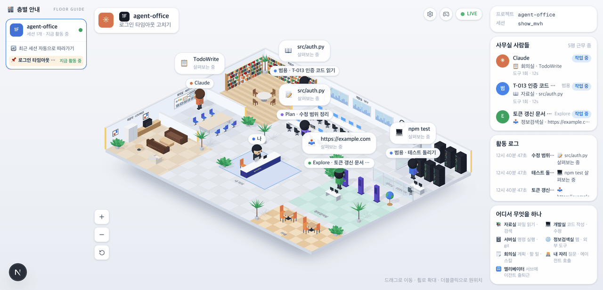

# agent-office


코딩 에이전트의 일을 밝은 등각 사무실로 보여 준다. 파일을 읽으면 자료실로, 명령을 돌리면 서버실로, 계획을 세우면 회의실 화이트보드로 간다. 물어볼 게 생기면 내 자리까지 찾아온다. 서브에이전트는 엘리베이터로 출퇴근한다.

Claude Code · OpenCode · Gemini CLI · Codex CLI 를 같은 사무실에 띄운다. 무엇을 왜 만드는지는 [근거 문서](docs/plan/spec.md), 진행 상황은 [작업 분할](docs/plan/work-breakdown.md)에 있다.

[paulrobello/claude-office](https://github.com/paulrobello/claude-office) 를 포크해 화면을 새로 만들었다. 이벤트 수집(훅 · 백엔드 · 웹소켓)은 원본 구조를 이어 쓴다.



## 사무실에서 보이는 것

| 에이전트가 하는 일 | 사무실에서 보이는 것 |
|---|---|
| 파일 읽기 · 검색 (`Read` · `Grep` · `Glob` …) | 📚 자료실 책장 앞에서 책을 편다 |
| 코드 작성 · 수정 (`Edit` · `Write` …) | 💻 개발실 자기 자리 아이맥에 코드가 흐른다 |
| 명령 실행 · git (`Bash` …) | 🗄️ 서버실 랙 앞에 선다. 랙 불빛이 빨라진다 |
| 웹 · 외부 도구 (`WebFetch` · `WebSearch` · MCP) | 🌐 정보검색실 키오스크 앞에 선다 |
| 계획 · 할 일 · 스킬 (`TodoWrite` · 플랜 모드 · `Skill`) | 🗒️ 회의실 화이트보드에 적는다 |
| 질문 · 권한 대기 (`AskUserQuestion`) | 🧑‍💻 내 자리(안내 데스크)까지 찾아온다 |
| 서브에이전트 (`Task`) | Claude 가 전화를 걸면 🛗 엘리베이터로 출근한다. 끝나면 Claude 옆에서 보고하고 「👋 퇴근합니다!」 하고 돌아간다. Explore 는 초록 옷에 모자, Plan 은 보라 옷에 안경 |
| 생각 · 실패 | 「💭 고민 중」 구름 말풍선. 도구가 실패하면 그 자리에서 식은땀을 흘리며 빨간 말풍선을 띄운다 |

왼쪽 「층별 안내」는 프로젝트를 층으로, 세션을 매장으로 보여 준다. 다른 층을 누르면 「▲ 3F」 표시등이 뜨고 그 층 사무실로 간다. 오른쪽에는 「사무실」(지금 일하는 사람들) · 활동 로그 · 「사무실 안내도」(방마다 하는 일)가 있다.

⚙ 설정의 「일반」 탭에서 언어(한국어 · English · Español · Português)와 테마를 고른다. 「새 세션 자동으로 따라가기」와 「같은 층 세션 함께 보기」도 여기서 켜고 끈다.

## 실행하기

필요한 것: [uv](https://docs.astral.sh/uv/)(Python 3.13 은 uv 가 받는다), Node.js 20+ 또는 Bun.

```bash
git clone https://github.com/heejunKIM01/agent-office.git
cd agent-office
make install     # 백엔드 · 프런트 · 훅 · OpenCode 플러그인 의존성
make dev         # 백엔드 :8000 + 프런트 :4747
```

브라우저로 <http://localhost:4747> 을 연다. tmux 를 쓰면 `make dev-tmux` 로 백엔드와 프런트를 창 두 개에 나눠 띄운다.

## 에이전트 연결

이벤트를 넣는 방법은 넷이다.

1. **Claude Code** — 브라우저에서 ⚙ 설정 → 「연결」 탭의 「연결」을 누른다. 빈 사무실의 「에이전트 연결」 버튼도 그 탭을 연다. 버튼은 `make hooks-install` 을 대신 실행해 `~/.claude/settings.json` 에 훅을 등록한다. 백엔드는 이 화면(4747)에서 온 요청만 실행 토큰 없이 받는다.
2. **Gemini CLI · Codex CLI · OpenCode** — Gemini CLI · Codex CLI 도 같은 「연결」 탭에서 연결한다. 터미널에서는 `make gemini-hooks-install` 이 `~/.gemini/settings.json` 에, `make codex-hooks-install` 이 `~/.codex/hooks.json` 에 훅을 넣는다. 다른 도구의 훅은 그대로 둔다. Codex 는 새 훅을 `/hooks` 에서 신뢰해야 돌린다([훅 README](hooks/README.md#codex-cli)). OpenCode 는 `make opencode-install` 이 플러그인을 `~/.config/opencode/opencode.json` 에 등록한다.
3. **전역 설정을 건드리지 않고 한 번 돌려 보기** — `scripts/live_session.sh` 가 임시 프로젝트에서 짧은 Claude Code 세션(haiku, 지출 상한 $0.5)을 돌린다. 훅은 그 세션에만 걸린다. Gemini CLI 는 `scripts/gemini_session.sh`, Codex CLI 는 `scripts/codex_session.sh` 가 계정 없이 가짜 모델로 진짜 CLI 를 돌린다.
4. **시뮬레이터** — `uv run python scripts/simulate_events.py errands` 가 같은 장면을 가짜 이벤트로 재생한다.

## 명령

| 명령 | 하는 일 |
|---|---|
| `make dev` · `make dev-tmux` | 개발 서버를 띄운다. `make dev-tmux-kill` 로 tmux 세션을 끈다 |
| `make checkall` | 포맷 · 린트 · 타입체크 · 테스트를 전부 돌린다 |
| `make test` | 테스트만 돌린다 |
| `make simulate` | 이벤트 시뮬레이션을 돌린다 |
| `make hooks-install` · `hooks-uninstall` · `hooks-status` | Claude Code 훅을 설치 · 제거 · 확인한다 |
| `make hooks-logs` · `hooks-debug-on` · `hooks-debug-off` | 훅 로그를 보고 디버그 로그를 켜고 끈다 |
| `make gemini-hooks-install` · `codex-hooks-install` | Gemini CLI · Codex CLI 훅을 설치한다. `-uninstall` · `-status` 도 있다 |
| `make opencode-install` · `opencode-uninstall` | OpenCode 플러그인을 등록 · 제거한다 |
| `make docker-up` · `docker-config` · `docker-down` | Docker 로 띄운다(UI <http://localhost:8050>). `docker-config` 는 훅과 플러그인을 :8050 으로 돌린다([Docker 가이드](docs/guides/deployment.md)) |
| `make clean-db` | 이벤트 DB 를 지운다 |

## 환경 변수

| 변수 | 기본값 | 설명 |
|---|---|---|
| `SUMMARY_BACKEND` | `claude-cli` | 이벤트 요약을 만드는 방법. `claude-cli` 는 이벤트마다 `claude -p` 를 부른다. 사용량을 아끼려면 `disabled`, OpenAI 호환 엔드포인트는 `openai`([요약 문서](docs/reference/ai-summary.md)) |
| `LOCALHOST_ONLY` | `1` | 백엔드가 이 컴퓨터에서 온 요청만 받는다. Docker compose 는 `0` |
| `CLAUDE_OFFICE_API_URL` | `http://localhost:8000/api/v1/events` | 훅 · 플러그인이 이벤트를 보내는 주소 |
| `CLAUDE_OFFICE_ALLOW_REMOTE` | `0` | `1` 이어야 localhost 밖의 백엔드로 보낸다. 이벤트에 도구 입출력과 파일 경로가 담겨서 기본은 막는다 |
| `CLAUDE_OFFICE_DEBUG` | `0` | `1` 이면 훅 로그를 `~/.claude/claude-office-hooks.log` 에 남긴다 |

예: `SUMMARY_BACKEND=disabled make dev`

## 프로젝트 구조

```
agent-office/
├── backend/           # FastAPI — 이벤트 수신, 상태 기계, 웹소켓 방송
├── frontend/          # Next.js + three.js
│   └── src/
│       ├── components/iso/   # 등각 사무실(방 · 가구 · 사람 · 말풍선)
│       ├── systems/          # 동선 · 길찾기 · 심부름
│       ├── machines/         # 직원 출퇴근 상태 기계(XState)
│       ├── stores/           # Zustand
│       └── i18n/             # en · es · ko · pt-BR
├── hooks/             # Claude Code · Gemini CLI · Codex CLI 훅
├── opencode-plugin/   # OpenCode 플러그인
├── scripts/           # 시뮬레이터 · 실세션 스크립트
└── docs/              # 근거 문서 · 작업 분할 · 보고서
```

## 문제 해결

| 증상 | 확인할 것 |
|---|---|
| 사무실이 안 움직인다 | `make hooks-status` 로 훅이 깔렸는지 본다. 설치 뒤에는 에이전트를 다시 띄워야 훅을 읽는다 |
| 훅이 도는지 모르겠다 | `make hooks-debug-on` 을 켜고 `make hooks-logs-follow` 로 본다 |
| 화면이 갱신되지 않는다 | <http://localhost:8000/health> 가 응답하는지, 개발자 도구 Network › WS 가 연결돼 있는지 본다 |
| 백엔드 오류 | `make clean-db && make dev` 로 DB 를 비우고 다시 띄운다 |
| 포트 8000 · 4747 이 사용 중이다 | 그 포트를 쓰는 프로세스를 끈다. tmux 세션이 남았으면 `make dev-tmux-kill` |

## 문서

- [근거 문서](docs/plan/spec.md) — 무엇을 왜 만드는지
- [작업 분할](docs/plan/work-breakdown.md) — 진행 상황
- [작업 보고서](docs/reports/) — 작업마다 확인한 결과와 스크린샷
- [아키텍처](docs/architecture/ARCHITECTURE.md)
- [훅 README](hooks/README.md) · [스크립트 README](scripts/README.md) · [Docker 가이드](docs/guides/deployment.md)

## 라이선스

MIT. 원본 [paulrobello/claude-office](https://github.com/paulrobello/claude-office) 의 저작권(Copyright (c) 2026 Paul Robello)과 라이선스 전문은 [LICENSE](LICENSE) 에 그대로 둔다.
