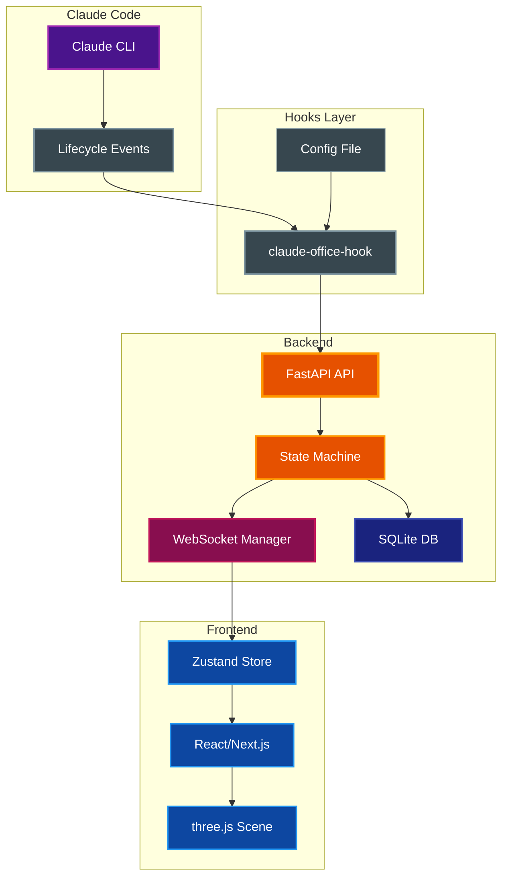
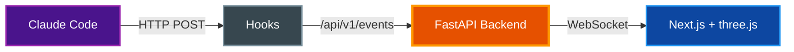
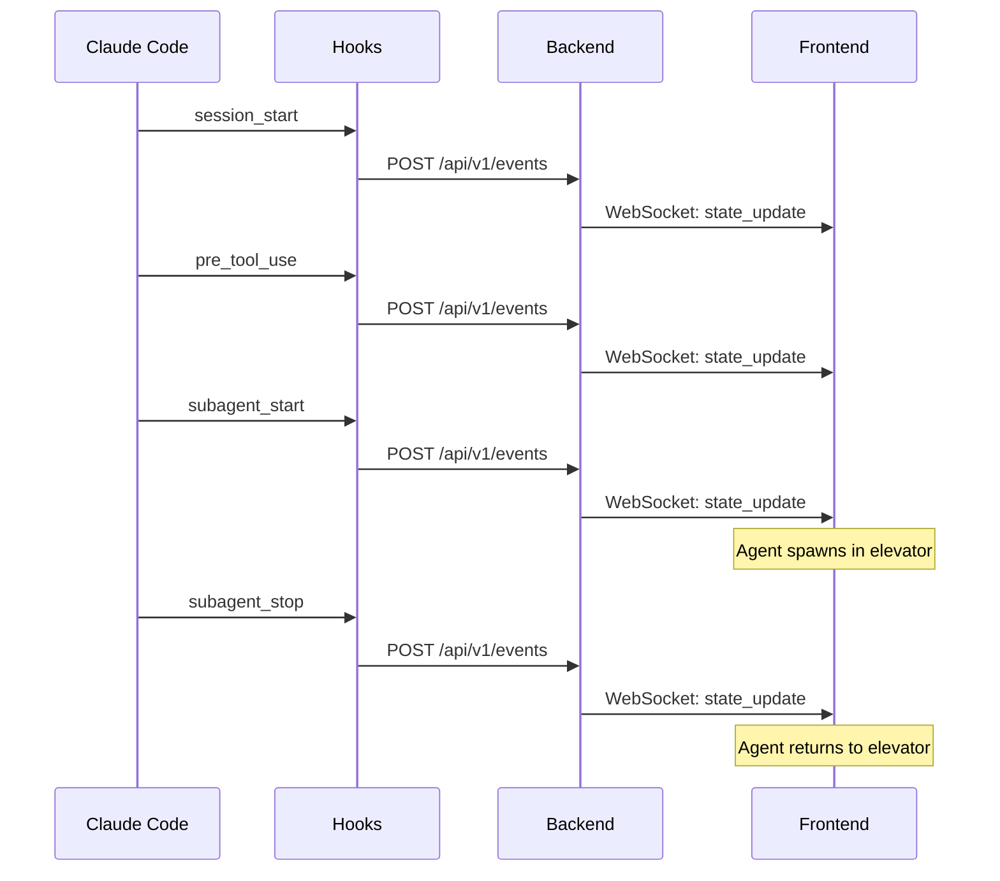
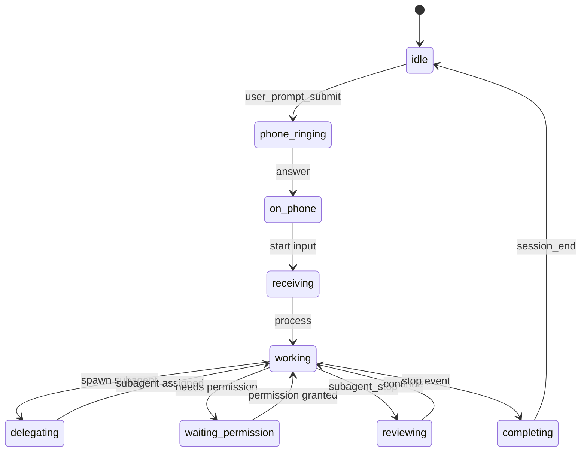
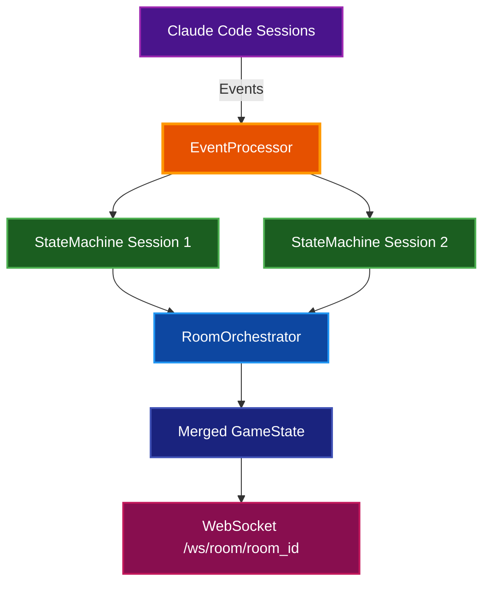

# Architecture

System architecture and design documentation for Claude Office Visualizer.

## Table of Contents

- [Overview](#overview)
- [System Architecture](#system-architecture)
- [Data Flow](#data-flow)
- [Components](#components)
- [Event System](#event-system)
- [Subagent Lifecycle](#subagent-lifecycle)
- [Mid-Session Joining](#mid-session-joining)
- [Frontend State Management](#frontend-state-management)
- [Boss State Machine](#boss-state-machine)
- [Work Acceptance Quotes](#work-acceptance-quotes)
- [Work Completion Quotes](#work-completion-quotes)
- [Beads Issue Tracker Integration](#beads-issue-tracker-integration)
- [User Preferences](#user-preferences)
- [Internationalization](#internationalization)
- [Isometric Office](#isometric-office)
- [Multi-Floor / Agent Teams](#multi-floor--agent-teams)
- [Configuration Reference](#configuration-reference)
- [Related Documentation](#related-documentation)

## Overview

Claude Office Visualizer transforms Claude Code operations into a real-time isometric office. A "boss" character (main Claude agent) manages work, spawns "employee" agents (subagents), and orchestrates tasks visually.

In this fork the office (`/`) is drawn with three.js (see [Isometric Office](#isometric-office)). The original 2D pixel office, with the whiteboard, the Command Center and the Building view, has been removed.

**Design Principle:** The backend is the source of truth. The frontend is a "dumb" renderer that displays whatever state it receives via WebSocket.

## System Architecture



## Data Flow



**Flow sequence:**
1. Claude Code hooks capture lifecycle events (tool use, subagent spawning)
2. Hooks POST events to backend API
3. Backend state machine transforms events into game state changes
4. State updates broadcast to frontend via WebSocket
5. Frontend renders state as the isometric office (three.js)

## Components

### Backend (`backend/app/`)

| File | Purpose |
|------|---------|
| `core/state_machine.py` | Transforms CLI events into game state; manages agent lifecycle, desk assignments, animations |
| `core/event_processor.py` | Routes incoming events to state machine, persists to DB |
| `core/handlers/agent_handler.py` | Agent-specific event handling logic |
| `core/handlers/conversation_handler.py` | Conversation history management |
| `core/handlers/session_handler.py` | Session lifecycle event handling |
| `core/handlers/tool_handler.py` | Tool use event handling |
| `core/summary_service.py` | AI-powered summarization for agent tasks and prompts |
| `core/transcript_poller.py` | Polls Claude Code JSONL transcript files for token usage |
| `core/jsonl_parser.py` | Parses Claude Code JSONL transcript format |
| `core/quotes.py` | Quote generation for boss completion messages |
| `core/office_layout.py` | Desk and position constants |
| `core/path_utils.py` | Path utilities for transcript file handling |
| `core/task_persistence.py` | Task list persistence from TodoWrite tool |
| `core/task_file_poller.py` | Polls external task files for todo list updates |
| `core/beads_poller.py` | Polls beads issue tracker for task list integration |
| `core/broadcast_service.py` | Service for broadcasting state updates to WebSocket clients |
| `core/whiteboard_tracker.py` | Tracks whiteboard data (tool usage, agent lifespans, etc.) |
| `core/floor_config.py` | Building/floor/room configuration models for multi-floor navigation |
| `core/product_mapper.py` | Maps sessions to floors/rooms based on repo/project name resolution |
| `core/room_orchestrator.py` | Merges multiple session states into a single GameState for team views |
| `core/token_tracker.py` | Token usage tracking from JSONL transcripts, tool-use counting, thinking-block extraction |
| `core/handlers/team_handler.py` | Event handlers for Agent Teams (task_created, task_completed, teammate_idle) |
| `core/constants.py` | Shared constants |
| `core/logging.py` | Logging configuration |
| `api/websocket.py` | Connection manager for broadcasting state updates |
| `api/routes/events.py` | Event ingestion API endpoint |
| `api/routes/sessions.py` | Session management API endpoints |
| `api/routes/preferences.py` | User preferences API endpoints |
| `api/routes/floors.py` | Building/floor configuration API endpoint |
| `services/git_service.py` | Git repository status service |
| `db/database.py` | SQLite database connection and initialization |
| `db/models.py` | SQLAlchemy database models |
| `models/agents.py` | Agent, Boss, Office state models |
| `models/events.py` | Event and EventData models |
| `models/sessions.py` | GameState and session models |
| `models/common.py` | Shared models (BubbleContent, SpeechContent, TodoItem) |
| `models/git.py` | Git status models |
| `models/ui.py` | UI-specific model re-exports |
| `main.py` | FastAPI application entry point |
| `config.py` | Application configuration |

### Frontend (`frontend/src/`)

| File | Purpose |
|------|---------|
| `app/page.tsx` | The isometric office page: floor guide, scene, side panel, settings (`/iso` redirects here) |
| `components/iso/IsoOffice.tsx` | Mounts the three.js scene and feeds it the people from the store |
| `components/iso/isoView.ts` | three.js orthographic 2:1 camera, lights, MapControls, CSS2D name chips and bubbles |
| `components/iso/buildIsoOffice.ts` · `isoFurniture.ts` · `isoPalette.ts` · `isoTextures.ts` | The floor plate, walls, labels and furniture as simple solids, and their canvas textures |
| `components/iso/isoCharacters.ts` | Two-head-tall people: poses and outfits |
| `components/iso/isoPeople.ts` | The people on the floor: walking by the errand rules, bubbles, elevator trips |
| `components/iso/isoBubbles.ts` | Bubbles over the people, drawn as HTML |
| `components/iso/isoEffects.ts` | Room effects: rack lights, code on iMacs, whiteboard writing, elevator doors |
| `components/iso/IsoFloorGuide.tsx` · `IsoSidePanel.tsx` · `AgentLogo.tsx` | 「층별 안내」, the right-hand panels and the coding agent logo |
| `components/overlay/Modal.tsx` | Base modal component |
| `components/overlay/SettingsModal.tsx` | Settings modal: general (language, auto-follow) and connect tabs |
| `components/settings/ConnectTab.tsx` | Installs and removes coding agent hooks from the browser |
| `stores/gameStore.ts` | Unified Zustand store for all game state (includes bubble queue) |
| `stores/preferencesStore.ts` | User preferences store (language, auto-follow) |
| `systems/stateReconciler.ts` | Applies backend state updates to the store |
| `systems/webSocketController.ts` | WebSocket transport: connect, reconnect, backoff |
| `systems/typingTracker.ts` | Minimum typing duration per character |
| `systems/officePeople.ts` · `officeBubbles.ts` · `officeRoster.ts` · `floors.ts` | Who is in the office, which bubble each shows, the panel rows and log lines, projects as floors |
| `systems/isoErrands.ts` · `isoNavGrid.ts` | Iso walker rules and the 0.5 m walk grid |
| `systems/astar.ts` · `pathFollow.ts` | A* path finding and path following, shared by both grids |
| `systems/animationSystem.ts` · `pathfinding.ts` · `navigationGrid.ts` · `pathSmoothing.ts` · `agentCollision.ts` · `queuePositions.ts` · `bossErrands.ts` · `agentErrands.ts` | The agent machine's grid, paths and queue positions |
| `hooks/useWebSocketEvents.ts` | WebSocket handler with state machine integration |
| `hooks/useSessions.ts` | Session listing and management hooks |
| `hooks/useSessionSwitch.ts` | Session switching logic with auto-follow |
| `hooks/useTranslation.ts` · `useCodingAgentName.ts` · `useNow.ts` | i18n, the session's coding agent name, a ticking clock |
| `machines/agentMachine.ts` · `agentArrivalMachine.ts` · `agentDepartureMachine.ts` · `agentMachineCommon.ts` | XState agent lifecycle |
| `machines/agentMachineService.ts` · `positionHelpers.ts` · `queueManager.ts` | Machine service, position helpers, arrival and departure queues |
| `types/index.ts` | TypeScript types barrel (re-exports from generated.ts) |
| `types/generated.ts` | Auto-generated types from backend Pydantic models |
| `constants/isoFloorPlan.ts` | Iso rooms, walls and furniture in metres; seats and room spots |
| `constants/positions.ts` · `rooms.ts` | Desk grid and side rooms of the agent machine's grid |
| `constants/quotes.ts` | Work acceptance and completion quotes |
| `constants/codingAgents.ts` | Display names for the coding agents |
| `i18n/index.ts` | i18n setup and language loader |
| `i18n/en.ts` · `es.ts` · `ko.ts` · `pt-BR.ts` | Translations |
| `utils/api.ts` | API client and base URLs |

### Hooks (`hooks/src/claude_office_hooks/`)

| File | Purpose |
|------|---------|
| `main.py` | CLI entry point; parses arguments, reads stdin, calls event mapper, POSTs to backend |
| `event_mapper.py` | Maps raw Claude Code hook payloads to structured Event format |
| `config.py` | Configuration loading (environment variables, config file) |
| `debug_logger.py` | Debug logging to file (when CLAUDE_OFFICE_DEBUG=1) |

**Hook Design Principle:** Hooks must stay lightweight and fast. They should only:
- Pass along data already present in the JSON payload from Claude Code
- Perform minimal transformations (e.g., field renaming, timestamp formatting)
- Never read files, parse transcripts, or do heavy processing

If data needs to be extracted from JSONL transcript files (e.g., token usage, thinking blocks), that extraction belongs in the **backend**, not the hooks.

## Event System

### Event Types

Events flow from Claude Code hooks through the backend to the frontend:

| Event Type | Description |
|------------|-------------|
| `session_start` | Claude Code session begins |
| `session_end` | Claude Code session ends |
| `pre_tool_use` | Tool execution starting |
| `post_tool_use` | Tool execution completed |
| `user_prompt_submit` | User submitted a prompt |
| `permission_request` | Claude needs user permission |
| `notification` | System notification from Claude Code |
| `subagent_start` | Task tool spawning a subagent |
| `subagent_info` | Updates agent with native_agent_id and transcript path |
| `subagent_stop` | Subagent completing work |
| `background_task_notification` | Background task completed or failed |
| `agent_update` | Agent state update |
| `context_compaction` | Context window was compacted |
| `stop` | Main agent completing work |
| `cleanup` | Logical removal of agent after departure |
| `reporting` | Agent reporting to boss |
| `walking_to_desk` | Agent walking to desk |
| `waiting` | Agent waiting for work |
| `leaving` | Agent leaving office |
| `error` | Error event |
| `task_created` | Agent Teams: new task assigned to the team |
| `task_completed` | Agent Teams: team task completed |
| `teammate_idle` | Agent Teams: teammate session went idle |

Agent IDs use format `subagent_{tool_use_id}` to correlate start/stop events.

### Event Flow Sequence



## Subagent Lifecycle

### Agent ID Resolution

When a `SUBAGENT_STOP` event arrives, the backend must identify which agent to stop. This is handled by `resolve_agent_for_stop()` in `state_machine.py`:

**Resolution Order:**
1. **Direct agent_id match** - For synchronous subagents (spawned with explicit agent_id)
2. **Native ID lookup** - For agents that received `SUBAGENT_INFO` (linked to `native_agent_id`)
3. **Fallback linking** - For agents that missed `SUBAGENT_INFO` (late-link to `native_agent_id`)

### Fallback Linking

When native `SubagentStart` hooks don't produce `SUBAGENT_INFO` events (e.g., backend restart, missed hook), agents remain unlinked (`native_id=None`). The fallback logic:

1. **FIFO from arrival_queue** - Links the oldest unlinked agent first
2. **Last resort** - Links any unlinked agent not in the arrival queue

```python
# Example: Fallback linking flow
agents = {
    "subagent_abc": Agent(native_id=None),  # Unlinked
    "subagent_def": Agent(native_id="xyz"),  # Already linked
}
arrival_queue = ["subagent_abc", "subagent_def"]

# SUBAGENT_STOP with native_agent_id="new_id"
# Resolves to: subagent_abc (oldest unlinked)
```

**Why FIFO?** When multiple background agents start in parallel without `SUBAGENT_INFO`, FIFO linking matches the most likely completion order (oldest starts first, likely finishes first).

### CLEANUP Event Persistence

When an agent is removed, a `CLEANUP` event is persisted with the resolved `agent_id`:

```python
cleanup_data = EventData(agent_id=resolved_agent_id)
await persist_synthetic_event_fn(session_id, EventType.CLEANUP, cleanup_data)
```

This ensures event replay correctly removes agents even when the original `SUBAGENT_STOP` had `agent_id=None`.

## Mid-Session Joining

When a client connects to an active session (or switches sessions), agents appear at their correct positions rather than re-animating from the elevator.

**Backend State:**
```typescript
interface GameState {
  // ... other fields
  arrivalQueue: string[];    // Agent IDs in arrival queue
  departureQueue: string[];  // Agent IDs in departure queue
}
```

**Frontend Position Detection:**
| Condition | Spawn Position |
|-----------|----------------|
| Agent in `arrivalQueue` | Arrival queue slot (A1, A2, etc.) |
| Agent in `departureQueue` | Departure queue slot (D1, D2, etc.) |
| Agent has desk, not in queues | Desk position |
| Otherwise | Elevator spawn |

**Queue Lifecycle:**
1. `SUBAGENT_START` → Agent added to `arrivalQueue`
2. `PRE_TOOL_USE` → Agent removed from `arrivalQueue` (at desk)
3. `SUBAGENT_STOP` → Agent added to `departureQueue`
4. Agent enters elevator → Agent removed from `departureQueue`

**Implementation:**
- `backend/app/models/sessions.py` - GameState includes queue arrays
- `backend/app/core/state_machine.py` - Manages queue membership
- `frontend/src/hooks/useWebSocketEvents.ts` - Detects position on join
- `frontend/src/systems/queuePositions.ts` - Tracks occupied elevator positions

## Frontend State Management

All game state is managed in a single Zustand store (`gameStore.ts`). Use individual selectors to prevent re-render loops:

```typescript
// Good - stable primitive selector
const isConnected = useGameStore((state) => state.isConnected);

// Good - use exported selectors for consistency
const agents = useGameStore(selectAgents);
const boss = useGameStore(selectBoss);

// Bad - returns new object reference every render
const { boss, agents } = useGameStore((state) => ({ boss: state.boss, agents: state.agents }));
```

**Key State Areas:**
- Agent state (phase, bubbles)
- Boss state (backend state, typing, task)
- Office state (todos, context utilization)
- Queues (arrival and departure queues)
- UI state (connection, replay)

## Boss State Machine

The boss character has the following internal states (defined in `backend/app/models/agents.py`):

| State | Meaning |
|-------|---------|
| `idle` | Waiting, not doing anything |
| `phone_ringing` | Phone is ringing (incoming user prompt) |
| `on_phone` | Boss is on the phone with user |
| `receiving` | Actively receiving user input |
| `working` | Processing/executing tasks |
| `delegating` | Spawning subagents |
| `waiting_permission` | Waiting for user permission (AskUserQuestion tool) |
| `reviewing` | Reviewing completed work from agents |
| `completing` | Finishing up a task |



**Note:** The compaction animation (boss walking to trash can and jumping) is handled separately in the frontend via `CompactionAnimationPhase` in `gameStore.ts`, not as a boss state. See [Context Compaction Animation](#context-compaction-animation) for details.

## Work Acceptance Quotes

When agents receive work from the boss, they display a random quote from a pool of 100 phrases:

**Categories:** Enthusiastic, Professional, Casual, Motivated, Tech-themed, Office humor

**Implementation:**
- `frontend/src/constants/quotes.ts` - Quote definitions (`WORK_ACCEPTANCE_QUOTES` array)
- Random selection from the array when agent receives work

## Work Completion Quotes

When agents turn in completed work, they display a random quote from a pool of 100 phrases:

**Categories:** Presenting work, Proud, Confident, Casual handoff, Professional, Tech-themed, Playful, Relief, Short

**Implementation:**
- `frontend/src/constants/quotes.ts` - Quote definitions (`WORK_COMPLETION_QUOTES` array)
- `backend/app/core/quotes.py` - Backend quote generation for boss completion messages
- Displayed when agent reaches the departure ready spot

## Beads Issue Tracker Integration

The visualizer can integrate with the [beads](https://github.com/paulrobello/beads) issue tracker CLI. When a session's project root contains a `.beads/` directory, the poller automatically:

1. Detects the presence of `.beads/` on session start
2. Polls `bd query --json` for open/in_progress/blocked issues
3. Converts beads issues to `TodoItem` objects for the task list panel
4. Updates in real-time when issues change status

**Status Mapping:**

| Beads Status | TodoStatus |
|--------------|------------|
| `open` | `pending` |
| `in_progress` | `in_progress` |
| `blocked` | `pending` |
| `deferred` | `pending` |
| `closed` | `completed` |

**Configuration:**

| Environment Variable | Default | Description |
|---------------------|---------|-------------|
| `BEADS_POLL_INTERVAL` | `3.0` | Polling interval in seconds |

**Implementation:**
- `backend/app/core/beads_poller.py` - Poller implementation with hash-based change detection
- `backend/app/core/event_processor.py` - Integration with session lifecycle
- Thread pool execution for non-blocking CLI calls
- WARNING-level logging on first failure, DEBUG for subsequent failures

## User Preferences

User preferences are stored in the backend SQLite database as key-value pairs:

| Key | Values | Default | Description |
|-----|--------|---------|-------------|
| `auto_follow_new_sessions` | `true`, `false` | `true` | Auto-follow new sessions in the current project |
| `language` | `en`, `es`, `ko`, `pt-BR` | `en` | UI language for internationalization |

**Auto-Follow New Sessions:**
When enabled (default), the frontend automatically detects new Claude Code sessions in the same project and switches to follow them. Detection is based on matching `projectRoot` paths. This is useful when working in the same repository and starting multiple Claude Code sessions.

**API Endpoints:**
- `GET /api/v1/preferences` - Get all preferences
- `GET /api/v1/preferences/{key}` - Read a single preference
- `PUT /api/v1/preferences/{key}` - Set a preference
- `DELETE /api/v1/preferences/{key}` - Remove a stored preference

**Frontend:** The `preferencesStore.ts` Zustand store manages preference state and syncs with the backend.

## Internationalization

The frontend supports multiple languages via a lightweight i18n system in `frontend/src/i18n/`:

| File | Purpose |
|------|---------|
| `i18n/index.ts` | Locale type, translation loader, and `getTranslation()` factory |
| `i18n/en.ts` | English translations (source of truth) |
| `i18n/es.ts` | Spanish translations |
| `i18n/pt-BR.ts` | Brazilian Portuguese translations |

**Usage:** The `useTranslation` hook provides a `t()` function with parameter interpolation. Translations are key-value; English serves as the fallback for missing keys.

**Adding a language:** Create a new file (e.g., `fr.ts`) with all `TranslationKey` entries, register it in `index.ts`, and add the locale to the `Locale` type.

## Isometric Office

The main page, after the video in [the spec](../plan/spec.md) (「화면 재설계」): one bright floor with seven rooms, the floor guide on the left and the people, activity log and room legend on the right. It reads the shared Zustand store; the agent machine's animation loop does not run, so the page drains bubble queues and seats newcomers itself.

| File | Purpose |
|------|---------|
| `app/page.tsx` | The page: floor guide, scene, side panel, settings (`/iso` redirects here) |
| `constants/isoFloorPlan.ts` | Rooms, walls and furniture in metres; seats, room spots, the elevator and the report spots |
| `components/iso/isoView.ts` | three.js orthographic 2:1 camera, lights, MapControls, CSS2D name chips and bubbles |
| `components/iso/buildIsoOffice.ts` · `isoFurniture.ts` · `isoPalette.ts` | The floor plate, walls, labels and furniture as simple solids |
| `components/iso/isoCharacters.ts` | Two-head-tall people: poses (sit, type, walk, work, stand, wave, phone), outfits (Explore green with a cap, Plan purple with glasses) |
| `components/iso/isoPeople.ts` | The people on the floor: walking by the errand rules, bubbles, elevator trips |
| `components/iso/isoEffects.ts` | Room effects: rack lights, code on iMacs, whiteboard writing, elevator doors |
| `components/iso/IsoFloorGuide.tsx` · `IsoSidePanel.tsx` | 「층별 안내」 and the right-hand panels |
| `systems/isoErrands.ts` | Pure walker rules: rooms by tool, linger, stuck, and the trip in by elevator and home after reporting |
| `systems/isoNavGrid.ts` | 0.5 m walk grid over the floor plan for the shared A* path finder |
| `systems/officePeople.ts` · `officeBubbles.ts` · `officeRoster.ts` · `floors.ts` | Who is in the office, which bubble each shows, the panel rows and log lines, projects as floors |

## Multi-Floor / Agent Teams

When `CLAUDE_CODE_EXPERIMENTAL_AGENT_TEAMS=1` is enabled, Claude Code can run multiple sessions that collaborate as a team. The visualizer maps each team session onto a floor/room model so multiple sessions render as a single shared office view.

### Components

| File | Purpose |
|------|---------|
| `backend/app/core/floor_config.py` | Pydantic models (`BuildingConfig`, `FloorConfig`, `RoomConfig`) that define which projects belong to which floors and rooms. Configuration is stored as JSON in the `user_preferences` table under the key `building_config`, or loaded from `floors.toml` for development. |
| `backend/app/core/room_orchestrator.py` | `RoomOrchestrator` merges multiple session `StateMachine` instances into a single `GameState`. Solo sessions (one session, no `team_name`) pass through unchanged. Team sessions get lead/teammate/subagent character allocation and a merged kanban board. |
| `backend/app/core/handlers/team_handler.py` | Handlers for `task_created`, `task_completed`, and `teammate_idle` events. These are fired by Claude Code Agent Teams and add logging and room-level notifications alongside the state machine transitions. |

### Data Flow



**Flow sequence:**

1. Multiple Claude Code sessions (a lead plus teammates) send events to the same backend
2. `EventProcessor` creates one `StateMachine` per session and resolves floor/room assignment via `ProductMapper` and `BuildingConfig`
3. After processing each event, the `EventProcessor` updates the `RoomOrchestrator` for the session's room
4. The `RoomOrchestrator` merges all session states into a single `GameState` with lead and teammate characters
5. The merged state is broadcast to room-level WebSocket connections

### Team Event Types

Agent Teams emit three additional event types:

| Event Type | Description | State Machine Effect |
|------------|-------------|---------------------|
| `task_created` | A new task is assigned to the team | Creates a `KanbanTask` entry on the whiteboard |
| `task_completed` | A team task is completed | Updates the `KanbanTask` status to `completed` |
| `teammate_idle` | A teammate session goes idle | Sets the teammate's boss state to `IDLE` |

### Team Character Mapping

The `RoomOrchestrator` maps each teammate's `BossState` to an `AgentState` for character rendering:

| BossState | AgentState (Teammate Rendering) |
|-----------|--------------------------------|
| `IDLE` | `IDLE` |
| `PHONE_RINGING` | `WAITING` |
| `ON_PHONE` | `WORKING` |
| `RECEIVING` | `THINKING` |
| `WORKING` | `WORKING` |
| `DELEGATING` | `WORKING` |
| `WAITING_PERMISSION` | `WAITING_PERMISSION` |
| `REVIEWING` | `WORKING` |
| `COMPLETING` | `COMPLETED` |

Teammates are assigned colors in order of arrival: blue, green, purple, orange, pink, teal. The lead is always gold (`#f59e0b`).

### Floor Configuration

Floors can be configured via a `floors.toml` file in the backend directory or through the preferences API. Each floor has a name, floor number, accent color, icon, and a list of rooms (repos).

```toml
[[floors]]
id = "engineering"
name = "Engineering"
floor_number = 1
accent = "#6366f1"
icon = "office"

[[floors.rooms]]
id = "main-app"
repo_name = "my-application"
```

### API Endpoints

| Method | Path | Description |
|--------|------|-------------|
| `GET` | `/api/v1/floors` | Return the current building/floor configuration |

### WebSocket

| Path | Description |
|------|-------------|
| `/ws/room/{room_id}` | Real-time state updates for all sessions in a room (team view) |

The room WebSocket broadcasts the merged `GameState` from the `RoomOrchestrator`. The 2D office's floor view connected to this endpoint; the isometric office reads the session-level `/ws/{session_id}` only.

## Configuration Reference

All configuration is managed via environment variables or a `.env` file in the `backend/` directory.

| Variable | Default | Description |
|----------|---------|-------------|
| `DATABASE_URL` | `sqlite+aiosqlite:///<backend dir>/visualizer.db` | Database connection string (absolute path; `docker-compose` overrides to `/app/data/visualizer.db`) |
| `GIT_POLL_INTERVAL` | `5` | Git status polling interval in seconds |
| `CLAUDE_CODE_OAUTH_TOKEN` | (empty) | OAuth token for AI summaries via Claude API |
| `SUMMARY_ENABLED` | `True` | Enable or disable AI-powered summaries |
| `SUMMARY_MODEL` | `claude-haiku-4-5-20251001` | Claude model used for summary generation |
| `SUMMARY_MAX_TOKENS` | `1000` | Maximum tokens for summary API responses |
| `CLAUDE_PATH_HOST` | (empty) | Host path prefix for Docker volume translation |
| `CLAUDE_PATH_CONTAINER` | (empty) | Container path prefix for Docker volume translation |
| `BEADS_POLL_INTERVAL` | `3.0` | Beads issue tracker polling interval in seconds |
| `EVENT_RATE_LIMIT` | `300` | Max event POSTs accepted per 60 s window (global, shared across all sessions) |
| `ZOMBIE_SUBAGENT_TIMEOUT_SECONDS` | `90` | Seconds of transcript inactivity before a subagent is assumed crashed and a synthetic `SubagentStop` is emitted to clean it up |
| `CLAUDE_OFFICE_API_KEY` | (empty — auto-generated per launch) | Explicit API key; when set, gates all state-changing endpoints via `X-API-Key` (see [Authentication](#authentication)) |
| `SERVE_STATIC` | (unset) | Set to `1`/`true`/`yes` to serve the built frontend from `backend/static/` |
| `BACKEND_CORS_ORIGINS` | localhost origins | Allowed CORS origins (localhost only by default) |

**Docker path translation:** When running in Docker, set both `CLAUDE_PATH_HOST` and `CLAUDE_PATH_CONTAINER` so the backend can translate transcript file paths from the host to the container filesystem. For example, `CLAUDE_PATH_HOST=/Users/username/.claude` and `CLAUDE_PATH_CONTAINER=/claude-data`.

### Authentication

The backend has a two-mode API-key model. When `CLAUDE_OFFICE_API_KEY` is unset (the default), a random token is generated per launch and only the destructive global operations (`DELETE /api/v1/sessions`, `POST /api/v1/sessions/simulate`) require it. When `CLAUDE_OFFICE_API_KEY` is set explicitly, every endpoint except `/health`, `/docs`, `/redoc`, the OpenAPI schema, and CORS preflight requires the key in the `X-API-Key` header (compared with `hmac.compare_digest`). Browser WebSocket connections must originate from an allowed localhost origin; non-browser clients must send `X-API-Key` or the handshake closes with code 4003. See the [backend README](../../backend/README.md#authentication) for the full key sources, gated endpoints, and discovery flow.

## Related Documentation

- [README.md](../../README.md) - Project overview and quick start
- [CLAUDE.md](../../CLAUDE.md) - AI assistant instructions and commands
- [Claude Code JSONL Format](../research/claude-code-jsonl-format.md) - Transcript file format research
