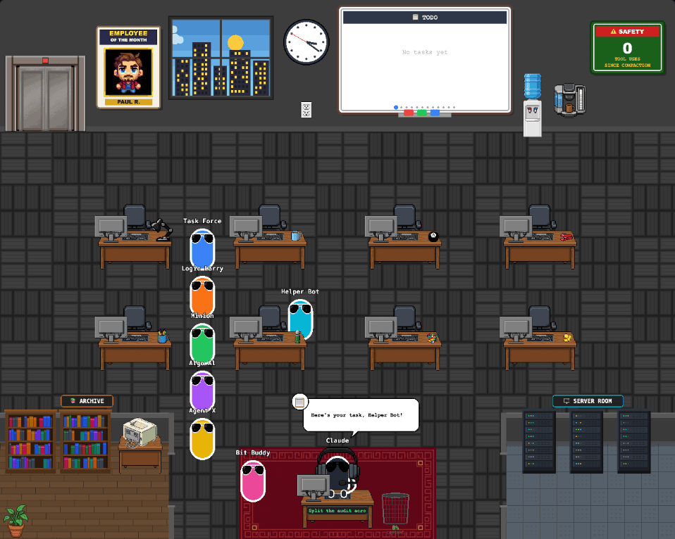
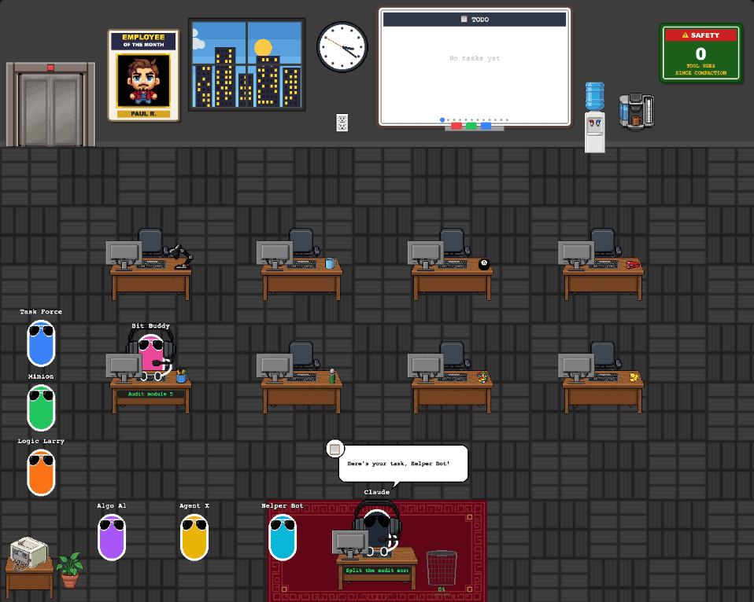
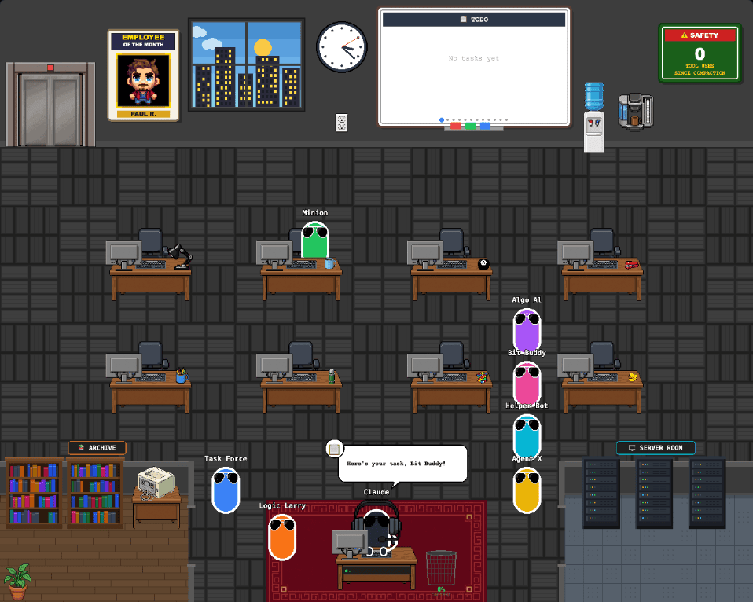
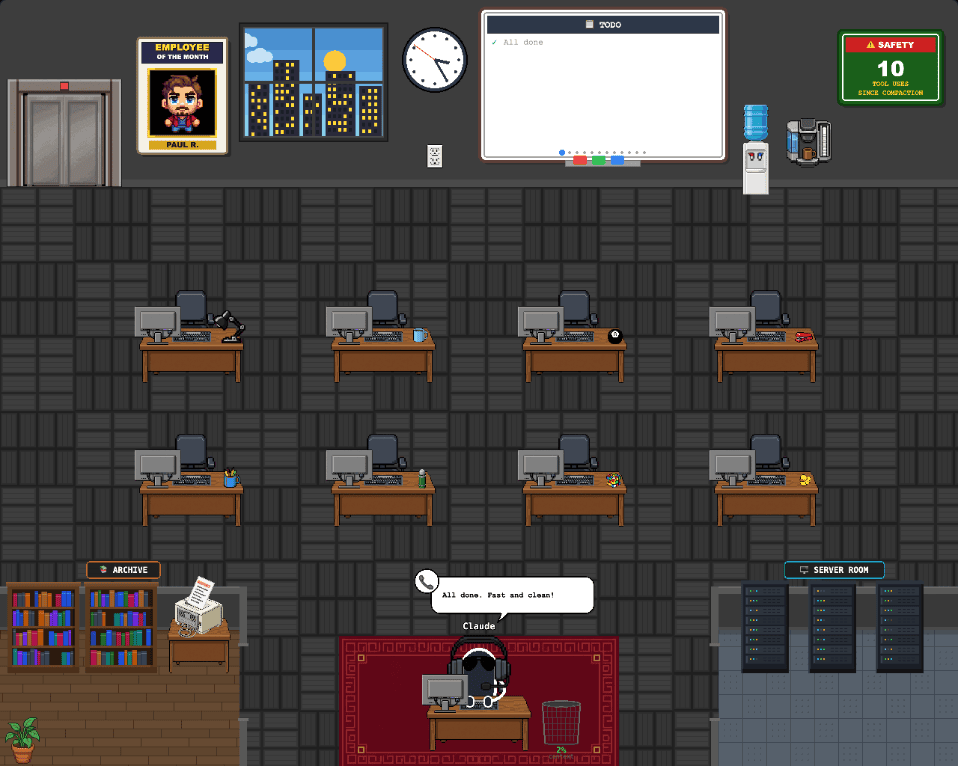
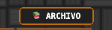
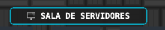

# 01 · 자료실 · 서버실 방

- 브랜치: `feat/01-office-rooms`
- 근거: [근거 문서](../plan/spec.md) 「화면 배치」
- 검증한 커밋: `feat/01-office-rooms` 의 구현 커밋 2개 (보고서 커밋 직전)

## 목표

사무실 아래 왼쪽에 자료실, 아래 오른쪽에 서버실이 생긴다. 캐릭터가 걸어 들어갈 수 있게 문이 사장 책상 쪽으로 나 있고, 원래 그 자리에 서던 도착 · 퇴근 줄은 책상 사이 통로로 옮긴다. 이 항목은 방과 동선만 만들고, 캐릭터가 방에 들어가는 동작은 02 · 03 에서 붙인다.

## 한 일

- `frontend/src/constants/rooms.ts` — 방 경계 · 칸막이 두께 · 문 위치 · 가구 위치 · 서 있을 자리(책장 앞 2곳, 랙 앞 3곳)를 한 곳에 모았다. 그림과 길찾기 격자가 같은 값을 읽는다.
- `frontend/src/components/game/OfficeRooms.tsx` — 자료실(마루 바닥 · 책장 2개 · 간판), 서버실(이중 바닥 · 서버 랙 3대 · LED 깜빡임 · 간판), 두 방의 칸막이와 문을 그린다. 책 배치는 시드 고정이라 매 프레임 같다.
- 프린터와 화분을 자료실 안으로 옮겼다(`constants/positions.ts`).
- 도착 줄은 `A0 (480,930)` 다음부터 `x=384` 통로를, 퇴근 줄은 `D0 (800,930)` 다음부터 `x=896` 통로를 따라 위로 선다(`systems/queuePositions.ts`). 백엔드 `MAX_AGENTS = 8` 이라 8칸이면 넘치지 않는다.
- 길찾기 격자에 방 윗벽 · 가구 줄 · 안쪽 칸막이를 막고 문 2칸만 열었다. 원래 왼쪽 아래에 있던 프린터 장애물은 지웠다(`systems/navigationGrid.ts`).
- 간판 문구 i18n 키 `office.archive` · `office.serverRoom` (en · es · pt-BR).
- `frontend/tests/officeRooms.test.ts` — 실제 격자로 8건: 벽 · 문 · 서 있을 자리 · 사장 → 각 자리 경로가 문을 지나는지 · 줄 칸이 걸을 수 있고 방 밖인지 · 엘리베이터 → 줄 칸 · 책상 경로.

## 검증

| 단계 | 명령 · 방법 | 결과 |
| --- | --- | --- |
| 정적 검증 | `make checkall` | 통과 — 백엔드 418 · 프런트 166(새 8) · 훅 24 · 플러그인 33 |
| 실검증 | 헤드리스 Chromium, local `:3000` + baseline(`origin/main`) `:3001` 를 같은 백엔드에 붙여 같은 이벤트를 흘렸다 | TC 8건 — ✅ 8 |
| 스모크 회귀 | 사무실 · 지휘 센터, 뷰포트 3종, 콘솔 `error` · `pageerror` | 0건 |

### 실검증 TC

| TC | 우선순위 | 판정 | 방법 · 근거 |
| --- | --- | --- | --- |
| TC-01 자료실 그림 | P0 | ✅ | 책장 2개 · 프린터 · 화분 · `ARCHIVE` 간판이 왼쪽 아래 방 안에 보인다 |
| TC-02 서버실 그림 · LED | P0 | ✅ | 랙 3대 · `SERVER ROOM` 간판. 400ms 간격 두 프레임의 랙 영역 픽셀이 59개 다르다 — LED 가 깜빡인다 |
| TC-03 도착 줄 | P0 | ✅ | 서브에이전트 7명을 0.15초 간격으로 보냈다. 줄이 `x=384` 통로를 따라 위로 선다. baseline 은 예전 L자(아래 줄 + 왼쪽 끝) |
| TC-04 퇴근 줄 | P0 | ✅ | 7명을 한꺼번에 끝냈다. 줄이 `x=896` 통로로 서고 엘리베이터로 나간다. 방 안으로 들어간 캐릭터가 없다 |
| TC-05 프린터 | P1 | ✅ | `quick` 시나리오(보고서 요청 프롬프트) 끝에 자료실 안 프린터가 `REPORT` 종이를 뽑는다 |
| TC-06 스페인어 간판 | P1 | ✅ | 언어를 `es` 로 바꾸면 `ARCHIVO` · `SALA DE SERVIDORES` |
| TC-07 뷰포트 | P1 | ✅ | `1280×800` · `1600×1100` · `1920×1200` 에서 가로 스크롤 없음, 콘솔 오류 0 |
| TC-08 지휘 센터 회귀 | P1 | ✅ | 활성 세션 2개로 `COMMAND` 진입. 원래 그림 그대로, 콘솔 오류 0 |

### 화면

도착 줄이 책상 사이 통로로 선다 (수정 후):

같은 순간 baseline (수정 전) — 줄이 아래 줄과 왼쪽 끝을 쓴다:

퇴근 줄과 엘리베이터:

`quick` 시나리오 끝, 자료실 프린터 출력:

스페인어 간판:  

## 발견 사항

- **기존 결함 — 동시 이벤트에서 세션이 사라진다.** 세션 둘의 이벤트를 몇 ms 간격으로 보내면 백엔드가 `StaleDataError: UPDATE statement on table 'sessions' expected to update 1 row(s); 0 were matched` · `No row was found when one was required` 를 3건 남기고 한쪽 세션이 목록에서 빠진다. 이 브랜치는 백엔드를 건드리지 않았으니 원본(`origin/main`) 코드의 결함이다. 이벤트를 백그라운드에서 동시에 처리하는데 DB 연결을 하나(`StaticPool`)만 써서 서로의 트랜잭션이 섞인다. 계획 문서에 `fix/01a-event-db-concurrency` 로 넣었다.
  1. 빈 DB 로 백엔드를 띄운다.
  2. 세션 A 의 `session_start` · `user_prompt_submit`, 세션 B 의 `session_start` · `user_prompt_submit` 를 간격 없이 POST 한다.
  3. `GET /api/v1/sessions` 에 B 만 남는다.

## 검증하지 못한 것

- 빌딩 뷰(층 설정이 있을 때) — 층 설정을 만들지 않았다. 층 화면은 같은 `OfficeGame` 을 그리므로 사무실 검증과 같다고 보고, 11 통합 QA 에서 층 설정을 만들어 확인한다.

## 다음 작업

01a `fix/01a-event-db-concurrency` — 동시 이벤트 유실. 그다음 02 활동 계약.
