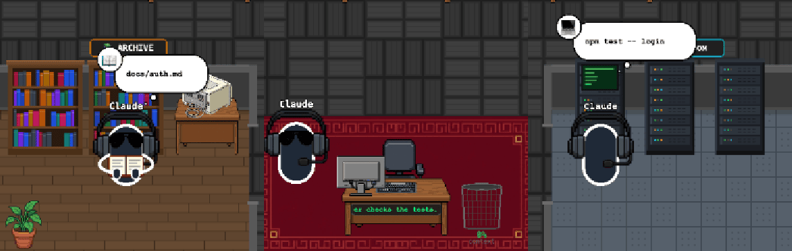
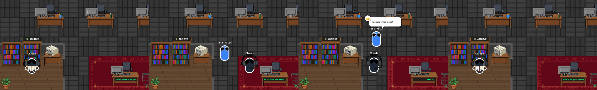
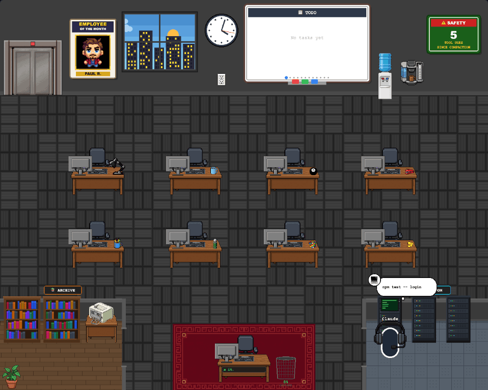

# 03 · 사장 심부름 — 자료실에서 책 펴고, 서버실 랙 앞에 선다

- 브랜치: `feat/03-boss-errands`
- 근거: [근거 문서](../plan/spec.md) R1 · R2 · 「동선 규칙」

## 목표

메인 에이전트(사장)가 파일을 읽는 동안 자료실 책장 앞으로 걸어가 책을 펴 들고, 명령을 돌리는 동안 서버실 랙 앞에 서서 콘솔을 본다. 일이 끝나면 책상으로 돌아와 앉는다.

## 한 일

- `frontend/src/systems/bossErrands.ts` — 심부름 규칙을 순수 함수 하나(`stepBossErrand`)로 만들었다. 단일 애니메이션 루프(`animationSystem`)가 매 프레임 부른다.
  1. 활동(02 의 `boss.activity`)이 생기면 그 방의 자리로 걷는다(문에 가까운 자리, 260px/s).
  2. 도구가 걷는 도중에 끝나도 끝까지 가고, 도착한 뒤 1.5초 머문다. 빠른 `Read` 도 눈에 보이고, 연속 읽기에 왕복하지 않는다.
  3. 다른 활동이 오면 걷는 중이어도 바로 방향을 바꾼다.
  4. 할 일이 없으면 책상으로 돌아와 앉는다.
  5. 직원이 사장을 기다리면(도착 · 퇴근 줄, 업무 인계 중) 책상으로 돌아온다. 사장이 자리에 없는 동안 줄은 넘어가지 않고, 앉는 순간 다음 직원을 부른다 — 직원이 빈 의자에 말을 거는 일이 없다.
  6. 컨텍스트 압축이 오면 심부름을 접고 압축 연출(쓰레기통 밟기)이 책상에서 시작한다.
- 사장 경로는 벽 · 책상 · 방 가구만 피한다(`NavigationGrid.staticView()`). 직원끼리도 서로 통과하는 구조라, 문 앞에 직원이 서 있어도 사장이 방에 못 들어가는 일을 막았다.
- `ErrandBoss.tsx` — 걷기(통통 튐) · 읽기(펼친 책을 두 손으로 들고 책장을 넘김) · 조작(랙을 보느라 등을 돌림, 살짝 흔들림) 세 자세. 말풍선과 이름표가 걷는 사장을 따라간다.
- 서버실 첫 랙에 콘솔 화면을 달았다. 사장이 명령을 돌리는 동안 초록 글자가 흐르고 LED 가 빨리 깜빡인다. 그때 말풍선은 콘솔 위로 올라간다.
- 경로 따라 걷기를 `systems/pathFollow.ts` 로 떼어 직원 이동과 같이 쓴다(동작 그대로).

## 검증

| 단계 | 명령 · 방법 | 결과 |
| --- | --- | --- |
| 정적 검증 | `make checkall` | 통과 — 백엔드 456 · 프런트 178(새 10) · 훅 29 · 플러그인 33 |
| 실검증 | 헤드리스 Chromium, 빈 DB 백엔드 + 시뮬레이터 `errands` 와 전용 시나리오 3개(압축 · 직원 응대 · 직원 7명) | TC 8건 — ✅ 8 |
| 스모크 회귀 | 직원 7명 도착 · 퇴근(사장은 계속 앉아 있음) | 줄 서기 · 자리 배정 · 엘리베이터 퇴장 정상, 콘솔 · 백엔드 오류 0 |

### 실검증 TC

| TC | 우선순위 | 판정 | 방법 · 근거 |
| --- | --- | --- | --- |
| TC-01 읽기 → 자료실 | P0 | ✅ | `errands`: 읽기 3번 동안 자료실 책장 앞에서 책을 펴 든다. 읽기 사이 0.5초 공백에 돌아가지 않는다 |
| TC-02 명령 → 서버실 | P0 | ✅ | `npm test` 5초 동안 서버실 첫 랙 앞에 등을 돌리고 서 있다. 콘솔에 글자가 흐른다(프레임마다 줄 길이가 바뀜) |
| TC-03 끝나면 복귀 | P0 | ✅ | 명령이 끝나고 1.5초 뒤 책상으로 걸어와 앉는다. 편집(`Edit`) 동안은 책상에 있다 |
| TC-04 실패한 명령 | P1 | ✅ | 실패하는 `npm test` 도 서버실에 갔다가 실패 이벤트로 끝난 뒤 돌아온다 |
| TC-05 직원 응대 | P0 | ✅ | 읽기를 켠 채로 직원을 보냈다. 직원이 줄에 서자 사장이 책상으로 돌아와 일을 넘기고 다시 자료실로 간다. 직원이 보고하러 올 때도 같다 |
| TC-06 압축 우선 | P1 | ✅ | 자료실에서 읽는 중에 압축 이벤트: 압축 연출이 책상에서 시작해 쓰레기통을 밟고, 끝난 뒤 아직 읽는 중이라 자료실로 돌아간다 |
| TC-07 경로 | P1 | ✅ | 사장이 책상 · 벽을 뚫지 않고 문으로 드나든다. 문 2칸을 직원이 막아도 사장 경로는 열린다(단위 테스트) |
| TC-08 말풍선 | P2 | ✅ | 말풍선 · 이름표가 걷는 사장을 따라가고, 서버실에서는 콘솔을 가리지 않게 올라간다 |

### 화면

세 자세 — 자료실에서 책 읽기 · 걷기 · 서버실 콘솔 앞:

직원 응대 — 읽던 사장이 줄 선 직원을 보고 돌아와(2) 일을 넘기고(3) 다시 자료실로 간다(4):

서버실에서 명령을 돌리는 장면:

## 검증하지 못한 것

- 압축이 심부름 도중에 오면 사장이 책상으로 순간 이동한 뒤 압축 연출을 시작한다. 원래 압축 연출이 책상에서 쓰레기통까지 직선으로 걷는 방식이라 방 안에서 바로 시작하면 벽을 뚫는다. 드문 일이라 그대로 둔다.
- 실제 Claude Code 세션 — 06 에서 확인한다.

## 다음 작업

04 `feat/04-ponder-pose` — 막히면 그 자리에서 턱 괴고 고민.
