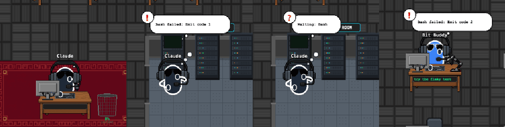
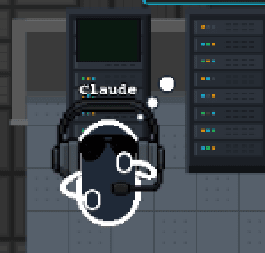

# 04 · 막히면 그 자리에서 턱 괴고 고민

- 브랜치: `feat/04-ponder-pose`
- 근거: [근거 문서](../plan/spec.md) R3

## 목표

에이전트가 막히면 걷지 않고 지금 있는 곳에서 턱을 괴고, 머리 위에 생각 점(…)이 차오른다. 막힘은 세 가지다 — 도구 실패, 권한 대기, 턴 중에 도구 없이 오래 생각함.

## 한 일

- 백엔드 `Boss.stuck` · `Agent.stuck` (`tool_failed` · `waiting_permission`). 실패한 도구 끝 이벤트(02 에서 받기 시작한 `PostToolUseFailure`)와 권한 요청에서 켜지고, 그 캐릭터가 다음 도구를 시작하거나 턴 · 서브에이전트 · 세션이 끝나면 꺼진다. 권한 대기는 그 도구가 성공으로 끝나도 꺼진다.
- 실패하면 말풍선이 `❗ Bash failed: Exit code 1` 처럼 바뀐다(오류 첫 줄만).
- `Boss.turn_active` — 프롬프트부터 턴 끝까지 참. 프런트가 "턴 중 조용함" 을 가려낸다.
- 프런트 `stateReconciler` 가 턴 중에 도구 · 막힘 없이 조용해진 시각을 기억하고, 6초가 넘으면 오래 생각하는 것으로 본다.
- 사장 심부름 규칙에 고민을 더했다(`bossErrands.ts` 규칙 7): 고민하는 동안 새로 떠나지 않는다. 다만 지금 기다리는 도구의 방으로는 간다 — 권한 요청은 도구 시작과 같은 순간에 와서, 사장이 랙까지 가서 승인을 기다린다. 직원 응대는 고민보다 먼저다.
- 자세: 앉은 사장 · 서 있는 사장 · 자리의 직원 모두 오른손을 턱에 괴고 생각 점 3개가 차례로 찬다. 고민 중에는 서버실 콘솔이 멈춘다.

## 검증

| 단계 | 명령 · 방법 | 결과 |
| --- | --- | --- |
| 정적 검증 | `make checkall` | 통과 — 백엔드 463(새 7) · 프런트 188(새 10) · 훅 29 · 플러그인 33 |
| 실검증 | 헤드리스 Chromium, 빈 DB 백엔드 + 전용 시나리오(오래 생각 → 실패 → 다음 도구 → 권한 대기 → 직원 실패) | TC 6건 — ✅ 6 |
| 스모크 회귀 | 같은 시나리오 동안 콘솔 · 백엔드 오류 | 0건 |

### 실검증 TC

| TC | 우선순위 | 판정 | 방법 · 근거 |
| --- | --- | --- | --- |
| TC-01 오래 생각 | P0 | ✅ | 프롬프트 뒤 16초 동안 도구 없음: 사장이 책상에서 턱을 괴고 점이 찬다 |
| TC-02 명령 실패 | P0 | ✅ | `npm test` 가 서버실에서 실패: 사장이 랙 앞에 남아 `❗ Bash failed: Exit code 1` 과 함께 고민한다. 콘솔은 멈춘다 |
| TC-03 다음 도구로 풀림 | P0 | ✅ | 4.5초 뒤 `Read` 가 시작되자 고민을 풀고 자료실로 걸어간다 |
| TC-04 권한 대기 | P0 | ✅ | 도구 시작과 권한 요청을 같은 순간에 보냈다: 사장이 랙까지 가서 `❓ Waiting: Bash` 로 고민한다. 이전에는 책상에서 일어나지도 못했다(아래 발견 사항) |
| TC-05 직원 실패 | P1 | ✅ | 직원의 명령이 실패하자 그 직원만 자기 자리에서 턱을 괸다. 사장은 그대로다 |
| TC-06 생각 점 | P2 | ✅ | 연속 캡처로 점이 0 → 1 → 2 → 3 개로 차오른 뒤 다시 시작하는 것을 봤다(단위 테스트로도 고정) |

### 화면

오래 생각(책상) · 명령 실패(랙) · 권한 대기(랙) · 직원 실패(자리):

생각 점이 다 찬 순간:

## 발견 사항

- 처음 구현은 "고민하면 그 자리에서 멈춤" 이었는데, 권한 요청이 도구 시작과 거의 동시에 와서 사장이 책상에서 일어나기도 전에 멈췄다. 기다리는 도구의 방으로 가는 것만은 허용하도록 고쳤다(TC-04).
- QA 도구 문제 — 연속 캡처 스크립트가 끝날 때 셸만 죽고 시나리오 드라이버가 살아남아 다음 회차 세션에 이벤트를 섞었다. 프로세스 그룹째 내리도록 고쳤고, 오염된 회차 결과는 버리고 다시 찍었다.

## 검증하지 못한 것

- 실제 권한 요청 · 도구 실패가 있는 Claude Code 세션 — 06 에서 확인한다.
- 서브에이전트의 "오래 생각" — 서브에이전트에는 턴 개념이 없어 실패 · 권한 대기만 고민으로 보여 준다.

## 다음 작업

05 `feat/05-agent-errands` — 직원도 자료실 · 서버실을 다녀온다.
