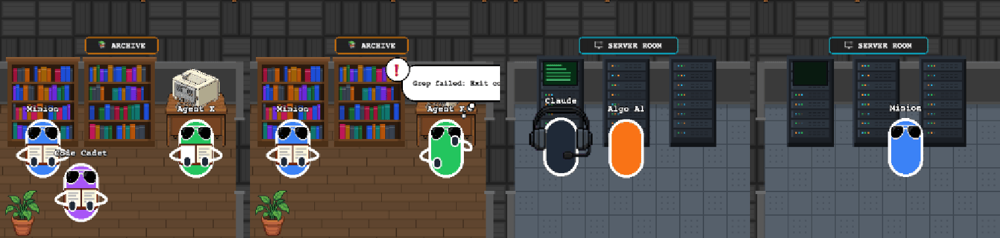
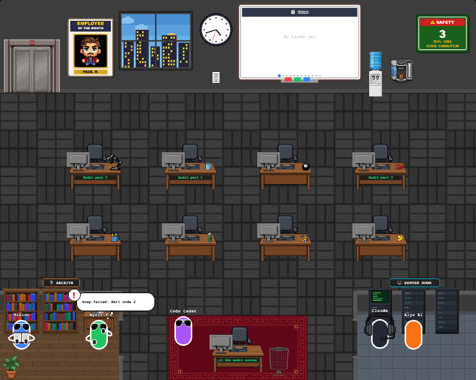

# 05 · 직원도 자료실 · 서버실을 다녀온다

- 브랜치: `feat/05-agent-errands`
- 근거: [근거 문서](../plan/spec.md) R1 · R2 · R4

## 목표

서브에이전트(직원)도 자기 책상에서 읽기 도구를 쓰면 자료실로, 명령을 돌리면 서버실로 걸어가 일하고 돌아온다. 여럿이 같은 방을 써도 자리가 겹치지 않는다.

## 한 일

- `frontend/src/systems/agentErrands.ts` — 직원 심부름 규칙(순수 함수). 사장 규칙(03 · 04)과 같고 다른 점은 셋이다.
  1. 방마다 직원용 자리 5곳(앞줄 가구 앞 2곳 + 뒷줄 3곳, 사장 자리 제외)을 예약해서 쓴다. 자리가 다 차면 책상에서 일한다.
  2. 직원이 책상 상태를 벗어나면(퇴근 시작) 심부름을 바로 놓는다. 직원은 상태 기계를 따라 지금 자리(예: 자료실)에서 퇴근 줄로 걸어 나간다 — 순간 이동이 없다.
  3. 고민은 막힘(실패 · 권한 대기)일 때만이다. 직원에게는 턴이 없다.
- 걷기는 원래 직원 이동(`animationSystem.setAgentPath`)을 그대로 쓴다. 심부름 길은 정적 격자로 찾고(사장과 같음), 280px/s 로 걷는다(평소 200). 맨 윗줄 책상에서 자료실까지 1,100px 라 평소 속도로는 짧은 도구 호출을 따라가지 못했다. 경로 상태에 속도(`PathState.speed`)를 둘 수 있게 했다.
- 그림: 자료실에서는 책을 펴 들고 책장을 넘긴다, 서버실 랙 앞에서는 등을 돌린다(선글라스 숨김), 막히면 그 자리에서 턱을 괸다. 책상을 비운 동안은 책상 위 팔 · 헤드셋을 그리지 않는다. 직원이 랙을 쓰는 동안에도 서버실 LED 가 빨리 깜빡인다.
- 책 그림을 `shared/drawOpenBook.ts` 로 옮겨 사장과 같이 쓴다.

## 검증

| 단계 | 명령 · 방법 | 결과 |
| --- | --- | --- |
| 정적 검증 | `make checkall` | 통과 — 백엔드 463 · 프런트 202(새 14) · 훅 29 · 플러그인 33 |
| 실검증 | 헤드리스 Chromium, 빈 DB 백엔드 + 직원 4명 시나리오(셋 읽기 · 하나와 사장 명령 · 읽다가 명령으로 · 실패 · 자료실에서 퇴근) | TC 7건 — ✅ 7 |
| 스모크 회귀 | 같은 시나리오와 03 직원 7명 줄 서기 동안 콘솔 · 백엔드 오류 | 0건 |

### 실검증 TC

| TC | 우선순위 | 판정 | 방법 · 근거 |
| --- | --- | --- | --- |
| TC-01 직원 읽기 | P0 | ✅ | 셋이 동시에 읽기: 책장 앞 · 프린터 앞 · 뒷줄로 나뉘어 각자 책을 편다 |
| TC-02 직원 명령 | P0 | ✅ | 직원과 사장이 동시에 명령: 사장은 랙 0, 직원은 랙 1 앞에서 등을 돌린다 |
| TC-03 자리 예약 | P0 | ✅ | 직원끼리 · 사장과 겹치지 않는다. 앞 직원이 랙 1 에 머무는 동안 다음 직원은 랙 2 로 간다 |
| TC-04 방 옮기기 | P1 | ✅ | 읽던 직원이 명령을 시작하자 자료실에서 서버실로 바로 간다 |
| TC-05 직원 고민 | P1 | ✅ | 자료실에서 `Grep` 이 실패한 직원이 프린터 앞에서 `❗` 말풍선과 함께 턱을 괸다 |
| TC-06 자료실에서 퇴근 | P0 | ✅ | 자료실에 있던 직원이 끝나자 자료실에서 바로 퇴근 줄로 걸어 나간다. 사장은 서버실에서 돌아와 받는다 |
| TC-07 책상 비움 | P2 | ✅ | 직원이 나간 책상에는 팔 · 헤드셋이 없고 할 일 글자는 남는다 |

### 화면

40초 자료실(셋 읽기) · 45.5초 자료실(한 명 실패로 고민, 한 명 퇴근) · 40초 서버실(사장 랙 0, 직원 랙 1) · 50.5초 서버실(읽던 직원이 랙 2 로 오는 중):

자료실에서 바로 퇴근하는 직원(가운데 보라색):

## 검증하지 못한 것

- 실제 Claude Code 서브에이전트 — 02 에서 훅이 서브에이전트 도구를 그 직원에게 붙이게 했고, 실제 세션은 06 에서 확인한다.
- 직원 8명이 한 방에 몰리는 경우 — 자리가 5곳이라 나머지는 책상에서 일한다(단위 테스트로 확인).

## 다음 작업

06 `feat/06-live-e2e` — 실제 Claude Code 세션으로 끝까지 확인.
