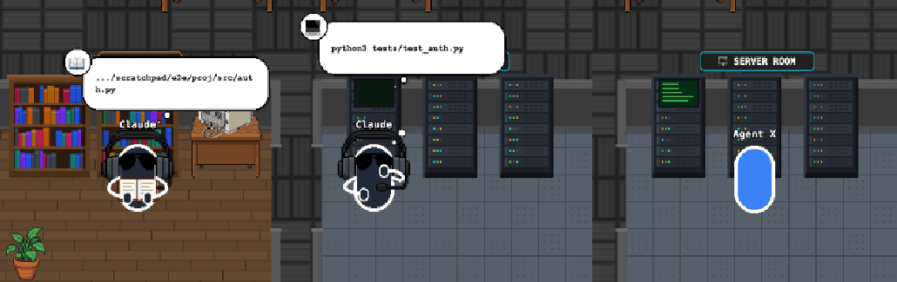

# 06 · 실제 Claude Code 세션으로 끝까지 확인

- 브랜치: `feat/06-live-e2e`
- 근거: [근거 문서](../plan/spec.md) R5 — "전부 내 터미널이랑 실시간으로 같이 움직임"

## 목표

시뮬레이터가 아니라 실제 Claude Code 세션의 훅 이벤트로 사무실이 움직이는지 확인한다. 확인하다 나온 버그를 고치고, 누구나 같은 확인을 다시 돌릴 수 있게 한다.

## 한 일

- **실제 세션 확인** — 임시 프로젝트에서 `claude -p`(haiku)를 세 번 돌렸다. 훅은 `--settings` 로 그 세션에만 걸고 `--setting-sources project` 로 내 사용자 설정 · 훅을 뺐다. 전역 `~/.claude/settings.json` 은 앞뒤 해시가 같다.
- **버그 수정 — 서브에이전트 도구가 두 번 반영됨** — 02 에서 훅이 서브에이전트 도구를 그 직원에게 붙이게 되자, 원본이 그 공백을 메우려고 쓰던 서브에이전트 기록 파일(transcript) 폴러와 겹쳐 같은 도구가 두 번 들어왔다(도구 사용 수 · 이벤트 로그 두 배). 같은 세션에서 같은 `(이벤트 종류, tool_use_id)` 는 처음 것만 반영한다. 폴러 이벤트도 01a 의 세션별 잠금을 거치게 했다(그동안 순서 보장 밖이었다).
- **걷는 중 고민 자세** — 실패 직후 랙까지 걷는 동안 턱 괸 자세로 미끄러지듯 이동했다. 걷는 동안은 걷기 자세, 멈춘 뒤 고민 자세로 바꿨다.
- `scripts/live_session.sh` — 위 확인을 한 줄로 돌린다(임시 프로젝트 · 프로젝트 범위 훅 · haiku · 지출 상한 $0.5). 훅 설정은 설치기의 `create_hook_config` 로 만들어 설치기 형식도 함께 확인된다.
- README 「이 포크 실행하기」 — 설치 · 실행, 이벤트를 넣는 세 방법(훅 설치 · 실제 세션 스크립트 · 시뮬레이터), 요약 기능 끄기.

## 검증

| 단계 | 명령 · 방법 | 결과 |
| --- | --- | --- |
| 정적 검증 | `make checkall` | 통과 — 백엔드 464(새 1) · 프런트 202 · 훅 29 · 플러그인 33 |
| 중복 테스트 되돌려 보기 | 중복 거르기만 빼고 새 테스트 실행 | 실패(도구 사용 수 2) — 고친 뒤 통과 |
| 실제 세션 ① | 읽기 2 · 실패하는 명령 · 서브에이전트 Grep (5턴, $0.0056, 14초) | 이벤트 19개가 빠짐없이 들어왔다. 실패는 `PostToolUseFailure` → `Exit code 1`. 서브에이전트 Grep 은 서브에이전트 id 로 그 직원에게 붙었다. 이때 폴러 중복을 발견했다 |
| 실제 세션 ② | 서브에이전트가 `sleep 15` 를 돌리는 동안 읽기를 겹쳐 실행(백그라운드 에이전트) | 서브에이전트가 서버실 랙 1 에 등을 돌리고 서 있다가 자료실로 넘어갔다. 백엔드 오류 0 |
| 실제 세션 ③ | `scripts/live_session.sh` (5턴, $0.0061, 26초) | 종료 0, 도구 시작 6 · 끝 7 로 중복 없음, 전역 설정 해시 그대로, 임시 폴더 정리됨 |

실제 세션에서 화면이 한 일:

| 시점 | 장면 |
| --- | --- |
| 첫 `Read` | 사장이 자료실로 걸어가 책을 편다(실제 파일 이름이 말풍선에) |
| `python3 tests/test_auth.py` 실패 | 사장이 서버실 랙 앞에 남아 턱을 괴고 생각 점이 찬다. 콘솔은 멈춘다 |
| `Agent` 호출 | 엘리베이터가 열리고 직원이 출근해 사장에게 일을 받는다. 사장은 그동안 책상으로 돌아와 있다 |
| 서브에이전트의 `sleep` | 직원이 서버실 랙 1 앞에서 등을 돌리고 선다 |

## 검증하지 못한 것

- 권한 요청 — 헤드리스(`-p`) 세션은 권한 창을 띄우지 않는다. 시뮬레이터 확인(04)으로 갈음한다.
- **화면이 실제보다 2~3초 늦다.** 서브에이전트는 엘리베이터 → 줄 → 사장 → 책상 연출에 10초 가까이 걸린다. 그래서 2초 만에 끝나는 서브에이전트는 책상에 앉기 전에 퇴근하고, 마지막 도구가 64ms 짜리면 자료실 문 앞까지 갔다가 책을 펴기 전에 퇴근한다. 원본의 연출 시간이라 그대로 둔다.

## 다음 작업

07 `feat/07-ko-locale` — 한국어 로케일.
