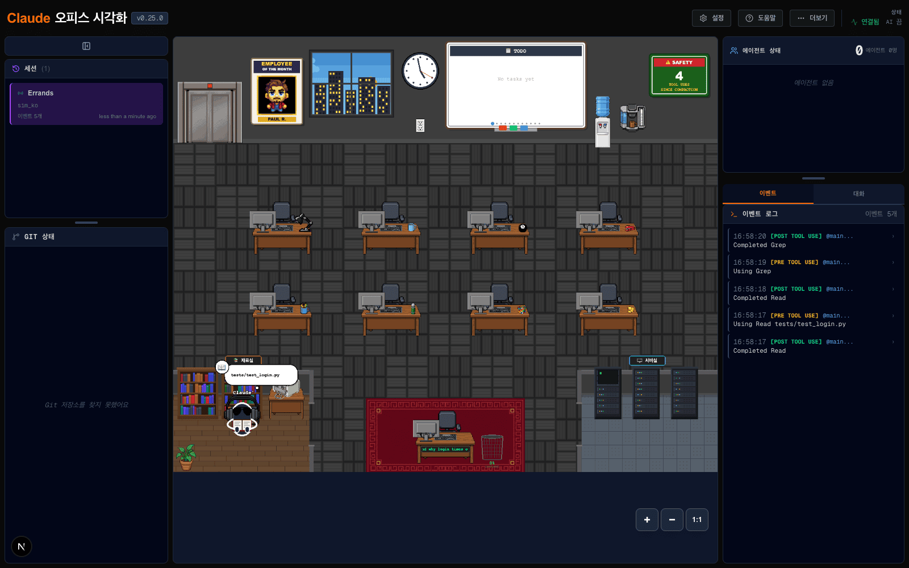
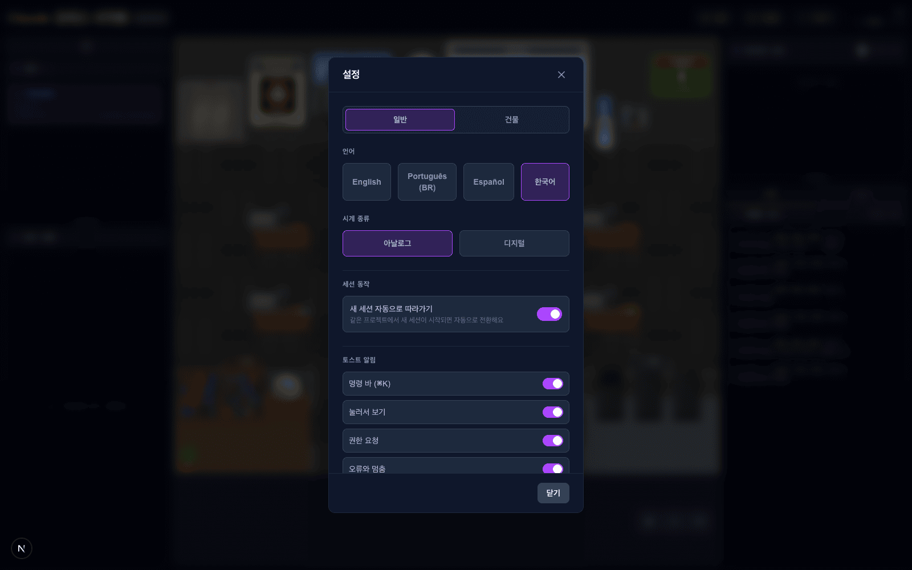
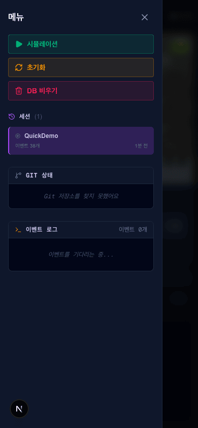

# 07 · 한국어 로케일

- 브랜치: `feat/07-ko-locale`
- 근거: [근거 문서](../plan/spec.md) 화면 배치 — "간판 문구는 영어 기본(`ARCHIVE` · `SERVER ROOM`)이고 한국어 로케일에서는 `자료실` · `서버실` 이다."

## 목표

설정에서 한국어를 고를 수 있게 하고, 화면 문구 · 간판 · 상대 시간이 한국어로 나오게 한다.

## 한 일

- **`ko` 사전** — 영어 원문 216개를 전부 옮겼다. 새 문구는 없고 기존 영어 문구의 번역이다. 자리표시자(`{count}` 등)는 그대로 두었다. 화면에서 값과 이어 붙는 문구(세션 삭제 확인 등)는 이어 붙인 결과가 한국어 어순이 되게 골랐다.
- **설정 「언어」에 `한국어`** 를 추가했다.
- **상대 시간** — 세션 목록과 모바일 메뉴가 "언어 → date-fns 로케일" 매핑을 각자 삼항식으로 들고 있었다. 한곳(`frontend/src/i18n/dateLocale.ts`)으로 모으고 `ko` 를 넣었다. 이제 언어를 하나 더 넣을 때 고칠 곳이 하나다.
- **테스트** — 한국어 키가 영어와 같은지, 자리표시자를 빠뜨리지 않았는지, 영어가 아닌 모든 언어에 날짜 로케일이 있는지, 한국어 상대 시간이 `5분 전` 으로 나오는지 확인한다.

## 검증

| 단계 | 명령 · 방법 | 결과 |
| --- | --- | --- |
| 정적 검증 | `make checkall` | 통과 — 백엔드 464 · 프런트 207(새 5) · 훅 29 · 플러그인 33 |
| 되돌려 보기 | 날짜 로케일 매핑에서 `ko` 를 빼고 테스트 실행 | 새 테스트 2건 실패 — 되돌린 뒤 통과 |
| 브라우저 | 헤드리스 Chromium, 1600×1100 · 1280×800 · 1920×1200 · 390×844 | 아래 TC 전부 ✅, 콘솔 오류 0 |

### 실검증 TC

| TC | 우선순위 | 판정 | 방법 · 근거 |
| --- | --- | --- | --- |
| TC-01 간판 | P0 | ✅ | 한국어에서 간판이 `자료실` · `서버실` 로 나온다. 심부름 시나리오 중 사장이 자료실에서 책을 편 화면에서 확인 |
| TC-02 헤더 · 사이드바 | P0 | ✅ | `설정` · `도움말` · `세션` · `이벤트 로그` · `에이전트 상태` 가 한국어고, 영어 `SETTINGS` 는 없다 |
| TC-03 상대 시간 | P0 | ✅ | 세션 목록 `1분 미만 전`, 모바일 메뉴 `1분 전` |
| TC-04 설정에서 바로 전환 | P0 | ✅ | 설정에서 English → Español → 한국어 순서로 누르면 새로고침 없이 바뀐다. 상대 시간도 `less than a minute ago` → `hace menos de un minuto` → `1분 미만 전` |
| TC-05 새로고침 뒤 유지 | P1 | ✅ | 한국어를 고른 뒤 새로고침해도 한국어다(백엔드 설정에 저장) |
| TC-06 세션 삭제 확인창 | P1 | ✅ | `이 세션을 삭제할까요: QuickDemo?` · `영구히 지워지는 것: 38 개 이벤트. 되돌릴 수 없어요.` — 이어 붙인 문장이 어순에 맞다 |
| TC-07 뷰포트 | P1 | ✅ | 1280×800 · 1920×1200 에서 가로 스크롤이 없고 헤더 버튼이 한 줄에 들어간다 |
| TC-08 모바일 메뉴 | P1 | ✅ | 390×844 에서 메뉴 · 세션 · Git 상태 · 이벤트 로그가 한국어고 가로 스크롤이 없다 |
| TC-09 다른 언어 회귀 | P1 | ✅ | 영어 · 스페인어 상대 시간이 전처럼 나온다(TC-04) |

### 화면

심부름 시나리오 중 — 간판 `자료실` · `서버실`, 사장이 자료실에서 책을 편다:

설정의 언어 목록:

모바일 메뉴(390×844):

## 검증하지 못한 것 · 영어로 남은 것

- 사무실 그림 속 글자(`EMPLOYEE OF THE MONTH` · `SAFETY` · 화이트보드 `No tasks yet` 등)는 원본에서 모든 언어에 영어로 박혀 있다. 그림의 일부라 이번 범위에서 옮기지 않았다.
- 이벤트 로그 · 말풍선의 요약(`Using Read …` · `Completed Grep`)은 백엔드가 영어로 만든다. 화면 사전 밖이다.
- 상단 제목 앞의 `Claude` 는 08(에이전트 이름)에서 바꾼다.

## 발견 사항

- 끝난 세션을 열면 이벤트 로그가 비어 있다. 원본부터 그렇다(이벤트 로그를 채우는 두 파일이 원본과 같다). [작업 분할](../plan/work-breakdown.md)의 「발견한 기존 결함」에 재현을 적고 `fix/07a-event-log-history` 로 넣었다.

## 다음 작업

07a `fix/07a-event-log-history` — 지난 이벤트로 이벤트 로그 채우기.
