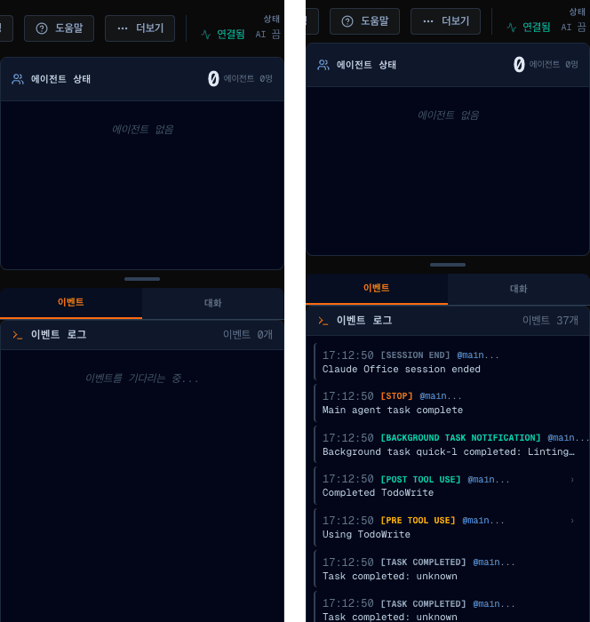

# 07a · 끝난 세션도 이벤트 로그를 보여 준다

- 브랜치: `fix/07a-event-log-history`
- 근거: [작업 분할](../plan/work-breakdown.md) 「발견한 기존 결함」 — 07 실검증에서 찾았다. [근거 문서](../plan/spec.md) R5(실시간 연동)

## 목표

끝난 세션을 열거나 새로고침하면 이벤트 로그가 「이벤트를 기다리는 중...」 으로 비어 있었다. 세션 목록에는 이벤트 수가 보이는데 로그는 비어 있어서, 무슨 일이 있었는지 다시 볼 방법이 없었다. 그 세션의 지난 이벤트가 로그에 나오게 한다.

## 원인

- 이벤트 로그는 웹소켓 `event` 메시지로만 채워진다. 이 메시지는 페이지가 붙어 있는 동안 일어난 이벤트에만 온다.
- 백엔드는 상태(`state_update`)를 보낼 때마다 최근 500건(`history`)을 실어 보낸다. 그런데 화면은 이 기록을 읽지 않았다.
- 원본과 같은 코드다(이벤트 로그를 채우는 두 파일이 원본 그대로였다).

## 한 일

- **상태가 올 때마다 로그에 없는 이벤트만 채운다** — `mergeEventHistory`. 새 항목이 없으면 배열을 그대로 둬서 화면이 다시 그려지지 않는다. 로그는 최신순, 최대 500건이다.
- **같은 이벤트를 두 번 넣지 않는다** — 백엔드는 이벤트 하나를 상태의 기록과 `event` 메시지로 두 번 보낸다(상태가 먼저 간다). 둘은 id(이벤트 시각) · 종류 · 에이전트 · 요약이 같으므로 이 넷으로 같은 이벤트를 가린다. 시각이 같아도 종류나 요약이 다르면 다른 이벤트로 둔다.

## 검증

| 단계 | 명령 · 방법 | 결과 |
| --- | --- | --- |
| 정적 검증 | `make checkall` | 통과 — 백엔드 464 · 프런트 214(새 7) · 훅 29 · 플러그인 33 |
| 되돌려 보기 | 고친 세 파일만 원래대로 두고 새 테스트 실행 | 새 테스트 7건 전부 실패 — 되돌린 뒤 통과 |
| 브라우저 | 헤드리스 Chromium 1600×1100. 판정 기준은 백엔드가 그 세션에 들고 있는 기록 수다(페이지 안에서 웹소켓을 따로 열어 읽었다) | 아래 TC 전부 ✅, 콘솔 오류 0 |

### 실검증 TC

| TC | 우선순위 | 판정 | 방법 · 근거 |
| --- | --- | --- | --- |
| TC-01 끝난 세션 | P0 | ✅ | 시뮬레이터로 세션을 끝낸 뒤 페이지를 연다. 로그 37건 = 백엔드 기록 37건, 맨 위가 마지막 이벤트(`SESSION END`) |
| TC-02 실시간 | P0 | ✅ | 세션 시작부터 지켜본다. 끝난 뒤 로그 30건 = 기록 30건 — 상태와 `event` 메시지로 두 번 온 이벤트가 한 번씩만 들어갔다 |
| TC-03 진행 중 새로고침 | P0 | ✅ | 세션 10초째에 새로고침하고 끝까지 본다. 로그 30건 = 기록 30건. 새로고침 직후에는 원본 규칙(진행 중인 세션 중 이벤트가 가장 많은 것)대로 다른 세션이 열려서 그 세션을 다시 골랐다 |
| TC-04 세션 전환 | P1 | ✅ | 같은 프로젝트의 지난 세션(30건) · 다른 프로젝트 세션(37건)으로 바꿀 때마다 그 세션의 기록 수와 같다 |
| TC-05 상세 보기 | P1 | ✅ | 기록에서 채운 항목을 눌러도 상세 창이 열린다 |

### 화면

끝난 세션을 연 화면 — 왼쪽이 고치기 전(07 실검증, `이벤트 0개`), 오른쪽이 고친 뒤(`이벤트 37개`):

## 검증하지 못한 것

- 백엔드를 다시 띄운 뒤 DB 에서 되살린 세션 — 되살린 기록에는 상세(`detail`)가 비어 있다(원본 동작). 로그에는 나오지만 상세 창의 도구 입력이 비어 있을 수 있다. 화면 쪽 변경은 같은 경로라 따로 돌리지 않았다.

## 다음 작업

08 `feat/08-agent-identity` — 사장 이름표 · 세션 목록 · 앱 제목에 세션을 띄운 에이전트를 보여 준다.
