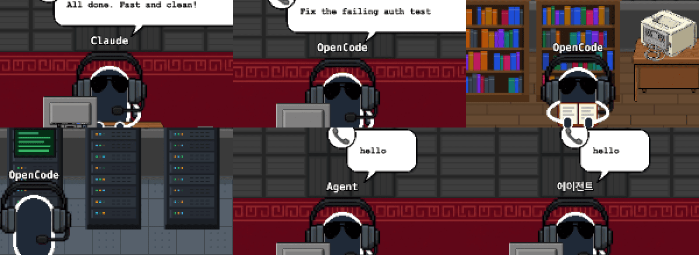
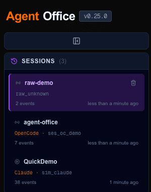

# 08 · 세션을 띄운 에이전트 이름을 보여 준다

- 브랜치: `feat/08-agent-identity`
- 근거: [근거 문서](../plan/spec.md) 「에이전트 범위」 — "사장 이름표는 지금 "Claude" 로 고정돼 있다. 세션을 띄운 에이전트 이름(Claude · OpenCode · Gemini · Codex)을 보여 주게 바꾼다."

## 목표

사장 이름표 · 대화 탭 · 세션 목록에 그 세션을 띄운 코딩 에이전트 이름을 보여 주고, 앱 제목을 `Agent Office` 로 바꾼다. OpenCode 플러그인 세션에서도 R1(읽기 → 자료실) · R2(명령 → 서버실)가 나오는지 확인한다.

## 한 일

- **이벤트에 에이전트 이름을 싣는다** — 이벤트 데이터에 `coding_agent` 를 더했다. Claude Code 훅은 `claude-code`, OpenCode 플러그인은 `opencode`, 시뮬레이터는 Claude Code 세션을 흉내 내므로 `claude-code` 를 보낸다. `coding_agent` 가 없는 예전 OpenCode 플러그인은 이미 보내던 `source: "opencode"` 로 알아본다.
- **세션에 저장한다** — 세션 테이블에 `coding_agent` 열을 더했다. 기존 DB 는 시작할 때 원본의 인라인 마이그레이션이 열을 붙인다. 세션의 첫 이름이 남고, 이름 없는 뒤 이벤트가 지우지 않는다.
- **화면에 보낸다** — 세션 목록 API 는 `codingAgent`, 화면 상태(`GameState`)도 `codingAgent` 를 싣는다.
- **화면** — 사장 이름표(책상 · 심부름 · 압축 연출 셋 다)와 대화 탭의 답변 이름이 `Claude` · `OpenCode` · `Gemini` · `Codex` 로 나온다. 모르는 값은 그 값을 16자까지 그대로 보여 주고, 이름이 없는 세션은 `Agent`(한국어 `에이전트`)로 둔다. 세션 목록 카드에는 `OpenCode · <세션 id>` 처럼 앞에 붙인다(이름 없으면 안 붙인다).
- **제목** — 헤더와 브라우저 탭 제목을 `Agent Office` 로 바꿨다. 문구 중 Claude 로 박혀 있던 것(둘러보기 환영 문구 · 빈 대화 안내)은 "코딩 에이전트" 로 바꿨고, 쓰지 않게 된 `app.title` · `conversation.claude` 키는 네 언어에서 지웠다.
- 훅 README 의 필드 표에 `coding_agent` 를 적었다.

## 검증

| 단계 | 명령 · 방법 | 결과 |
| --- | --- | --- |
| 정적 검증 | `make checkall` | 통과 — 백엔드 470(새 6) · 프런트 220(새 6) · 훅 31(새 2) · 플러그인 34(새 1) |
| 되돌려 보기 | 화면 상태 복사 · 세션 전환 초기화를 빼고 프런트 테스트 실행 | 새 테스트 2건 실패 — 되돌린 뒤 통과 |
| 기존 DB 마이그레이션 | 07a 때 만든 QA DB(`coding_agent` 열 없음)로 새 백엔드를 띄운다 | 열이 붙고 기존 세션 3개는 `codingAgent: null`, 백엔드 오류 0 |
| 브라우저 | 헤드리스 Chromium 1600×1100 · 390×844. OpenCode 세션은 **실제 플러그인 코드**(`opencode-plugin/src/index.ts`)에 OpenCode 모양의 호출(`session.created` · `chat.message` · `tool.execute.before/after`)을 넣어 만들었다 | 아래 TC 전부 ✅, 콘솔 오류 0 |

### 실검증 TC

| TC | 우선순위 | 판정 | 방법 · 근거 |
| --- | --- | --- | --- |
| TC-01 제목 | P0 | ✅ | 헤더 `Agent Office`, 브라우저 탭 제목 `Agent Office`, `Claude` 없음 |
| TC-02 Claude 세션 | P0 | ✅ | 시뮬레이터 세션: 이름표 `Claude`, 목록 `Claude · sim_claude` |
| TC-03 OpenCode 세션 | P0 | ✅ | 플러그인 세션: 이름표 `OpenCode`, 목록 `OpenCode · ses_oc_demo` |
| TC-04 OpenCode R1 · R2 | P0 | ✅ | `read` 동안 사장이 자료실에서 책을 펴고, `bash` 동안 서버실 랙 앞에 등을 돌리고 선다. 이름표가 따라간다 |
| TC-05 대화 탭 | P1 | ✅ | 답변 이름이 OpenCode 세션은 `OPENCODE`, Claude 세션은 `CLAUDE`(대문자는 CSS). 답변은 QA 용 대화 기록 파일로 만들었다 |
| TC-06 이름 없는 세션 | P1 | ✅ | `coding_agent` 없이 보낸 세션: 이름표 `Agent`, 한국어 `에이전트`, 목록에는 태그 없음 |
| TC-07 모바일 | P1 | ✅ | 390×844 헤더 `Agent Office` 가로 스크롤 없음, 메뉴의 세션 카드 `OpenCode · 이벤트 N개` |

### 화면

이름표 — 위: Claude(책상) · OpenCode(책상) · OpenCode(자료실에서 `read`), 아래: OpenCode(서버실에서 `bash`) · 이름 없음(`Agent`) · 같은 세션 한국어(`에이전트`):

헤더와 세션 목록:

## 검증하지 못한 것

- **실제 OpenCode 프로그램** — 이 컴퓨터에 OpenCode 가 없고, 돌리려면 모델 계정 로그인이 필요하다. 그래서 플러그인 코드를 그대로 불러 OpenCode 가 부르는 모양으로 호출했다. 플러그인 → 백엔드 → 화면 구간은 실제와 같고, OpenCode 본체가 이 훅을 실제로 이 순서로 부르는지는 확인하지 못했다.
- Gemini · Codex 이름표 — 이름 표는 넣었지만 보내는 쪽은 09 · 10 에서 만든다(단위 테스트로만 확인).

## 발견 사항

- OpenCode 세션의 말풍선이 파일 경로 · 명령 대신 `read` · `bash` 만 보인다. 원본의 말풍선 함수가 Claude 도구 이름과 `file_path` 만 안다. [작업 분할](../plan/work-breakdown.md)의 「발견한 기존 결함」에 적고 `fix/08a-agent-tool-bubbles` 로 넣었다.

## 다음 작업

08a `fix/08a-agent-tool-bubbles` — 말풍선 문구 · 아이콘을 에이전트 공통으로.
