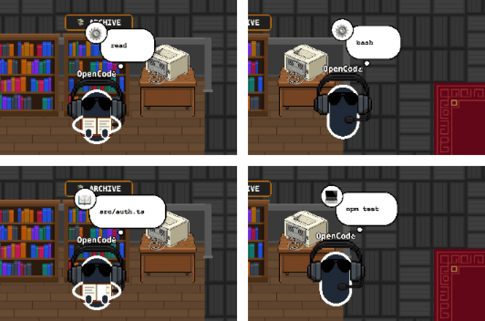

# 08a · 다른 에이전트의 도구도 말풍선에 파일 · 명령이 나온다

- 브랜치: `fix/08a-agent-tool-bubbles`
- 근거: [작업 분할](../plan/work-breakdown.md) 「발견한 기존 결함」 — 08 실검증에서 찾았다. [근거 문서](../plan/spec.md) 「에이전트 범위」

## 목표

OpenCode 세션에서 사장이 자료실 · 서버실로는 가는데, 말풍선에는 파일 경로 · 명령 대신 도구 이름(`read` · `bash`)만 보이고 아이콘도 ⚙️ 였다. 이벤트 로그 요약도 `Using read` 처럼 대상이 빠졌다. 어느 에이전트의 도구든 무엇을 읽고 무엇을 돌리는지 보이게 한다.

## 원인

- 말풍선 함수가 Claude Code 도구 이름(`Read` · `Glob` · `Grep` · `Write` · `Edit` · `Bash`)과 정확히 같을 때만 경로 · 명령을 읽었다.
- 경로는 `file_path` 만 읽었다. OpenCode 는 `filePath`, Gemini CLI 는 `absolute_path` 를 쓴다.
- 아이콘 표도 Claude 이름과 정확히 같아야 찾았다.

## 한 일

- **입력 키를 에이전트 공통으로 읽는다** — 활동 모듈(`backend/app/core/activity.py`)에 `tool_subject()` 를 두었다. 명령 도구(활동 표의 `running`)는 `command` · `cmd` 를 읽고, Codex 처럼 명령이 인자 목록이면 공백으로 잇는다. 그 밖의 도구는 경로 · 패턴(`file_path` · `filePath` · `absolute_path` · `notebook_path` · `pattern` · `path` · `dir_path`)을 먼저, 없으면 `url` · `query` 를 읽는다.
- **말풍선** — 도구 이름이 아니라 이 결과로 문구를 고른다. 경로는 전처럼 줄여서, 명령은 첫 줄을 45자까지 보여 준다. 서브에이전트 도구(`Task` · `Agent` · OpenCode `task`)는 전처럼 `Delegating...` 이다.
- **아이콘** — 대소문자를 가리지 않고 찾고, 없으면 활동으로 고른다(읽기 📖 · 명령 💻). Claude 의 `Agent` 도구도 `Task` 처럼 🎯 이다.
- **이벤트 로그 요약** — `Using <도구> <대상>` 의 대상도 같은 함수로 읽는다. 세션 시작 · 끝 요약의 `Claude Office` 는 뺐다(`Session started` · `Session ended`).

Claude Code 도구의 말풍선 · 요약은 그대로다(아래 테스트와 TC-01).

## 검증

| 단계 | 명령 · 방법 | 결과 |
| --- | --- | --- |
| 정적 검증 | `make checkall` | 통과 — 백엔드 491(새 21) · 프런트 220 · 훅 31 · 플러그인 34 |
| 되돌려 보기 | 새 함수는 두고 말풍선 · 요약 쪽만 원래대로 돌린다 | OpenCode · Gemini · Codex · `Agent` 쪽 8건 실패, Claude 쪽 3건은 그대로 통과 — 되돌린 뒤 전부 통과 |
| 브라우저 | 헤드리스 Chromium 1600×1100. OpenCode 세션은 08 과 같이 실제 플러그인 코드로 만들었다 | 아래 TC 전부 ✅, 콘솔 오류 0 |

### 실검증 TC

| TC | 우선순위 | 판정 | 방법 · 근거 |
| --- | --- | --- | --- |
| TC-01 Claude 회귀 | P0 | ✅ | 시뮬레이터 세션의 요약이 전처럼 `Using Read src/auth/login.py` · `Using Edit src/auth/login.py` |
| TC-02 OpenCode 읽기 | P0 | ✅ | 자료실에서 말풍선 📖 `src/auth.ts`, 로그 `Using read src/auth.ts` |
| TC-03 OpenCode 명령 | P0 | ✅ | 서버실로 가는 동안 말풍선 💻 `npm test`, 로그 `Using bash npm test` |

### 화면

위가 고치기 전(08 실검증), 아래가 고친 뒤 — 같은 OpenCode 세션의 `read` · `bash`:

## 검증하지 못한 것

- Gemini CLI · Codex CLI 도구는 단위 테스트로만 확인했다(`read_file` · `run_shell_command` · 인자 목록 명령). 실제 이벤트는 09 · 10 에서 붙인다.

## 발견 사항

- **새 세션의 첫 이벤트가 두 번 반영된다** — 세션 시작이 백엔드 기록에 두 번 들어가고, 하나는 시간대가 빠져서 9시간 이른 시각으로 보인다. 원본부터 같은 순서(저장 → DB 로 되살리기 → 다시 처리)라서 생긴다. 「발견한 기존 결함」에 재현을 적고 `fix/08b-first-event-applied-twice` 로 넣었다.
- 화이트보드 통계도 Claude 도구 이름에만 맞춰져 있다(코드로 확인). `fix/08c-whiteboard-agent-tools` 로 넣었다.

## 다음 작업

08b `fix/08b-first-event-applied-twice` — 첫 이벤트 두 번 반영 · 되살린 시각의 시간대.
