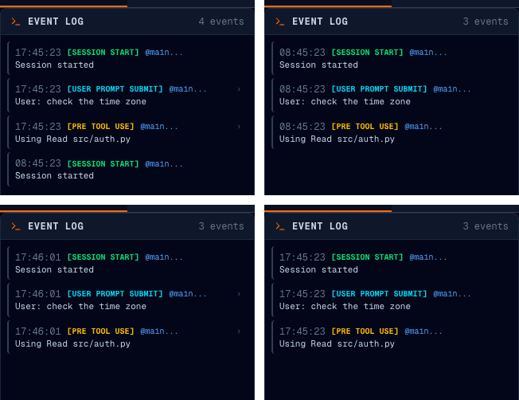

# 08b · 첫 이벤트를 한 번만 반영하고, 되살린 시각을 UTC 로 읽는다

- 브랜치: `fix/08b-first-event-applied-twice`
- 근거: [작업 분할](../plan/work-breakdown.md) 「발견한 기존 결함」 — 08a 실검증에서 찾았다. [근거 문서](../plan/spec.md) R5(실시간 연동)

## 목표

- 새 세션을 열면 백엔드 기록에 「세션 시작」이 두 번 들어갔다. 하나는 9시간 이른 시각이라 이벤트 로그 맨 아래에 따로 보였다.
- 백엔드를 다시 띄우면 지난 세션의 이벤트 시각이 전부 9시간 이르게(한국 기준) 보였다.

두 문제를 고쳐 이벤트가 한 번씩, 제 시각으로 보이게 한다.

## 원인

- **두 번 반영** — 메모리에 없는 세션의 이벤트가 오면 `process_event` 는 이벤트를 DB 에 먼저 저장하고, DB 로 세션을 되살린 뒤(방금 저장한 이벤트까지 다시 처리), 그 이벤트를 한 번 더 처리했다. 새 세션의 첫 이벤트, 그리고 백엔드 재시작 · 유휴 정리 뒤 오는 첫 이벤트(프롬프트 · 도구)가 그렇게 두 번 반영됐다. 원본도 같은 순서다.
- **9시간** — SQLite 는 시간대를 저장하지 않는다. DB 에서 읽은 시각은 시간대가 없어서, 이벤트 id(`.timestamp()`)와 화면 시각이 UTC 시각을 현지 시각으로 읽었다. 그래서 되살린 「세션 시작」은 id 까지 달라 화면에서 다른 이벤트로 보였다.

## 한 일

- **되살린 뒤 저장한다** — 메모리에 없는 세션은 지금 이벤트를 저장하기 **전에** DB 의 앞선 이벤트로 되살리고, 지금 이벤트는 그 뒤에 한 번 처리한다. 진짜 「세션 시작」은 저장된 이벤트를 지우므로(원본 동작) 되살리지 않고 새로 시작한다.
- **웹소켓 쪽 되살리기가 덮어쓰지 않게** — 화면이 붙을 때 되살린 세션이 그사이 이벤트가 만든 세션을 덮어쓰지 않고, 이미 있으면 그대로 둔다.
- **시각 열 타입** — `UTCDateTime`(`backend/app/db/types.py`)을 두고 모든 시각 열에 썼다. 쓸 때는 UTC 로 바꿔 저장하고, 읽을 때는 UTC 시간대를 붙인다. 열 정의는 그대로라 마이그레이션은 없다.

## 검증

| 단계 | 명령 · 방법 | 결과 |
| --- | --- | --- |
| 정적 검증 | `make checkall` | 통과 — 백엔드 496(새 5) · 프런트 220 · 훅 31 · 플러그인 34 |
| 되돌려 보기 | `event_processor.py` · `models.py` 만 원래대로 두고 새 테스트 실행 | 새 테스트 5건 전부 실패 — 되돌린 뒤 통과 |
| 브라우저 | 같은 DB 로 **원본 main 백엔드**(스크래치패드 워크트리)와 이 브랜치 백엔드를 번갈아 띄우고, 실제 재시작 전후의 이벤트 로그를 비교했다. 헤드리스 Chromium 1600×1100 | 아래 TC 전부 ✅, 콘솔 오류 0 |

### 실검증 TC

| TC | 우선순위 | 판정 | 방법 · 근거 |
| --- | --- | --- | --- |
| TC-01 새 세션 | P0 | ✅ | 시작 · 프롬프트 · 읽기 3건을 보낸다. 원본은 로그 4건(「세션 시작」 08:45 가 하나 더), 이 브랜치는 3건 |
| TC-02 재시작 뒤 시각 | P0 | ✅ | 백엔드를 다시 띄운 뒤 같은 세션을 연다. 원본은 08:45, 이 브랜치는 보낸 시각 그대로 17:45 |
| TC-03 메모리에서 내린 세션 | P1 | ✅ | 단위 테스트: 세션을 메모리에서 내린 뒤 프롬프트를 보내면 대화에 한 번만 들어간다 |
| TC-04 이어 하기 세션 시작 | P1 | ✅ | 단위 테스트: 재시작 뒤 진짜 「세션 시작」(`source: resume`)은 지난 이벤트를 다시 처리하지 않고, DB 도 그 시작 하나만 남는다(원본과 같은 지우기) |

### 화면

위가 원본 main, 아래가 이 브랜치. 왼쪽은 새 세션을 보낸 직후, 오른쪽은 백엔드를 다시 띄운 뒤의 같은 세션이다(이벤트를 같은 초에 보내 같은 초 안의 순서는 의미 없다):

## 검증하지 못한 것

- 유휴 정리(오래 쉰 세션을 메모리에서 내리기)는 실제 시간을 기다리지 않고 단위 테스트로 내렸다.

## 다음 작업

08c `fix/08c-whiteboard-agent-tools` — 화이트보드 통계를 에이전트 공통으로.
