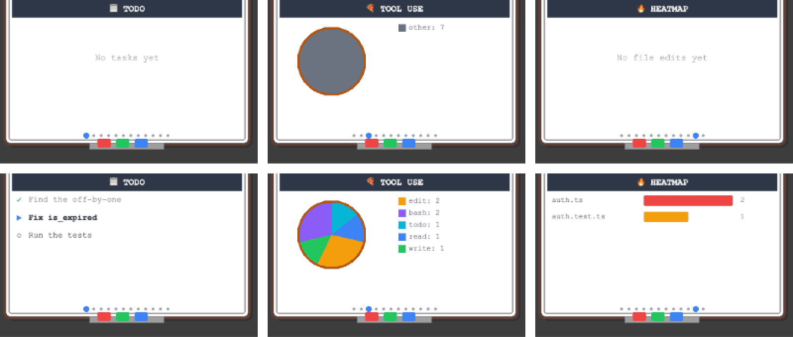

# 08c · 화이트보드가 다른 에이전트의 도구도 센다

- 브랜치: `fix/08c-whiteboard-agent-tools`
- 근거: [작업 분할](../plan/work-breakdown.md) 「발견한 기존 결함」 — 08a 에서 코드로 찾았다. [근거 문서](../plan/spec.md) 「에이전트 범위」

## 목표

OpenCode 세션의 화이트보드가 비어 있었다. 할 일 목록은 「No tasks yet」, 도구 비율은 전부 `other`, 고친 파일 열지도는 「No file edits yet」 였다. 어느 에이전트의 세션이든 화이트보드가 채워지게 한다.

## 원인

- 도구 분류 표(`TOOL_CATEGORIES`)가 `Read` · `Bash` 같은 Claude Code 이름과 정확히 같을 때만 분류했다.
- 고친 파일은 `Edit` · `Write` 의 `file_path`, 버그 수정 수는 `Bash` 의 `command`, 할 일은 `TodoWrite` 일 때만 셌다.
- OpenCode 플러그인은 도구 입력을 「시작」 이벤트에만 싣는다. 화이트보드는 「끝」 이벤트로 세므로 입력이 없었다.

## 한 일

- **분류 표** — 이름을 소문자로 찾고, OpenCode · Gemini CLI · Codex CLI 이름을 넣었다(`write_file` · `replace` · `apply_patch` · `write_todos` …). 표에 없는 읽기 · 명령 도구는 08a 의 활동 표로 `read` · `bash` 에 넣는다. Claude 의 `MultiEdit` 는 이제 `edit` 다.
- **파일 · 명령** — 고친 파일 이름과 명령은 08a 의 `tool_subject()` 로 읽는다(`filePath` · `absolute_path` 도).
- **시작 이벤트의 입력** — 「시작」 이벤트의 입력을 도구 id 로 잠깐 들고 있다가, 「끝」 이벤트에 입력이 없으면 그것을 쓴다. 끝이 오지 않을 때를 대비해 200개까지만 둔다.
- **할 일 목록** — OpenCode `todowrite` · Gemini `write_todos` 도 할 일 판을 채운다(입력 모양이 같다: `todos[].content` · `status`).

## 검증

| 단계 | 명령 · 방법 | 결과 |
| --- | --- | --- |
| 정적 검증 | `make checkall` | 통과 — 백엔드 523(새 27) · 프런트 220 · 훅 31 · 플러그인 34 |
| 되돌려 보기 | 상태 기계의 「시작 입력 기억」 · 할 일 판정만 원래대로 | OpenCode 세 건(고친 파일 · 버그 수정 · 할 일) 실패 — 되돌린 뒤 통과 |
| 브라우저 | 같은 OpenCode 세션(할 일 · 읽기 · 고치기 2 · 쓰기 · `npm run lint:fix` · `npm test`)을 **원본 main 백엔드**와 이 브랜치 백엔드에 각각 보냈다. 실제 플러그인 코드로 보냈다. 화이트보드는 단축키 `0`(할 일) · `2`(도구 비율) · `9` 뒤 클릭(열지도) | 아래 TC 전부 ✅, 콘솔 오류 0 |

### 실검증 TC

| TC | 우선순위 | 판정 | 방법 · 근거 |
| --- | --- | --- | --- |
| TC-01 할 일 판 | P0 | ✅ | 원본 「No tasks yet」 → 이 브랜치 할 일 3개(완료 ✓ · 진행 ▶ · 대기 ○) |
| TC-02 도구 비율 | P0 | ✅ | 원본 `other: 7` → `edit 2 · bash 2 · todo 1 · read 1 · write 1` |
| TC-03 고친 파일 열지도 | P0 | ✅ | 원본 「No file edits yet」 → `auth.ts 2 · auth.test.ts 1` |
| TC-04 Claude 회귀 | P0 | ✅ | 시뮬레이터 세션: 할 일 `All done`, 도구 `read 4 · edit 4 · todo 2`, 열지도 `login.py 3 · handlers.py 1` |

### 화면

위가 원본 main, 아래가 이 브랜치 — 같은 OpenCode 세션의 할 일 · 도구 비율 · 열지도:

## 검증하지 못한 것

- Gemini CLI · Codex CLI 도구는 분류 단위 테스트로만 확인했다. 실제 이벤트는 09 · 10 에서 붙인다.

## 다음 작업

09 `feat/09-gemini-cli-hooks` — Gemini CLI 연동.
