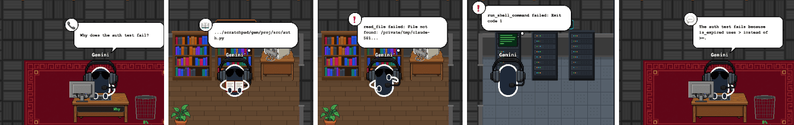
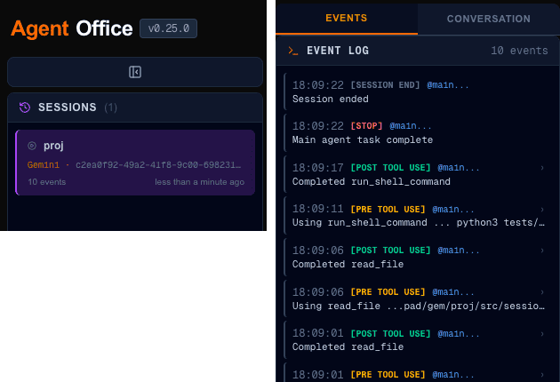

# 09 · Gemini CLI 연동

- 브랜치: `feat/09-gemini-cli-hooks`
- 근거: [근거 문서](../plan/spec.md) 「에이전트 범위」, 원본 설계 [ENH-012](../fable/ENH-012-gemini-cli-integration.md)

## 목표

Gemini CLI 세션도 같은 사무실에 띄운다. 훅 어댑터 · 설치기 · 이벤트 매핑을 만들고, 진짜 Gemini CLI 에서 R1(읽기 → 자료실) · R2(명령 → 서버실) · R3(막힘 → 턱 괴기)가 나오는지 확인한다.

## 한 일

- **훅 어댑터 `gemini-office-hook`** — Claude Code 훅과 같은 패키지에 넣었다(`hooks/src/claude_office_hooks/gemini_*.py`). Gemini 가 넘긴 JSON 을 사무실 이벤트로 바꿔 백엔드로 보내고, stdout 에는 `{}` 만 쓰고 늘 종료 0 이다. Gemini 는 훅의 stdout 을 JSON 으로 읽어서, 다른 글자가 섞이면 사용자에게 보인다.
- **매핑** — 세션 시작 · 끝, 프롬프트, 도구 시작 · 끝, 답변(멈춤), 수동 압축, 권한 알림. 표는 [훅 README](../../hooks/README.md#gemini-cli)에 있다.
- **설치기** — `make gemini-hooks-install` · `-status` · `-uninstall`(`hooks/manage_gemini_hooks.py`). `~/.gemini/settings.json` 에 `agent-office` 이름의 항목만 넣고 뺀다. 다른 도구의 훅(이 컴퓨터에는 Superset 훅이 있다)은 그대로 두고, 파일이 깨진 JSON 이면 손대지 않고, 처음 바꿀 때 `.bak` 을 남긴다.
- **백엔드** — 멈춤 이벤트가 답변(`speech_content.boss`)을 실어 오면, 대화 기록 파일에서 답을 못 찾을 때 그것을 대화 탭 · 사장 말풍선에 쓴다. Gemini 의 `write_todos`(항목 이름이 `description`)도 할 일 판을 채우고, `read_many_files` 의 `include` 목록도 말풍선에 나온다.
- **다시 돌려 보는 스크립트** — `scripts/gemini_session.sh` 가 진짜 Gemini CLI(npx, 0.64.0 고정)를 계정 없이 돌린다. 모델 API 만 `scripts/fake_gemini_api.py` 로 바꾸고(`GOOGLE_GEMINI_BASE_URL`), HOME 을 임시 폴더로 따로 둬서 내 Gemini 설정 · 로그인을 쓰지도 바꾸지도 않는다.
- 훅 디버그 로그 머리글 `RAW INPUT FROM CLAUDE CODE` 를 `RAW HOOK INPUT` 으로 바꿨다(두 훅이 같이 쓴다). 포크 README · 근거 문서의 에이전트 표도 갱신했다.

### 원본 설계(ENH-012)와 다르게 한 것

| 설계 | 이 포크 | 근거 |
| --- | --- | --- |
| Gemini 도구 이름을 Claude 이름으로 바꾼다(`run_shell_command` → `Bash`) | 바꾸지 않는다 | 백엔드가 02 · 08a · 08c 에서 모든 에이전트의 도구 이름을 읽게 됐다. 이벤트 로그에는 Gemini 가 부른 이름이 그대로 남는다 |
| 도구 호출 id 를 만들어 붙인다 | 붙이지 않는다 | Gemini 가 주지 않는다. 같은 도구를 다시 부르면 만든 id 가 겹쳐 06 의 중복 거르기에 걸린다. 백엔드가 이름으로 짝을 맞춘다 |
| `activate_skill` · `complete_task` 를 서브에이전트 시작 · 끝으로 | 일반 도구로 둔다 | 현재 문서에서 `activate_skill` 은 스킬 불러오기다. Gemini 서브에이전트에는 훅이 없다 |
| `PreCompress` → 압축 | `manual` 만 | 0.64.0 코드에서 `auto` 는 매 턴 압축 검사 **전에** 불린다. 실제로 압축하지 않아도 오므로 그대로 보내면 턴마다 휴지통 연출이 돈다(첫 실행 기록에 3번 들어왔다) |
| 실패는 `tool_response.error` 로 | 그것과 결과의 `Exit Code:` 줄 | 실패한 명령은 `error` 가 비어 있고 출력 끝에 `Exit Code: 1` 만 있다(실제 페이로드). Claude 의 `Exit code 1` 과 같은 모양으로 보낸다 |
| 대화 기록 파일을 넘긴다 | 넘기지 않고 `prompt_response` 를 답변으로 | 기록 파일은 Claude 형식이 아니라 백엔드가 읽지 못한다 |

## 검증

| 단계 | 명령 · 방법 | 결과 |
| --- | --- | --- |
| 정적 검증 | `make checkall` | 통과 — 백엔드 537(새 14) · 프런트 220 · 훅 73(새 42) · 플러그인 34 |
| 되돌려 보기 | 백엔드의 답변 경로만 원래대로 두고 새 테스트 실행 | 답변 테스트 실패 — 되돌린 뒤 통과 |
| 실제 Gemini CLI | `scripts/gemini_session.sh`(진짜 Gemini CLI 0.64.0 + 가짜 모델). 가짜 모델은 파일 읽기 → 없는 파일 읽기 → 6초 걸리는 실패 테스트 → 답변 순서로 답한다 | 종료 0, 25초. 훅 14번 호출 · 백엔드 기록 10건. 내 `~/.gemini/settings.json` 해시 전후 같음(`22fc8d4266e5`), 임시 폴더 지워짐 |
| 브라우저 | 헤드리스 Chromium 1600×1100, 같은 세션을 1초마다 캡처 | 아래 TC 전부 ✅, 콘솔 오류 0 |

### 실검증 TC

| TC | 우선순위 | 판정 | 방법 · 근거 |
| --- | --- | --- | --- |
| TC-01 실제 세션 | P0 | ✅ | 세션 시작 · 프롬프트 · `read_file` 2번 · `run_shell_command` · 답변 · 세션 끝이 Gemini 세션 하나로 들어온다. 실제 페이로드는 문서 · 0.64.0 코드와 같았다(아래 「확인한 페이로드」) |
| TC-02 R1 읽기 | P0 | ✅ | `read_file` 동안 사장이 자료실에서 책을 편다. 말풍선에 파일 경로 |
| TC-03 R2 명령 | P0 | ✅ | `sleep 6; python3 tests/test_auth.py` 동안 서버실 랙 앞에 등을 돌리고 선다 |
| TC-04 R3 막힘 | P0 | ✅ | 없는 파일 → 자료실에서 `❗ read_file failed: File not found…`, 실패한 테스트 → 랙 앞에서 `❗ run_shell_command failed: Exit code 1`. 둘 다 그 자리에서 턱을 괸다 |
| TC-05 답변 | P1 | ✅ | 끝나면 사장 말풍선과 대화 탭에 Gemini 의 답변 |
| TC-06 이름 | P1 | ✅ | 이름표 `Gemini`, 세션 목록 `Gemini · <세션 id>` |
| TC-07 압축 연출 없음 | P1 | ✅ | 매 턴의 `PreCompress(auto)` 가 기록에 들어가지 않는다 |
| TC-08 설치기 | P1 | ✅ | 단위 테스트: 없는 파일 만들기 · 다른 도구 훅 보존 · 다시 설치해도 하나 · 깨진 JSON 은 손대지 않음 · `.bak` · 우리 항목만 지우기 |
| TC-09 훅 입출력 | P1 | ✅ | 단위 테스트(실제 프로세스): stdout 은 `{}` 만 · 종료 0 · 백엔드가 꺼져 있거나 입력이 깨져도 같다 |

### 확인한 페이로드

공식 훅 문서(`docs/hooks/reference.md` · `index.md` · `reference/tools.md`)와 0.64.0 번들 코드, 실제 실행의 디버그 로그로 확인했다.

- 모든 이벤트: `session_id` · `transcript_path` · `cwd` · `hook_event_name` · `timestamp`, 환경 변수 `GEMINI_PROJECT_DIR` · `GEMINI_SESSION_ID` · `GEMINI_CWD`
- `BeforeTool` · `AfterTool`: `tool_name` · `tool_input`(+ `tool_response` 의 `llmContent` · `returnDisplay` · `error`), 호출 id 없음
- 도구 입력: `read_file.file_path` · `list_directory.dir_path` · `glob`/`grep_search.pattern` · `run_shell_command.command` · `write_todos.todos[].description`
- 권한 알림 `details`: `type` 이 `exec`(`command`) · `edit`(`filePath`) · `mcp`(`toolName`) · `info`, 늘 `title`

### 화면

실제 Gemini CLI 세션 — 프롬프트 · 자료실에서 읽기 · 없는 파일에 턱 괴기 · 실패한 테스트로 랙 앞에서 턱 괴기 · 답변:

세션 목록과 이벤트 로그(Gemini 도구 이름 그대로):

## 검증하지 못한 것

- **진짜 Gemini 모델** — 계정이 없어서 모델만 가짜다. CLI · 도구 실행 · 훅 · 백엔드 · 화면은 실제와 같다.
- **권한 알림** — `--yolo` 로 돌려서 권한을 묻지 않았다. 모양은 0.64.0 코드로 확인하고 단위 테스트로 잠갔다.
- **서브에이전트(R4)** — Gemini 에 훅이 없어서 직원이 출근하지 않는다.

## 다음 작업

10 `feat/10-codex-hooks` — Codex CLI 연동.
