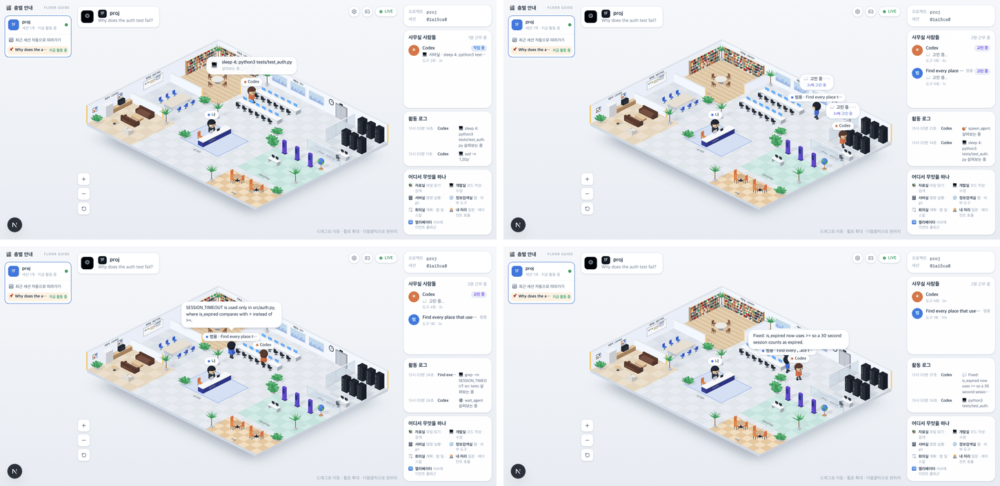
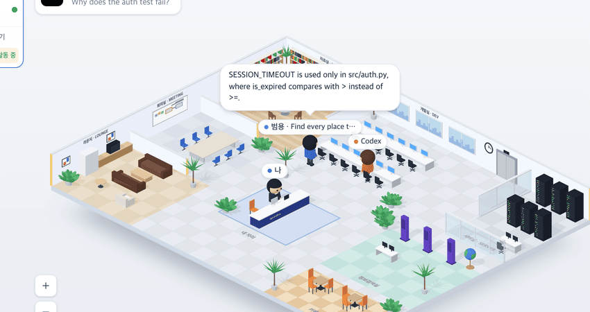

# 10 · Codex CLI 연동

- 브랜치: `feat/10-codex-hooks` (재설계 전에 멈춘 브랜치에 main 을 합쳐 이었다)
- 근거: [근거 문서](../plan/spec.md) 「에이전트 범위」 — Codex CLI 도 같은 사무실에 띄운다. 작업 표: 잡을 수 있는 이벤트를 다시 확인하고, 되는 만큼 붙이고, 안 되는 동작은 보고서에 남긴다
- 검증한 커밋: `0668ad9`(문서 `f529b3a`)

## 목표

Codex CLI 세션도 사무실에 뜬다. Codex 가 셸로 파일을 읽으면 자료실, 명령을 돌리면 서버실, 서브에이전트에게 일을 맡기면 엘리베이터로 직원이 온다. 안 되는 동작은 아래 「안 되는 것」에 남긴다.

## 한 일

- **실측** — 설치된 codex-cli 0.160.1 을 가짜 Responses API(대본대로 답하는 서버)로 돌려 훅이 받는 JSON 을 받아 적고, [공식 훅 문서](https://learn.chatgpt.com/docs/hooks)와 맞춰 봤다. 사용자 계정 · `~/.codex` 는 쓰지 않았다.
- **훅 `codex-office-hook`** — Codex 이벤트를 사무실 이벤트로 바꿔 백엔드에 보낸다. 표준 출력에는 아무것도 쓰지 않는다(SessionStart · UserPromptSubmit 의 출력은 모델 문맥에 들어간다).

  | Codex 훅 | 사무실 | 비고 |
  |---|---|---|
  | `SessionStart` · `SessionEnd` | 세션 시작 · 끝 | |
  | `UserPromptSubmit` | 내 질문 | 서브에이전트의 첫 질문(agent_id 가 있다)은 그 직원의 출근이다. 작업 문장이 직원 이름이 된다 |
  | `PreToolUse` · `PostToolUse` | 도구 시작 · 끝 | 셸은 `Bash`. `multi_agent_v1` 이름표는 뗀다. 서브에이전트의 호출 id 앞에 그 id 를 붙인다 |
  | `PermissionRequest` | 권한 대기(내 자리로) | |
  | `PreCompact` | 컨텍스트 압축 | |
  | `SubagentStop` | 직원 퇴근 | 마지막 답이 보고 말풍선이 된다 |
  | `Stop` | 턴 끝 | 마지막 답이 Codex 의 답 말풍선이 된다 |

- **셸로 읽기 = 자료실** — Codex 는 읽기 도구 대신 셸(`sed -n` · `cat` · `rg`)로 읽는다. 읽기만 하는 프로그램으로만 된 명령(파이프 · `&&` 포함, 리다이렉트 · 치환 없음)은 읽기로 센다. 이 브랜치의 첫 커밋(`040f74b`)이다.
- **셸로 부른 apply_patch** — 시작 훅만 오고 끝 훅이 없다. 그래서 시작과 끝을 한 번에 보내, 편집이 계속 걸려 있지 않게 했다.
- **설치기** — `make codex-hooks-install` 이 `$CODEX_HOME/hooks.json`(없으면 `~/.codex/hooks.json`)에 등록한다. 다른 도구의 훅은 그대로 두고, JSON 이 아닌 파일은 덮어쓰지 않는다. Codex 는 새 훅을 `/hooks` 에서 신뢰해야 돌리므로 설치 뒤 그 안내를 띄운다.
- **실행 스크립트** — `scripts/codex_session.sh` 가 임시 프로젝트 · 임시 `CODEX_HOME` 에서 진짜 Codex 를 가짜 모델로 돌린다. 대본은 「코드 읽기 → 실패하는 테스트 → 서브에이전트에게 검색 맡기고 기다리기 → 패치 → 테스트 → 답」이다.
- **백엔드**
  - `spawn_agent` 를 Task · Agent 처럼 위임 도구로 친다.
  - `view_image` 는 읽기로 친다.
  - 서브에이전트 퇴근에 실려 온 답(`speech_content.agent`)을 보고 말풍선으로 쓴다(보스의 `speech_content.boss` 와 같은 방식).
- **요약 대체 규칙** — AI 요약을 끄면 답을 첫 문장으로 줄이는데, `src/auth.py` 의 점에서 끊었다(19 의 「config.」도 같은 원인). 이제 점 · 느낌표 · 물음표 뒤가 공백이나 끝일 때만 문장이 끝난다.
- **활동 로그** — Gemini · Codex 도구 이름에도 아이콘을 붙였다(`apply_patch` 📝, `spawn_agent` 🎯 …). 퇴근한 직원은 id 앞자리 대신 마지막 작업 이름으로 남는다.

## 검증

| 단계 | 명령 · 방법 | 결과 |
| --- | --- | --- |
| 정적 검증 | `make checkall` | 통과 — 백엔드 585 · 프런트 272 · 훅 113(새 40) · 플러그인 34 |
| 실검증 | `scripts/codex_session.sh` 로 진짜 Codex CLI(가짜 모델)를 돌리며, 헤드리스 Chromium 1280×618(2배) · 한국어로 `/` 를 1.3초마다 찍고 칩 · 말풍선 · 패널 · 로그를 읽었다. 같은 세션을 세 번 돌렸고 마지막은 최종 코드다 | TC 15건 — ✅ 15 |
| 정리 | QA 로 띄운 프런트 · 백엔드 · 브라우저 · 가짜 모델을 내렸다. 임시 프로젝트 · `CODEX_HOME` 은 스크립트가 지운다 | `:3100` · `:8000` 듣는 프로세스 0 |

### 실검증 TC

| TC | 우선순위 | 판정 | 방법 · 근거 |
| --- | --- | --- | --- |
| A-01 세션 · 머리말 | P1 | ✅ | 머리말 ◎ 로고 · 「1F proj · Why does the auth test fail?」, 보스 이름 칩 「Codex」 |
| A-02 실패 테스트 | P1 | ✅ | 「💻 서버실 · sleep 4; python3 tests/test_auth.py」 작업 중(실패 표시는 없다 — 아래 「안 되는 것」) |
| A-03 서브에이전트 출근 | P1 | ✅ | 「범용 · Find every place that uses SESSION_TIMEOUT.」 칩과 패널의 「범」 아바타. 엘리베이터 쪽에서 들어온다 |
| A-04 서브에이전트의 도구 | P1 | ✅ | 그 직원의 grep 이 「도구 1회」로 잡히고 로그에 그 직원 이름으로 남는다 |
| A-05 보고 | P1 | ✅ | Codex 의자 뒤에서 「SESSION_TIMEOUT is used only in src/auth.py, where is_expired compares with > instead of >=.」(아래 그림) |
| A-06 퇴근 | P1 | ✅ | 「👋 퇴근합니다!」 뒤 사라지고 「사무실 사람들」이 2명에서 1명으로 준다 |
| A-07 패치 | P2 | ✅ | 로그 「📝 src/auth.py 살펴보는 중」. 편집이 걸려 있지 않고 다음 테스트로 넘어간다 |
| A-08 답 | P1 | ✅ | 「Fixed: is_expired now uses >= so a 30 second session counts as expired.」 말풍선 · 로그 💬 |
| A-09 퇴근한 직원 이름 | P2 | ✅ | 퇴근한 뒤에도 로그의 누구가 「Find every place that uses SESSION_TIMEOUT.」 |
| A-10 콘솔 · 종료 | P2 | ✅ | 콘솔 오류 0, Codex 종료 코드 0 |
| B-01 매퍼 | P1 | ✅ | [unit] 27건 — 실측 페이로드 기반(서브에이전트 출근 · 호출 id 범위 · 이름표 떼기 · 셸 패치 · 전용 패치 · 권한 · 압축 · 보고 · 답 · 매핑 안 하는 이벤트) |
| B-02 훅 진입점 | P1 | ✅ | [unit] 6건 — 표준 출력 · 오류 출력 없음, 종료 코드 0, 백엔드가 꺼져 있어도 조용함, 셸 패치는 두 이벤트 |
| B-03 설치기 | P1 | ✅ | [unit] 7건 — 다른 도구 훅 유지 · 다시 설치하면 교체 · 제거 · 깨진 파일 보호 · `CODEX_HOME` · SessionEnd 제한 3초 |
| B-04 백엔드 | P1 | ✅ | [unit] `spawn_agent` 위임 · `view_image` 읽기 · 서브에이전트 답 보고 · 문장 끝 규칙 · 읽기 전용 셸 명령 |
| B-05 로그 이름 | P2 | ✅ | [unit] 서브에이전트를 마지막 작업 이름으로 부른다 |

### 화면

진짜 Codex 세션: 실패 테스트(서버실) · 서브에이전트 출근 · 보고 · 답.

서브에이전트가 Codex 의자 뒤에서 결과를 보고한다.

## 안 되는 것 (Codex 쪽 사정)

- **실패한 명령** — `PostToolUse` 의 결과에는 종료 코드가 없다. Codex 기록(rollout)에는 남지만 훅이 돈 뒤에 써진다(실측). 그래서 식은땀 · 빨간 말풍선이 뜨지 않는다.
- **웹 검색** — `web_search` 는 호스팅 도구라 훅이 없다(문서). Codex 의 웹 검색으로는 정보검색실에 가지 않는다. MCP 도구는 간다.
- **생각 요약 구름** — Codex 기록은 Claude Code 형식이 아니라 읽지 않는다. 「💭 고민 중」은 뜨지만 생각 요약 구름은 없다.
- **중단(`Interrupt`)** — 연결하지 않았다. 대신 보낼 「멈춤」 이벤트가 없고, 턴 끝으로 보내면 백엔드가 「일을 마쳤다」는 임의 문구를 띄운다. Esc 로 멈추면 다음 질문까지 고민 중으로 남는다(Claude Code 와 같다).
- **`SubagentStart`** — 작업 문장이 없어 쓰지 않는다. 바로 뒤(실측 20ms)에 오는 그 직원의 첫 질문으로 출근시킨다.
- **신뢰** — 새 훅은 Codex 에서 `/hooks` 로 신뢰해야 돈다. 설치기는 등록만 하고 안내한다.

## 검증하지 못한 것

- 실제 OpenAI 모델 · 실계정 세션 — 사용자 계정을 쓰지 않는다는 원칙대로 가짜 모델로만 돌렸다.
- `PermissionRequest` — `codex exec` 는 승인을 물을 수 없어 실측하지 못했다. 문서의 필드(`tool_name` · `tool_input`)로 연결했다.
- 전용 `apply_patch` 도구 · `PreCompact` — 이번 모델 설정의 도구 목록에 전용 패치 도구가 없었고, 압축은 일어나지 않았다. 문서대로 연결했다(전용 패치는 `tool_name` 이 `apply_patch`).

## 다음 작업

11 `chore/11-integration-qa` — 통합 QA: 시나리오 전부 · 뷰포트 3종 · 빌딩 뷰 · 지휘 센터 회귀, 문서 정리.
