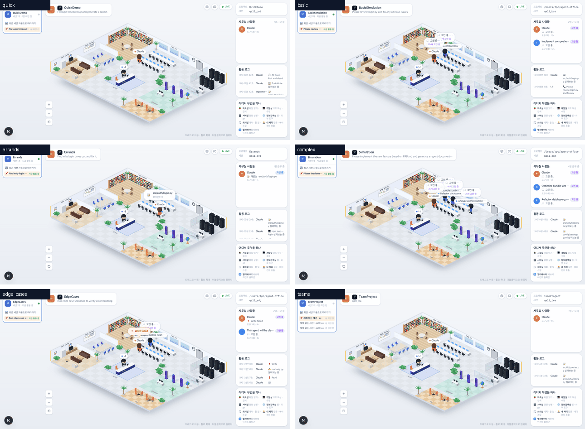
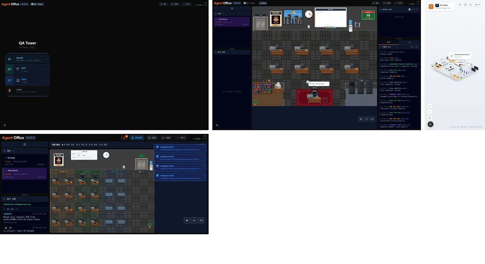

# 11 · 통합 QA

- 브랜치: `chore/11-integration-qa`
- 근거: [작업 분할](../plan/work-breakdown.md) 11 — 시나리오 전부 · 뷰포트 3종 · 빌딩 뷰 · 지휘 센터 회귀, 문서 정리
- 검증한 커밋: `ae03efe`(main, #26 까지) + 이 브랜치의 문서 변경

## 목표

화면 재설계(12–20)와 Codex 연동(10)까지 들어간 main 을 한 번에 돌려 본다. 시뮬레이터 시나리오 전부, 뷰포트 넷, 빌딩 뷰 · 층 뷰, 지휘 센터, 다른 에이전트(Gemini · Codex)를 기본 화면(`/`)과 2D 사무실(`/classic`)에서 확인하고, 낡은 문서를 고친다.

## 한 일

- **실검증만 했다** — 코드는 바꾸지 않았다. 찾은 결함은 없다.
- **문서 정리**
  - `docs/guides/quickstart.md`: 첫 화면 설명을 등각 사무실 기준으로 바꿨다. 층별 안내 · 방 · 오른쪽 패널을 적고, 2D 사무실 · 화이트보드 · 지휘 센터 · 빌딩 뷰는 `/classic` 에 있다고 적었다. 「Claude 로 시험해 보기」 · 「서브에이전트 시험」의 볼거리(고민 중 → 도구의 방으로 → 답 말풍선, 전화 → 엘리베이터 출근 → 보고 → 퇴근), 시뮬레이션 방법, 단축키가 `/classic` 용이라는 점도 고쳤다.
  - `docs/plan/spec.md`: 구현 방침의 「다 되면 기본을 바꾸고 2D 픽셀 사무실을 내린다」에 20 에서 마쳤다고 적었다.

## 검증

| 단계 | 명령 · 방법 | 결과 |
| --- | --- | --- |
| 정적 검증 | `make checkall` | 통과 — 백엔드 585 · 프런트 272 · 훅 113 · 플러그인 34 |
| 정적 내보내기 | `bun run build` | 통과 — `/` · `/classic` · `/iso` · `/sprite-debug` |
| 실검증 | 헤드리스 Chromium, QA 전용 백엔드(시나리오마다 빈 DB). 시뮬레이터 · 가짜 모델 세션을 돌리며 1.5초마다 화면을 읽고 찍었다 | TC 13건 — ✅ 13 |
| 정리 | QA 로 띄운 프런트 · 백엔드 · 브라우저를 내렸고, 빌드 산출물과 임시 빌딩 설정을 지웠다 | `:3100` · `:8000` 듣는 프로세스 0 |

### 실검증 TC

| TC | 우선순위 | 판정 | 방법 · 근거 |
| --- | --- | --- | --- |
| A-01 quick | P1 | ✅ | 15초. `/` 에 사람 칩 2 · 말풍선 · 로그 13줄, `/classic` 2D 사무실도 뜬다. 콘솔 오류 0 |
| A-02 basic | P1 | ✅ | 56초. 사람 칩 3(직원 1명 포함) · 말풍선 2, 양쪽 화면 콘솔 오류 0 |
| A-03 errands | P1 | ✅ | 76초. 사람 칩 3 · 로그 14줄, 양쪽 화면 콘솔 오류 0 |
| A-04 complex | P1 | ✅ | 126초. 직원 4명까지(「5명 근무 중」) · 말풍선 5개 동시, 콘솔 오류 0 |
| A-05 edge_cases | P1 | ✅ | 62초. 아주 긴 제목 · 이름이 잘려 보이고 「❗ Write failed」 빨간 말풍선이 뜬다, 콘솔 오류 0 |
| A-06 teams | P2 | ✅ | 같은 프로젝트의 세션 셋(lead · impl · test)이 한 층에 모이고, `/classic` 세션 목록에 셋이 보인다. 콘솔 오류 0 |
| A-07 뷰포트 넷 | P1 | ✅ | 두 시나리오를 함께 돌리며 1280×618 · 1600×1100 · 1920×1200 · 390×844. 모두 페이지 스크롤 없음. 큰 화면은 양쪽 패널(184 · 240px) 사이에 장면, 폰은 양쪽 패널이 숨고 머리말과 버튼 사이가 17px |
| A-08 지휘 센터 | P1 | ✅ | 일하는 세션 둘일 때 `/` 의 ⊞ 버튼이 생기고, 누르면 `/classic` 에 「확인 필요 · 작업 중 · 완료 · 종료」 구역 |
| A-09 빌딩 뷰 | P1 | ✅ | QA DB 에 층 둘(Web · API)을 넣자 `/classic` 이 「QA Tower · 2F API · 1F Web · 로비」로 열린다 |
| A-10 층 뷰 | P2 | ✅ | 1F Web 을 누르자 그 층의 2D 사무실(세션 QuickDemo)이 열린다. 빌딩 설정이 있어도 `/` 는 그대로다. 끝나고 설정을 지웠다(층 0) |
| A-11 Codex | P1 | ✅ | `scripts/codex_session.sh` 36초. 「Codex」 이름 칩, 서버실 테스트, 서브에이전트 출근 · 보고 · 「👋 퇴근합니다!」, 마지막 답. 콘솔 오류 0 |
| A-12 Gemini | P1 | ✅ | `scripts/gemini_session.sh` 25초. 「Gemini」 이름 칩, 실패한 `read_file` · 테스트가 빨간 말풍선, 마지막 답. 콘솔 오류 0 |
| A-13 정적 빌드 | P2 | ✅ | `output: "export"` 빌드에 `/` · `/classic` · `/iso` 페이지가 나온다 |

### 화면

시나리오 여섯(`/`).

빌딩 뷰 · 층 뷰 · 지휘 센터(`/classic`), 폰(`/`).

## 검증하지 못한 것

- 진짜 Claude Code 세션 — 사용량이 드는 실세션(`scripts/live_session.sh`)은 이번에 돌리지 않았다. 06 에서 확인했고, 같은 이벤트 모양을 시뮬레이터가 덮는다.
- OpenCode — 플러그인 세션은 08 에서 확인했고 이번에는 돌리지 않았다.
- 실제 폰 · 터치 — 데스크톱 브라우저의 폰 크기로만 봤다.

## 알려진 한계 (버그 아님)

- 폰 크기에서는 장면이 화면 폭에 맞춰 작아져 이름 칩 · 말풍선이 사람을 가린다. 확대 버튼이나 두 손가락으로 키워 볼 수 있다. 층 · 세션 바꾸기는 🎮 로 `/classic` 의 모바일 서랍에서 한다.
- 질문 없이 끝난 세션(teams 의 동료 세션 등)은 머리말 · 목록에 세션 id 가 이름으로 보인다.

## 다음 작업

작업 표의 항목(00–20)이 모두 머지됐다. 다음은 새 기획이 정해지면 작업 표에 이어서 넣는다.
