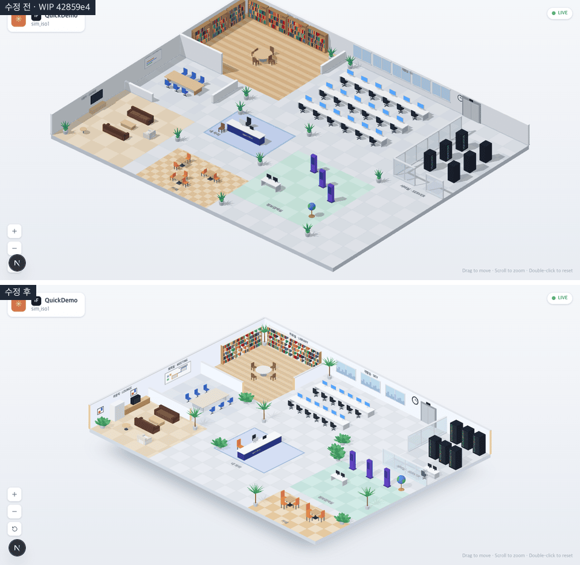
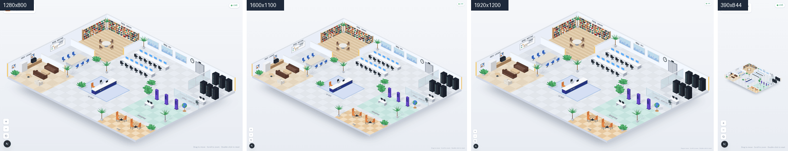
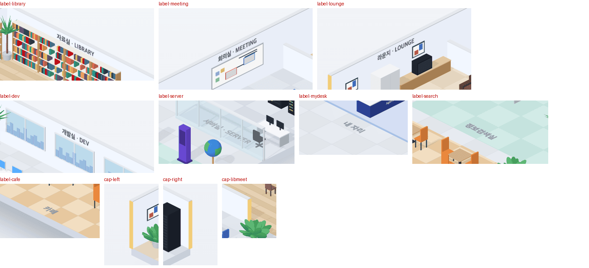
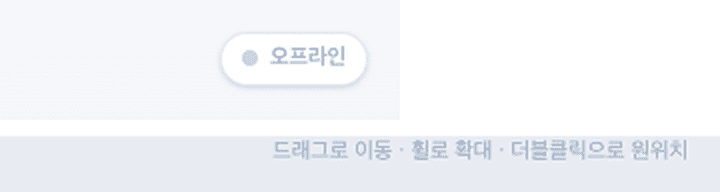

# 13 · 등각 사무실 장면

- 브랜치: `feat/13-iso-scene`
- 근거: [근거 문서](../plan/spec.md) 「화면 재설계」 — 화면 구성 표의 가운데 사무실 · 방 · 위 머리말 행, 구현 방침
- 검증한 커밋: `add6a89`

## 목표

`/iso` 를 열면 스레드 영상과 같은 밝은 등각 사무실 한 층이 보인다. 방 일곱 곳과 내 자리 · 엘리베이터, 벽 · 유리 · 창 · 가구 · 화분 · 방 이름이 영상과 같은 자리에 있고, 드래그 · 휠 · 더블클릭 · 버튼으로 둘러본다. 캐릭터와 좌우 패널은 14 이후다.

## 한 일

- **카메라** — 영상은 2:1 등각이다(바닥 모서리가 가로 2 에 세로 1 로 오른다). 방위 45° · 고도 30° 로 바꿨다. 1차의 41° · 33° 는 비틀려 보였다. 사무실 전체가 여백(위 72 · 옆 40 · 아래 44px) 안에 들어오게 화면마다 맞추고, 창 크기가 바뀌면 다시 맞춘다. 확대 1 이 이 맞춤이다.
- **배치** — 영상 프레임 16장의 픽셀 중앙값으로 말풍선 · 캐릭터를 지운 배경을 만들고, 그 위에 바닥 격자를 겹쳐 방 · 가구 좌표를 다시 읽었다. 1차와 크게 달랐던 곳은 이렇다.
  - 카페 · 정보검색실은 앞 오른쪽 변, 앞 꼭짓점 쪽에 있다
  - 서버실은 오른쪽 꼭짓점의 유리방이고 엘리베이터 쪽이 열려 있다
  - 자료실은 앞쪽 두 면이 반높이 벽이고 그 사이 모서리가 입구다
  - 개발실은 책상 두 줄 · 창 세 짝, 회의실 탁자는 세로로 길다
- **벽** — 바깥 벽을 3.4, 칸막이를 1.7 로 높였다. 다른 벽에 닿지 않는 끝 다섯 곳에 영상처럼 노란 띠를 그린다.
- **조명** — 왼쪽 벽 안쪽 면이 어두웠다. 주변광을 키우고 해를 앞쪽 높이로 옮겼다. 벽 · 바닥판 옆면 · 화이트보드 · 액자는 약하게 스스로 빛나게 해서 해를 등진 면도 밝다. 그림자는 옅게(세기 0.35) 둔다.
- **가구** — 영상 크기에 맞췄다. 흰 책장(책 사이 빈칸) · 흰 원탁 · 큰 화이트보드 · 긴 TV 장 · 액자 · 흰 수납장 · 큰 소파와 안락의자 · 높은 랙(초록 · 노란 불빛)을 넣었다. 키오스크 · 지구본 · 카페 의자와 탁자를 키우고, 화분을 키 큰 야자와 넓은 잎 두 가지로 나눴다. 창에는 도시 실루엣을 그렸다.
- **방 이름** — 벽 이름은 진하고 굵게, 바닥 이름은 굵게 키웠다. 자료실 이름이 책장에 가리던 것은 책장 높이(2.7)를 낮춰 풀었다.
- **바닥판 그림자** — 판 아래에 흐린 그림자를 깔아 떠 있게 보인다.
- **개발 배지와 버튼** — `next dev` 의 왼쪽 아래 배지가 `↺` 버튼을 덮었다(실검증에서 찾음). 개발 모드에서만 버튼 묶음을 배지 위로 올린다. 기존 2D 화면은 오른쪽 아래에 이벤트 로그가 있어서 배지는 옮기지 않았다.
- 인계 때 본 hydration 경고는 서버를 다시 띄우니 없다. 옛 서버 번들이 새 번역 키를 몰랐던 것이다.

### 영상과 맞춘 수치

같은 크기(1280×618)의 영상 프레임과 이 화면에서 쟀다.

| 항목 | 영상 | 이 화면 |
| --- | --- | --- |
| 바닥 앞 모서리 기울기(왼쪽 · 오른쪽) | 0.496 · 0.493 | 0.505 · 0.503 |
| 바닥판 가로 : 세로 | 40 : 30.8 | 40 : 31 |
| 바깥 벽 높이 ÷ 바닥 가로 | 0.086 | 0.085 |
| 왼쪽 벽 안쪽 면 색 | `#dfe3e9` ~ `#edf1f7` | `#e9eef8` |
| 오른쪽 벽 안쪽 면 색 | `#eff3f8` | `#f2f7ff` |
| 빈 바닥 색 | `#dadfe6` ~ `#e5e8ec` | `#e2e6ec` |
| 벽 끝 띠 색 | `#f2d38f` | `#f2cd78` |

## 검증

| 단계 | 명령 · 방법 | 결과 |
| --- | --- | --- |
| 정적 검증 | `make checkall` | 통과 — 백엔드 537 · 프런트 223 · 훅 73 · 플러그인 34 |
| 영상 대조 | 영상 중앙값 배경과 이 화면을 같은 축척으로 겹쳤다(바닥 뒤 꼭짓점 · 오른쪽 꼭짓점 기준). 자료실 · 왼쪽 벽 · 개발실과 서버실 · 앞쪽 네 구역을 확대해 비교했다 | 방 여덟 곳과 큰 가구 자리가 겹친다. 영상 캡처는 작성자 저작물이라 저장소에 넣지 않았다 |
| 실검증 | 헤드리스 Chromium(WebGL) · 시뮬레이터 `quick` · 뷰포트 5종(1280×618 · 1280×800 · 1600×1100 · 1920×1200 · 390×844) | TC 27건 — ✅ 27 |
| 스모크 회귀 | 기존 2D 사무실 `/` · 지휘 센터(세션 둘을 열어 `COMMAND`) | 둘 다 그대로 뜬다, 콘솔 오류 0 |
| 정리 | QA 로 띄운 프런트 · 백엔드 · 브라우저를 내렸다 | `:3100` · `:8000` 듣는 프로세스 0 |

### 실검증 TC

| TC | 우선순위 | 판정 | 방법 · 근거 |
| --- | --- | --- | --- |
| A-01 방 자리 | P1 | ✅ | 영상 대조(위 표). 자료실 뒤 꼭짓점, 회의실 · 라운지 왼벽, 개발실 · 엘리베이터 · 유리 서버실 오른벽, 내 자리 가운데, 정보검색실 · 카페 앞 오른쪽 |
| A-02 2:1 등각 | P1 | ✅ | 캔버스를 숨긴 화면과의 차이로 바닥판 아래 모서리를 열마다 찾아 직선을 맞췄다. 기울기 0.505 · 0.503 |
| A-03 방 이름 | P2 | ✅ | 2배 확대 캡처. 벽 4개(`자료실 · LIBRARY` `회의실 · MEETING` `라운지 · LOUNGE` `개발실 · DEV`)는 가구 위로 보이고, 바닥 4개(`서버실 · SERVER` `내 자리` `정보검색실` `카페`)도 보인다 |
| A-04 벽 끝 띠 | P2 | ✅ | 띠 자리 픽셀이 `#f2cd78` · `#f0d598` · `#efcb7b` · `#f2cd78`. 회의실 칸막이 끝 하나는 앞 야자 화분에 가린다(영상도 같은 자리에 화분). 유리벽에는 없다 |
| A-05 벽 면 밝기 | P2 | ✅ | 위 수치 표. 왼쪽 벽이 더는 어둡지 않다 |
| A-06 바닥판 그림자 | P3 | ✅ | 앞 두 변 아래로 흐린 그림자(화면 아래 그림) |
| A-07 방마다 가구 | P2 | ✅ | 근거 문서 「방」 행의 가구가 다 있다: 책장 · 원탁, 긴 탁자 · 파란 의자 · 화이트보드, 갈색 소파 · TV, 흰 책상 줄 · 아이맥 · 창 · 시계, 유리 · 검은 랙, 민트 바닥 · 보라 키오스크 · 지구본, 체크 바닥 · 주황 의자, 파란 깔개 · 안내 데스크, 엘리베이터, 화분 |
| B-01 드래그 | P1 | ✅ | 1920×1200 에서 (200, 100)px 끌자 장면도 (200, 100)px 움직였다 |
| B-02 휠 | P1 | ✅ | 커서 (700, 500) 에서 휠 400 → 0.814배(three.js 0.95⁴). 네 변이 커서를 중심으로 줄었다(오차 0.8px 안) |
| B-03 더블클릭 | P1 | ✅ | 드래그 뒤 · 휠 뒤 각각 더블클릭하자 네 변이 처음과 0px 차이로 돌아왔다 |
| B-04 버튼 | P1 | ✅ | `−` 0.8배(화면 가운데 기준, 오차 0.1px) · `+` 원래대로 · `↺` 처음 자리. 개발 배지가 `↺` 를 덮던 것은 이 브랜치에서 고쳤다(아래 발견 사항) |
| B-05 확대 한계 | P2 | ✅ | `−` 10번 → 0.5배에서 멈춤. `+` 10번 뒤 `−` 7번 → 0.839배 = 4 × 0.8⁷(4배에서 멈췄다는 뜻) |
| B-06 섞어 연타 | P2 | ✅ | 원위치 애니메이션 중에 드래그 · `+` · `−` · 더블클릭을 섞었다. 오류 없이 마지막 더블클릭대로 처음 자리 |
| B-07 키보드 | P3 | ✅ | Tab 순서 확대 → 축소 → 원래 크기. Enter 로 축소 동작, 포커스 테두리 2px. 이름은 번역된다(`확대` `축소` `원래 크기`) |
| C-01 뷰포트 3종 | P1 | ✅ | 1280×800 · 1600×1100 · 1920×1200 모두 사무실이 화면 안, 머리말과 안 겹침, 페이지 스크롤 없음. 잰 꼭짓점이 계산 값과 4px 안 |
| C-02 1280×618 | P1 | ✅ | 같음. 높이에 맞춰 가로 198~1082px |
| C-03 창 크기 바꾸기 | P2 | ✅ | 1280×800 → 1920×1200 → 1600×1100 으로 바꿀 때마다 다시 맞췄다 |
| C-04 폰 폭 | P3 | ✅ | 390×844 에서 가로 39~350px 에 들어온다, 가로 스크롤 없음 |
| D-01 머리말 | P1 | ✅ | `✳ 1F QuickDemo sim_iso1` · 초록 `LIVE`. 세션 제목이 없는 시뮬레이터 세션이라 id 앞 8자가 제목이다 |
| D-02 백엔드 끔 | P2 | ✅ | 보던 중에 백엔드를 내리자 1초 안에 `오프라인`(영어 `OFFLINE`), 다시 띄우자 1초 안에 `LIVE`. 장면은 그대로 |
| D-03 빈 DB | P2 | ✅ | 머리말 없이 장면만, 오류 0 |
| D-04 언어 | P2 | ✅ | `ko`: `드래그로 이동 · 휠로 확대 · 더블클릭으로 원위치`, `en`: `Drag to move · Scroll to zoom · Double-click to reset` |
| D-05 hydration | P2 | ✅ | 뷰포트 5종 모두 hydration 경고 · Next.js 이슈 배지 0 |
| E-01 화면 오가기 | P1 | ✅ | 클라이언트 이동으로 `/iso` → `/` → `/iso` 3번. 매번 캔버스 1개, 오류 0 |
| E-02 기존 사무실 | P1 | ✅ | `/` 와 지휘 센터가 그대로 뜬다, 오류 0 |
| E-03 층 계산 | P2 | ✅ | [unit] `tests/floors.test.ts` 3건(`make checkall` 안) |
| E-04 30초 | P3 | ✅ | 30초 뒤에도 드래그대로 100px 움직인다 |

### 화면

수정 전(1차 WIP)과 수정 후, 1280×618.

뷰포트 4종.

방 이름 8개와 벽 끝 띠(2배 확대).

백엔드를 내렸을 때 `오프라인`, 한국어 안내 문구.

## 발견 사항

| 발견 | 내용 | 처리 |
| --- | --- | --- |
| 실검증 B-04 | `next dev` 의 왼쪽 아래 배지가 `↺` 버튼을 덮는다. 개발 모드에서 누르면 배지가 눌린다(Playwright: `<nextjs-portal> … intercepts pointer events`). 수정 전 WIP 도 같다 | 이 브랜치에서 고쳤다 — 개발 모드에서만 버튼 묶음을 배지 위로 |

## 검증하지 못한 것

- 빌딩 뷰 — 빌딩 설정이 있을 때만 경로 표시줄에 들어가는 길이 생겨서 기본 설정으로는 열 수 없다. 이 브랜치는 그 화면의 코드를 건드리지 않았다.
- Safari · Firefox · 실기기 — 헤드리스 Chromium 만 썼다. 폰은 390×844 에뮬레이션으로 사무실이 들어오는 것까지만 봤다.
- 면 밝기 차이 — 영상은 면마다 색을 따로 칠한 듯하다. 흰 벽은 두 면 밝기가 거의 같은데 보라 키오스크는 오른쪽 면이 훨씬 어둡다. 조명 하나로 둘 다 맞출 수 없어서 벽은 스스로 빛나게 해 맞췄고, 키오스크 · 랙 같은 진한 물건은 영상보다 면 차이가 작다.

## 알려진 한계 (버그 아님)

- 캐릭터(14) · 오른쪽 패널(17) · 층별 안내(18)는 다음 항목이다. 좌우 패널 자리가 비어 사무실이 가운데에 조금 크게 놓인다. 패널이 생기면 같은 맞춤으로 영상과 같은 크기가 된다(가운데 890px 에서 16.1px/칸, 영상 16.2px/칸).
- 안내 데스크 글씨는 `Agent Office` 하나다(영상은 에이전트 · 사용자 이름). 영상 바닥의 `엘리베이터 홀`(로 보이는 글씨)은 근거 문서 문구에 없어서 넣지 않았다.

## 다음 작업

14 `feat/14-iso-characters` — 2등신 캐릭터, 이름 칩, 새 바닥 그리드에서 A* 로 걷기, 지금 활동의 방으로 가기.
