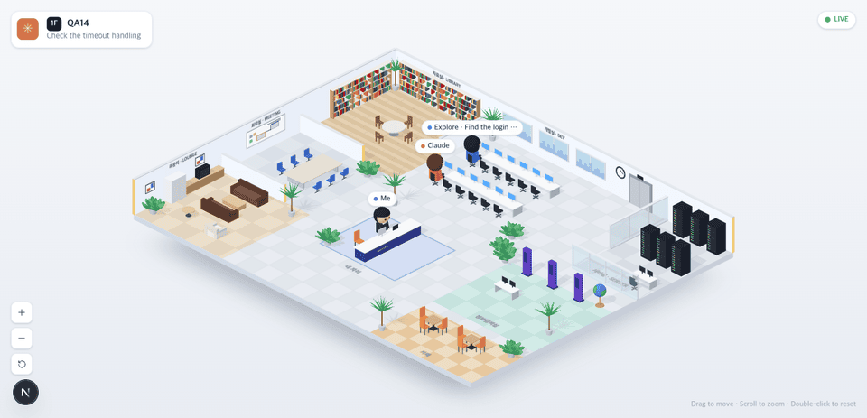
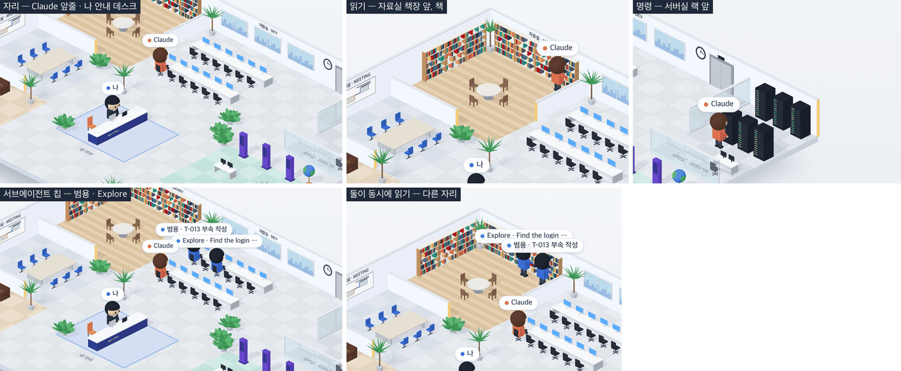

# 14 · 등각 사무실의 사람들

- 브랜치: `feat/14-iso-characters`
- 근거: [근거 문서](../plan/spec.md) 「화면 재설계」 — 화면 구성 표의 캐릭터 행, 방 ↔ 도구 표의 자료실 · 서버실, 「동선 규칙」 1–5
- 검증한 커밋: `f31df70`

## 목표

`/iso` 에 Claude · 나 · 서브에이전트가 2등신 캐릭터로 나온다. 이름 칩을 달고 자리에 앉아 있다가, 읽기 도구가 돌면 자료실로, 명령이 돌면 서버실로 걸어가 일하고 돌아온다.

## 한 일

- **캐릭터** — 큰 둥근 머리 · 머리카락 · 볼 터치 · 작은 몸 · 팔다리로 만든 2등신이다. 키는 벽보다 조금 작은 3.1m 로 영상과 같은 비율이다. Claude 는 산호색 옷 · 갈색 머리, 나는 남색 옷, 서브에이전트는 파란 옷이다. 걸을 때 팔다리를 흔들고, 의자에서는 다리를 앞으로 뻗고, 자료실에서는 책을 든다.
- **자리** — Claude 는 개발실 앞줄의 내 자리 쪽 끝, 나는 안내 데스크 뒤에 앉는다. 서브에이전트는 뒷줄 의자를 하나 건너 하나씩 먼저 채운다. 붙어 앉으면 이름 칩이 겹치기 때문이다.
- **이름 칩** — 캔버스 위에 HTML 로 겹쳐 글자가 또렷하다(CSS2DRenderer). 색 점 + 이름이고, 서브에이전트는 근거 문서대로 「범용 · 작업 제목」이다. `general-purpose` 는 「범용」, 그 밖의 종류(`Explore` 등)는 이름 그대로 쓴다. 칩은 포인터를 막지 않아서 칩 위에서도 드래그된다.
- **길찾기** — 바닥을 0.5m 칸으로 나눠 벽 · 유리 · 가구가 놓인 칸을 막고, 의자는 앉는 자리라 열어 둔다. 2D 사무실의 A* 와 경로 다듬기를 그대로 쓴다. 두 코드가 32px 칸을 가정해서, 1m 를 64 단위로 바꿔 넘긴다.
- **동선** — 근거 문서 「동선 규칙」 1–5 를 따른다. 활동이 시작되면 그 방의 빈 작업 지점으로 걸어가고, 도구가 끝나도 1.5초 머문 뒤 자리로 돌아간다. 걷는 중에 끝나면 도착한 다음 머문다. 다른 도구가 오면 걷는 도중에도 곧바로 방향을 바꾼다. 같은 방에 둘이 오면 다른 지점에 선다.
- **백엔드** — 서브에이전트 종류(`agent_type`)를 에이전트에 남긴다. 훅은 이미 `SubagentStart` 에 실어 보내고 있었다. 프런트 타입을 다시 만들고 스토어로 넘겼다.
- 문구는 4개 언어에 넣었다: 나 · Me · Yo · Eu, 범용 · General · General · Geral.

## 검증

| 단계 | 명령 · 방법 | 결과 |
| --- | --- | --- |
| 정적 검증 | `make checkall` | 통과 — 백엔드 539(새 2) · 프런트 237(새 14) · 훅 73 · 플러그인 34 |
| 실검증 | 헤드리스 Chromium 1280×618(2배) · 한국어. 이벤트를 시각에 맞춰 보내고, 이름 칩의 화면 위치를 바닥 좌표로 되돌려 사람마다 0.1~0.15초 간격으로 쫓았다 | TC 15건 — ✅ 15 |
| 시나리오 | 시뮬레이터 `errands`(사장 · 직원 심부름) · `complex`(직원 넷) | 걷기 · 방 · 자리 모두 기대대로, 콘솔 오류 0 |
| 스모크 회귀 | 기존 2D 사무실 `/`, `/iso` 1920×1200 | 둘 다 뜬다, 콘솔 오류 0 |
| 정리 | QA 로 띄운 프런트 · 백엔드 · 브라우저를 내렸다 | `:3100` · `:8000` 듣는 프로세스 0 |

### 실검증 TC

| TC | 우선순위 | 판정 | 방법 · 근거 |
| --- | --- | --- | --- |
| A-01 자리 | P1 | ✅ | 세션을 열자 Claude 가 (14.3, 9.6) 개발실 앞줄, 내가 (17.4, 19) 안내 데스크 뒤에 앉아 있다 |
| A-02 읽기 → 자료실 | P1 | ✅ | `Read` 시작 3.2초 뒤 자료실 책장 앞 (9.05, 1.4) 에 서서 책을 든다 |
| A-03 1.5초 머무름 | P1 | ✅ | `Read` 가 끝나고 1.2초까지 같은 자리, 1.7초쯤 떠난다 |
| A-04 자리로 돌아오기 | P1 | ✅ | 그 뒤 (14.3, 9.6) 에 다시 앉는다 |
| A-05 명령 → 서버실 | P1 | ✅ | `Bash` 동안 서버실 랙 앞 (35.6, 6.9). 유리벽 선(x 32.3)을 z 7.8 에서 넘는다 — 열린 쪽(z 6.9~11.3)으로 들어갔다 |
| A-06 도중에 방향 바꾸기 | P1 | ✅ | 자료실로 가던 중(x 22.8 → 22.5) 명령이 오자 0.1초 안에 서버실 쪽으로(x 25.4 → 25.8) |
| A-07 같은 방에 둘 | P2 | ✅ | 직원 둘이 동시에 읽자 (9.05, 1.4) · (6.75, 1.4) 서로 다른 책장 앞 |
| B-01 이름 칩 | P1 | ✅ | 한국어 `Claude` · `나` · `범용 · T-013 부속 작성` · `Explore · Find the login code`. 영어는 `Me` |
| B-02 직원 자리 | P2 | ✅ | 직원 둘이 뒷줄 (14.3, 5.2) · (17.3, 5.2) 에 하나 건너 앉는다 |
| B-03 칩 위 드래그 | P2 | ✅ | `Claude` 칩 위에서 끌자 장면이 마우스만큼(120, 48px) 움직였다 |
| B-04 화면 오가기 | P2 | ✅ | `/iso` → `/` → `/iso` 2번 뒤에도 캔버스 1개, 칩은 사람 수만큼 |
| C-01 길찾기 격자 | P1 | ✅ | [unit] 자리 · 작업 지점이 모두 열려 있고 벽 · 책상 · 탁자 · 랙은 막힌다. 경로를 0.1m 간격으로 따라가며 막힌 칸이 없다. 작업 지점 12곳에서 자리 13곳까지 길이 있다 |
| C-02 동선 규칙 | P1 | ✅ | [unit] 6건 — 방으로 가기 · 머무름 뒤 귀가 · 걷던 중 끝나면 도착 뒤 머무름 · 도중 방향 바꾸기 · 같은 방 도구가 다시 오면 머무름 취소 · 할 일 없으면 앉아 있기 |
| C-03 칩 문구 · 사람 목록 | P2 | ✅ | [unit] 3건 + 백엔드 2건(`agent_type` 저장 · 없으면 비움) |
| D-01 콘솔 오류 | P1 | ✅ | 위 실검증 · 두 시나리오 · 스모크 모두 0 |

### 화면

1280×618, 직원 하나가 있는 세션.

자리 · 자료실 · 서버실 · 서브에이전트 칩 · 둘이 동시에 읽기(2배 확대).

## 검증하지 못한 것

- 직원이 다섯 이상이면 칩이 계단처럼 쌓여 서로 일부를 가린다(`complex` 시나리오 넷에서 확인). 영상도 겹치는 칩이 있어서 같은 수준으로 두었다. 셋까지는 하나 건너 앉아서 겹치지 않는다.
- 실제 Claude Code 세션 — 시뮬레이터와 직접 보낸 이벤트로만 봤다. 훅이 `agent_type` 을 보내는 것은 훅 계약 테스트(`backend/tests/test_hooks_contract.py`)가 덮는다.

## 알려진 한계 (버그 아님)

- 끝난 서브에이전트는 백엔드가 퇴근 대기열에 둔다. 2D 사무실이 퇴근 연출을 마치고 정리 이벤트를 보내야 빠진다. 그래서 `/iso` 만 열어 두면 끝난 직원이 자리에 남는다. 2D 화면을 한 번 열자 빠지는 것은 확인했다. `/iso` 의 출퇴근은 19 에서 한다.
- 개발실 · 회의실처럼 아직 활동이 없는 방(편집 · 웹 · 계획 · 질문)은 15 에서 더한다. 말풍선은 16 이다.

## 다음 작업

15 `feat/15-room-activities` — 백엔드 활동 확장(`editing` · `browsing` · `planning` · `asking`) · 도구 표, 방 일곱 곳 동선, 방 효과.
