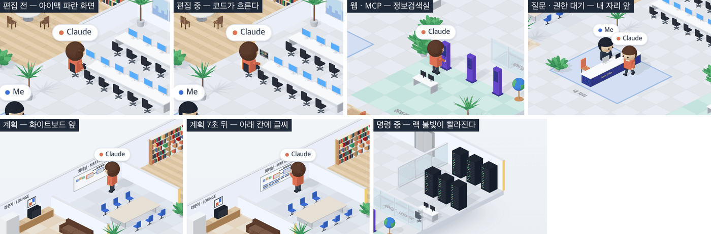

# 15 · 방마다 맡은 일

- 브랜치: `feat/15-room-activities`
- 근거: [근거 문서](../plan/spec.md) 「화면 재설계」 — 작성자 댓글(방마다 맡은 일), 「방 ↔ 도구」 표, 「동선 규칙」 7
- 검증한 커밋: `fca6ce9`

## 목표

작성자 댓글대로 방 여섯 곳이 각자 일을 맡는다. 코드를 고치면 자기 책상 아이맥에 코드가 흐르고, 명령이 도는 동안 서버실 랙 불빛이 빨라지고, 계획을 세우면 회의실 화이트보드에 적는다. 웹 · MCP 는 정보검색실, 질문과 권한 대기는 내 자리로 찾아온다.

## 한 일

- **백엔드 활동 넷 추가** — 근거 문서 「방 ↔ 도구」 표대로 도구를 나눴다. 이름은 에이전트 공통으로 대소문자 없이 맞춘다.
  - `editing`: `Edit` · `Write` · `MultiEdit` · `NotebookEdit` · `patch` · `replace` · `write_file` · `apply_patch`
  - `browsing`: `WebFetch` · `WebSearch` · `web_fetch` · `google_web_search`, 그리고 `mcp__` 로 시작하는 도구 전부. 웹 도구는 읽기에서 옮겼다
  - `planning`: `TodoWrite` · `EnterPlanMode` · `ExitPlanMode` · `Skill` · `write_todos` · `update_plan`
  - `asking`: `AskUserQuestion` · `request_user_input` · `ask_user`
  - 새 활동마다 도구 말풍선 아이콘과 화이트보드 통계 분류를 정했다. 아이콘이 따로 없는 도구는 활동 아이콘을 쓴다. 그래서 `TodoWrite` 는 ⚙️ 대신 📋, Gemini 의 `replace` 는 📝 가 된다.
- **등각 사무실 동선** — 정보검색실은 키오스크 · 책상 · 지구본 앞 다섯 자리, 회의실은 화이트보드 앞 네 자리, 내 자리는 안내 데스크 앞 네 자리다.
  - 편집은 자기 책상에서 한다. 다른 방에 있다가 편집이 시작되면 머물지 않고 곧장 돌아와 타자를 친다.
  - 권한을 기다리면 질문과 같이 내 자리로 온다(근거 문서 「내 자리 — AskUserQuestion, 권한 대기」).
  - 도구가 실패하면 그 자리에 남는다(동선 규칙 7). 다음 도구나 다음 턴에 다시 움직인다.
- **방 효과** — 개발실 · 서버실 · 회의실에서 일하는 모습이 방에 보인다.
  - 편집하는 사람의 아이맥이 파란 화면에서 흐르는 코드로 바뀐다.
  - 명령이 도는 동안 랙 불빛이 6배쯤 빨리 깜빡인다.
  - 계획하는 동안 화이트보드 아래 칸에 손글씨 세 줄이 8초에 걸쳐 채워진다. 다 찬 보드에 새 계획이 오면 지우고 다시 쓴다. 칸을 비우려고 보드의 메모 · 상자를 위쪽으로 옮겼다.
- **자세** — 타자(앉아서 손 움직임), 키오스크 만지기, 보드에 쓰기(오른팔), 내 자리에서 말하기를 더했다. 회의실에서는 보드 오른쪽 끝에 먼저 서서 보드를 덜 가린다.
- 기존 2D 사무실은 읽기 · 명령에만 움직인다. 새 활동이 와도 자리에 있어서 동작이 그대로다.

## 검증

| 단계 | 명령 · 방법 | 결과 |
| --- | --- | --- |
| 정적 검증 | `make checkall` | 통과 — 백엔드 557(새 18) · 프런트 244(새 7) · 훅 73 · 플러그인 34 |
| 실검증 | 헤드리스 Chromium 1280×618(2배). 도구 이벤트를 시각에 맞춰 보내고, Claude 이름 칩의 화면 위치를 바닥 좌표로 되돌려 쫓았다. 랙은 60ms 간격 캡처 12장의 픽셀 변화로 쟀다 | TC 12건 — ✅ 12 |
| 스모크 회귀 | 기존 2D 사무실 `/`, `/iso` 1920×1200 | 둘 다 뜬다, 콘솔 오류 0 |
| 정리 | QA 로 띄운 프런트 · 백엔드 · 브라우저를 내렸다 | `:3100` · `:8000` 듣는 프로세스 0 |

### 실검증 TC

| TC | 우선순위 | 판정 | 방법 · 근거 |
| --- | --- | --- | --- |
| A-01 편집은 자리에서 | P1 | ✅ | `Edit` 동안 Claude 가 (14.3, 9.6) 자리에서 타자를 친다 |
| A-02 아이맥 코드 | P1 | ✅ | 같은 때 Claude 앞 아이맥이 흐르는 코드 화면, `Edit` 이 끝나자 파란 화면(아래 그림) |
| A-03 웹 → 정보검색실 | P1 | ✅ | `WebFetch` 시작 5.5초 뒤 키오스크 앞 (30.4, 16) |
| A-04 MCP → 정보검색실 | P2 | ✅ | `mcp__github__get_issue` 가 바로 이어 와서 정보검색실에 그대로 머문다 |
| A-05 계획 → 회의실 | P1 | ✅ | `TodoWrite` 시작 7.4초 뒤 화이트보드 오른쪽 끝 (1.3, 14) |
| A-06 화이트보드 글씨 | P1 | ✅ | 도착 때는 빈 아래 칸, 7초 뒤 손글씨 줄이 차 있다(아래 그림) |
| A-07 질문 → 내 자리 | P1 | ✅ | `AskUserQuestion` 시작 6.0초 뒤 안내 데스크 앞 (20.4, 19), 나를 보고 선다 |
| A-08 권한 대기 → 내 자리 | P1 | ✅ | `Bash` 뒤 권한 요청이 오자 1.5초 만에 안내 데스크 앞 |
| A-09 실패하면 그 자리 | P1 | ✅ | 자료실에서 `Read` 가 실패하고 4초 뒤에도 (9.05, 1.4) — 머무는 1.5초가 지나도 안 돌아간다. 다음 턴이 시작되자 자리로 |
| A-10 랙 불빛 | P1 | ✅ | 60ms 간격 프레임 사이 바뀐 픽셀 — 평소 1091, 명령 중 6571(6.0배) |
| B-01 도구 표 · 아이콘 · 분류 | P1 | ✅ | [unit] 백엔드 도구 19개의 활동, 활동 없는 도구 5개, 말풍선 아이콘(`TodoWrite` 📋 · `replace` 📝) |
| B-02 동선 규칙 · 지점 | P1 | ✅ | [unit] 활동 4종의 방, 편집은 머물지 않고 자리로, 실패하면 제자리, 권한 대기는 질문. 새 지점 13곳이 모두 열려 있고 모든 자리에서 닿는다 |

### 화면

편집 전후 아이맥 · 정보검색실 · 내 자리 · 화이트보드 글씨 전후 · 명령 중 서버실(2배 확대).

## 검증하지 못한 것

- 실제 Claude Code 세션 — 시뮬레이터처럼 직접 보낸 이벤트로만 봤다. 도구 이름은 근거 문서 표(각 에이전트의 도구 이름)를 옮겼고, 훅이 도구 이름을 그대로 넘기는 것은 06 · 09 의 실세션에서 확인했다.
- 계획 도구 중 `EnterPlanMode` · `Skill` · Codex 의 `update_plan` 은 단위 테스트로만 봤다. 화면 동작은 `TodoWrite` 와 같은 길이다.

## 알려진 한계 (버그 아님)

- 근거 문서 「방 ↔ 도구」 의 「읽기만 하는 셸 명령 → 자료실」 은 10(Codex) 브랜치에 이미 커밋이 있어서 그쪽에서 들인다.
- 고민 포즈(턱 괴기) · 식은땀 · 빨간 말풍선은 16 이다. 지금은 실패하면 그 자리에 서 있기만 한다.

## 다음 작업

16 `feat/16-iso-bubbles` — 「💭 고민 중」 말풍선, 흰 말풍선(답 · 생각 요약), 도구 말풍선, 실패하면 식은땀과 빨간 말풍선.
