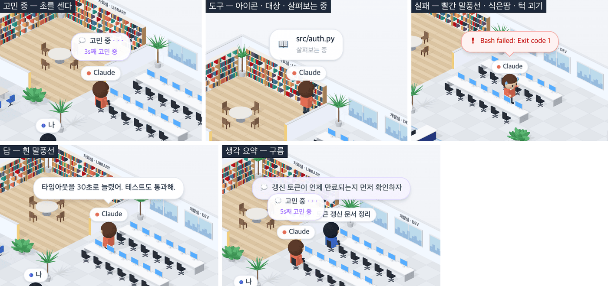

# 16 · 말풍선

- 브랜치: `feat/16-iso-bubbles`
- 근거: [근거 문서](../plan/spec.md) 「화면 재설계」 — 화면 구성 표의 캐릭터 행, 작성자 댓글(생각 요약 구름 · 실패하면 식은땀과 빨간 말풍선), R3
- 검증한 커밋: `2f3d0dc`

## 목표

등각 사무실의 사람마다 말풍선이 뜬다. 생각 중이면 「💭 고민 중 · · ·」과 「Ns째 고민 중」, 도구를 쓰면 아이콘과 대상 아래 「살펴보는 중」, 생각 요약은 구름, 한 말은 흰 말풍선이다. 도구가 실패하면 그 자리에 멈춰 식은땀을 흘리며 빨간 말풍선을 띄운다.

## 한 일

- **말풍선 고르기** — 한 사람에 하나만 띄운다. 앞의 것이 이긴다(`systems/officeBubbles.ts`).
  1. 실패한 도구로 멈춘 동안: 빨간 말풍선(백엔드의 「Bash failed: Exit code 1」)
  2. 도구가 도는 동안: 도구 아이콘 + 대상 + 「살펴보는 중」. 권한 대기(내 자리로 온 경우)는 둘째 줄 없이
  3. 생각 요약(💭, 대화 기록에서 오는 것): 구름 말풍선, 8초
  4. 한 말: 흰 말풍선, 8초
  5. 일하는 중인데 도구가 없으면: 「💭 고민 중 · · ·」 + 「Ns째 고민 중」. 초는 생각이 시작된 때부터 센다
- 사장 말풍선의 📞 아이콘은 내 질문(턴 시작)과 Claude 의 답(턴 끝) 둘 다에 붙는다. 생각 중인 턴의 📞 는 내 질문이라 Claude 입에 넣지 않는다.
- **멈춤 · 식은땀 · 턱 괴기** — 도구가 실패하면 걷던 중이어도 그 자리에 선다(동선 규칙 7). 오른손으로 턱을 괴고, 머리 양옆에서 식은땀 방울이 흘러내린다. 다음 도구나 다음 턴에 다시 움직인다.
- **모양** — 말풍선은 캔버스 위 HTML 이라 글자가 또렷하다. 이름 칩 바로 위에 뜨고, 흰 말풍선 · 구름 · 빨간 말풍선은 꼬리가 사람을 가리킨다. 세션에서 온 글자는 `textContent` 로만 넣는다.
- **/iso 에서 말풍선이 흐르게** — 2D 사무실의 말풍선 넘김과 직원 도착 걷기는 /iso 에서 돌지 않는다. 그래서 두 가지를 /iso 가 맡는다.
  - 쌓인 말풍선은 바로 넘겨 최신 것을 쓴다.
  - 새 서브에이전트는 곧바로 자리에 앉힌다. 2D 사무실 규칙상 직원은 책상에 있어야 말풍선을 받는다. 엘리베이터 출근은 19 에서 한다.
- 문구 「고민 중」 · 「{seconds}s째 고민 중」 · 「살펴보는 중」을 4개 언어에 넣었다.

## 검증

| 단계 | 명령 · 방법 | 결과 |
| --- | --- | --- |
| 정적 검증 | `make checkall` | 통과 — 백엔드 557 · 프런트 254(새 10) · 훅 73 · 플러그인 34 |
| 실검증 | 헤드리스 Chromium 1280×618(2배) · 한국어. 이벤트를 시각에 맞춰 보내고, 말풍선 글자를 같은 자리의 이름 칩과 짝지어 읽었다 | TC 12건 — ✅ 12 |
| 스모크 회귀 | 기존 2D 사무실 `/`, `/iso` 1920×1200 · 390×844 | 셋 다 뜬다, 페이지 스크롤 없음, 콘솔 오류 0 |
| 정리 | QA 로 띄운 프런트 · 백엔드 · 브라우저를 내렸다 | `:3100` · `:8000` 듣는 프로세스 0 |

### 실검증 TC

| TC | 우선순위 | 판정 | 방법 · 근거 |
| --- | --- | --- | --- |
| A-01 고민 중 | P1 | ✅ | 프롬프트 3.3초 뒤 Claude 위 「💭 고민 중 · · · / 3s째 고민 중」 |
| A-02 도구 | P1 | ✅ | `Read` 동안 「📖 src/auth.py / 살펴보는 중」 |
| A-03 다시 고민 | P1 | ✅ | `Read` 가 끝나고 1.2초 뒤 「1s째 고민 중」 — 초를 처음부터 다시 센다 |
| A-04 실패 | P1 | ✅ | `Bash` 가 실패하자 빨간 「❗ Bash failed: Exit code 1」, 3초 뒤에도 그대로 |
| A-05 멈춤 · 식은땀 · 턱 괴기 | P1 | ✅ | 서버실로 걷던 중 실패하자 그 자리에 서서 턱을 괴고 식은땀(아래 그림) |
| A-06 다음 턴 | P2 | ✅ | 새 프롬프트 1.5초 뒤 실패 말풍선이 사라지고 「1s째 고민 중」 |
| A-07 답 | P1 | ✅ | 턴이 끝나자 흰 말풍선 「타임아웃을 30초로 늘렸어. 테스트도 통과해.」, 9초 뒤 사라짐 |
| A-08 직원 고민 중 | P1 | ✅ | 서브에이전트가 나타나 3.5초 뒤 그 위에 「3s째 고민 중」 |
| A-09 생각 요약 구름 | P1 | ✅ | `agent_update` 의 💭 생각이 그 직원 위에 구름으로 「갱신 토큰이 언제 만료되는지 먼저 확인하자」 |
| B-01 고르기 규칙 | P1 | ✅ | [unit] 8건 — 아무것도 없을 때 · 도구 · 권한 대기 · 실패 우선 · 구름과 흰 말풍선의 8초 · 내 질문 거르기 · 턴 끝 답 · 초 세기 |
| B-02 멈춤 규칙 | P1 | ✅ | [unit] 걷던 중 실패하면 그 자리에 멈춘다 |
| B-03 생각 중 판정 | P2 | ✅ | [unit] 사장은 턴 중 조용할 때, 직원은 일하는 중(도착 · 자리로 가는 중 포함)에 도구가 없을 때 |

### 화면

고민 중 · 도구 · 실패 · 답 · 생각 요약(2배 확대).

## 검증하지 못한 것

- 실제 Claude Code 세션의 생각 요약 · 한 말 — 대화 기록을 읽는 백엔드 기능이 만드는 말풍선이라 같은 모양의 이벤트(`agent_update`)를 직접 보내 확인했다.
- 말풍선끼리 겹침 — 사람이 붙어 있으면 말풍선과 이름 칩이 서로 가린다. 영상도 겹치는 말풍선이 있어서 같은 수준으로 두었다.

## 알려진 한계 (버그 아님)

- 사장 말풍선의 📞 은 내 질문과 답 둘 다라서, 「생각 중인 턴」인지로 가른다. 턴이 끝난 뒤의 📞 만 답으로 띄운다.
- 서브에이전트가 /iso 에서는 엘리베이터 없이 바로 자리에 나타난다. 출퇴근은 19 다.

## 다음 작업

17 `feat/17-iso-panels` — 오른쪽 프로젝트 · 세션 카드, 「사무실 사람들」, 「활동 로그」, 「어디서 무엇을 하나」.
