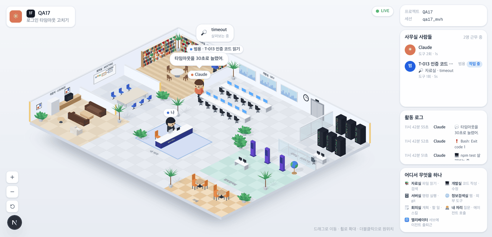

# 17 · 오른쪽 패널

- 브랜치: `feat/17-iso-panels`
- 근거: [근거 문서](../plan/spec.md) 「화면 재설계」 — 화면 구성 표의 오른쪽 행, 구현 방침(레이아웃 · 문구는 영상을 따른다)
- 검증한 커밋: `8b28606`

## 목표

등각 사무실 오른쪽에 영상과 같은 패널 넷이 선다. 프로젝트 · 세션, 「사무실 사람들」, 「활동 로그」, 「어디서 무엇을 하나」다. 누가 어디서 무엇을 하는지 장면을 보지 않고도 읽힌다.

## 한 일

- **프로젝트 · 세션** — 프로젝트 경로(없으면 이름)와 세션 id 앞 8자.
- **사무실 사람들** — Claude 와 서브에이전트(나는 빼고)를 「N명 근무 중」과 함께 보인다. 한 줄에 아래가 다 있다.
  - 동그란 아바타: Claude 는 ✳, 서브에이전트는 종류의 첫 글자(「범」)
  - 이름과 종류: Claude · Claude, 「T-013 인증 코드 읽기」 · 범용
  - 상태 알약: 도구 중이면 「작업 중」, 생각 중이거나 실패로 멈췄으면 「고민 중」
  - 지금 하는 일: 「📖 자료실 · src/auth.py」, 「💭 고민 중...」, 실패면 「❗ Bash failed: Exit code 1」
  - 「도구 N회 · Ns」: 이 세션에서 쓴 도구 수와 지금 상태가 이어진 초
- **활동 로그** — 시각(「11시 42분 55초」) · 누구 · 무엇을 최신순으로 40줄까지 보인다. 「무엇」은 말풍선과 같은 말이다.
  - 도구: 「📖 src/auth.py 살펴보는 중」
  - 실패: 「❗ Bash: Exit code 1」
  - 내 질문: 「📞 …」, 누구는 「나」
  - 턴 끝 답: 「💬 …」
  - 생각 요약: 「💭 …」
  - 잘 끝난 도구와 세션 시작 · 끝 같은 기록은 뺀다.
- **어디서 무엇을 하나** — 방 일곱 곳을 두 줄로 보인다. 자료실 「파일 읽기 · 검색」, 개발실 「코드 작성 · 수정」, 서버실 「명령 실행 · git」, 정보검색실 「웹 · 외부 도구」, 회의실 「계획 · 할 일 · 스킬」, 내 자리 「질문 · 에이전트 호출」, 엘리베이터 「서브에이전트 출퇴근」(영상 문구 그대로).
- **배치** — 패널은 폭 240px 의 오른쪽 기둥이다. 장면은 남은 자리에 맞춰 다시 맞춘다. 1024px 보다 좁으면 패널을 숨긴다. 사람 · 로그 칸은 3 : 2 로 나누고 각자 안에서 스크롤한다.
- **백엔드** — 턴을 끝내는 답은 STOP 의 `speech_content` 로 와서 이벤트 로그에 안 남았다. 그 답을 이벤트 세부의 `message` 로 싣는다.
- 문구 23개(패널 제목 · 방 이름 · 방 설명)를 4개 언어에 넣었다.

## 검증

| 단계 | 명령 · 방법 | 결과 |
| --- | --- | --- |
| 정적 검증 | `make checkall` | 통과 — 백엔드 557 · 프런트 258(새 4) · 훅 73 · 플러그인 34 |
| 실검증 | 헤드리스 Chromium 1280×618(2배) · 한국어, 1600×1100 · 영어, 390×844. 이벤트를 시각에 맞춰 보내고 패널 글자를 읽었다 | TC 11건 — ✅ 11 |
| 스모크 회귀 | 기존 2D 사무실 `/` 와 지휘 센터(세션 셋) | 둘 다 열린다, 콘솔 오류 0 |
| 정리 | QA 로 띄운 프런트 · 백엔드 · 브라우저를 내렸다 | `:3100` · `:8000` 듣는 프로세스 0 |

### 실검증 TC

| TC | 우선순위 | 판정 | 방법 · 근거 |
| --- | --- | --- | --- |
| A-01 프로젝트 · 세션 | P2 | ✅ | 「프로젝트 QA17 / 세션 qa17_mvh」 |
| A-02 생각 중 | P1 | ✅ | 프롬프트 뒤 「✳ Claude 고민 중 💭 고민 중... 도구 0회 · 1s」 |
| A-03 도구 중 | P1 | ✅ | `Read` 동안 「작업 중 📖 자료실 · src/auth.py 도구 1회」 |
| A-04 직원 · 실패 | P1 | ✅ | 「2명 근무 중」. 서브에이전트는 「범 T-013 인증 코드 읽기 범용 작업 중 🔎 자료실 · timeout」. 실패한 Claude 는 「고민 중 ❗ Bash failed: Exit code 1 도구 2회」 |
| A-05 초 세기 | P2 | ✅ | 같은 상태가 이어지는 동안 서브에이전트가 3s → 5s 로 올라간다 |
| A-06 활동 로그 | P1 | ✅ | 최신순으로 「💬 타임아웃을 30초로 늘렸어.」 · 「❗ Bash: Exit code 1」 · 「💻 npm test 살펴보는 중」 · … · 「나 📞 로그인 타임아웃 고치기」 |
| A-07 긴 로그 | P2 | ✅ | 도구 30개를 더 보내도 로그 칸 안에서만 스크롤한다(36줄), 페이지는 스크롤하지 않는다 |
| A-08 범례 | P2 | ✅ | 방 일곱 곳과 영상 문구 |
| A-09 영어 | P2 | ✅ | People in the office · 2 at work · Activity log · Who works where, 방 이름 · 설명도 영어 |
| A-10 화면 맞춤 | P1 | ✅ | 1280×618 에서 장면 오른쪽 끝(1040px)이 패널 왼쪽 끝(1040px)과 맞닿는다. 페이지 스크롤 없음 |
| A-11 폰 | P2 | ✅ | 390×844 에서 패널이 숨고 가로 스크롤 없음 |

### 화면

1280×618 — 장면 · 머리말 · LIVE · 오른쪽 패널.

## 검증하지 못한 것

- 실제 Claude Code 세션 — 직접 보낸 이벤트로만 봤다.
- 사람이 아주 많을 때의 모습 — 시뮬레이터 `complex`(직원 넷)까지만 봤다. 칸 안 스크롤은 로그 칸으로 확인했다.

## 알려진 한계 (버그 아님)

- 「도구 N회」는 화면이 받은 이벤트 로그(최근 500건)에서 센다. 아주 긴 세션에서는 실제보다 적게 나올 수 있다.
- 「Ns」는 화면이 지금 상태를 처음 본 때부터 센다. 페이지를 새로 열면 0 부터 다시 센다.
- 왼쪽 층별 안내는 18 이다. 그 전까지는 장면이 왼쪽까지 넓게 쓴다.

## 다음 작업

18 `feat/18-floor-guide` — 왼쪽 「층별 안내」: 프로젝트 = 층, 세션 목록, 자동 따라가기, 「오래 쉰 층 더 보기」, 층 이동 때 「▲ 3F」 표시.
