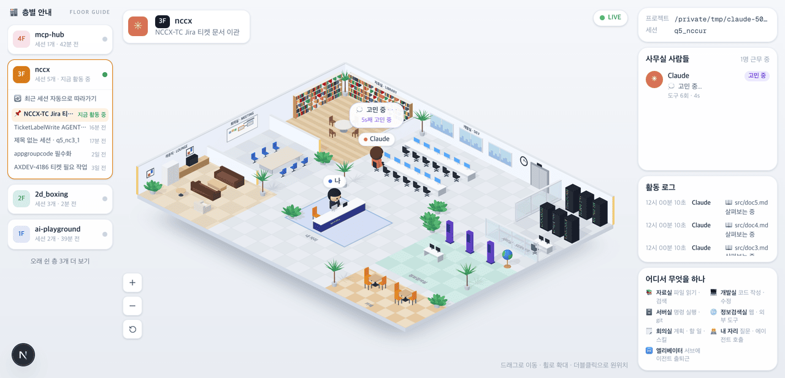
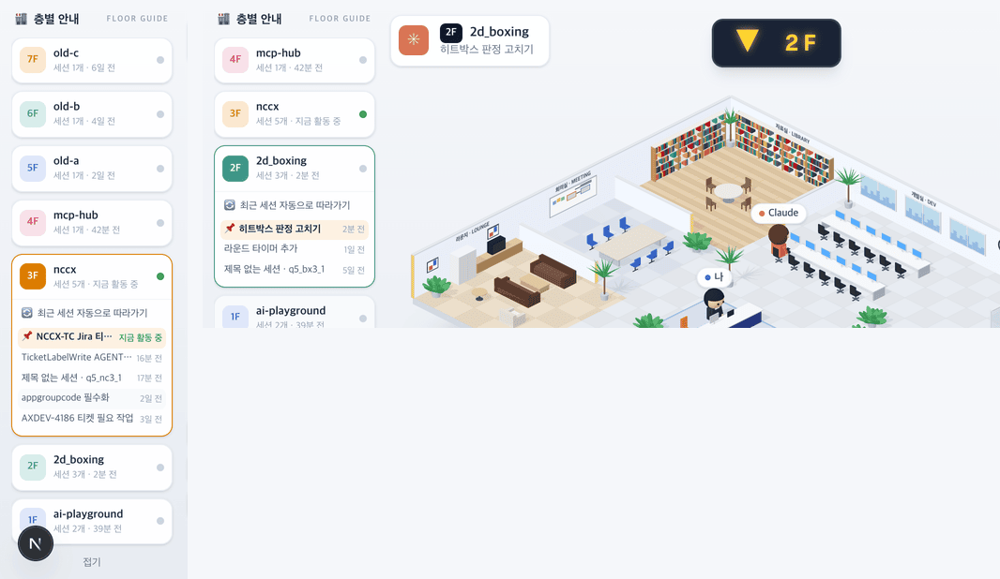

# 18 · 층별 안내

- 브랜치: `feat/18-floor-guide`
- 근거: [근거 문서](../plan/spec.md) 「화면 재설계」 — 작성자 댓글(층 · 매장 · 초록불 · 「▲ 3F」 · /clear 따라가기), 화면 구성 표의 왼쪽 행
- 검증한 커밋: `c6d8c6a`

## 목표

등각 사무실 왼쪽에 백화점 층별 안내가 선다. 프로젝트가 층이고 그 층의 세션이 매장이다. 지금 일하는 층엔 초록불이 켜지고, 층을 누르면 「▲ 3F」 표시등이 뜨면서 그 층 사무실로 간다. /clear 하면 같은 층의 새 세션으로 알아서 따라간다.

## 한 일

- **층 카드** — 프로젝트마다 카드 하나를 높은 층부터 쌓는다. 층 번호는 먼저 본 프로젝트가 1F 다(머리말 층 배지와 같은 규칙).
  - 배지: 1F 파랑 · 2F 청록 · 3F 주황 · 4F 분홍(영상 색). 보고 있는 층은 배지를 채우고 테두리를 같은 색으로 두른다.
  - 「세션 31개 · 지금 활동 중」, 쉬는 층은 「세션 1개 · 42분 전」. 일하는 층엔 초록 점, 나머지는 회색 점.
- **펼친 층** — 보고 있는 층만 펼친다.
  - 「🔄 최근 세션 자동으로 따라가기」 스위치. 원래 있던 「새 세션 자동으로 따라가기」 설정을 켜고 끈다.
  - 세션 목록(최신순): 보고 있는 세션은 「📌」와 옅은 주황 바탕. 일하는 세션은 초록 「지금 활동 중」, 나머지는 「16분 전」 · 「2일 전」.
  - 세션 이름은 직접 붙인 이름, 없으면 첫 질문의 첫 줄, 그것도 없으면 「제목 없는 세션 · ef13b3cc」.
- **층 이동** — 다른 층 카드를 누르면 그 층에서 일하는 세션(없으면 최신 세션)으로 간다.
  - 장면 위에 「▲ 4F」(내려가면 「▼ 2F」) 표시등이 1.6초 떴다 사라진다.
  - 같은 층의 다른 세션은 표시등 없이 바로 바뀐다. 머리말의 층 · 프로젝트 · 세션 이름도 따라 바뀐다.
- **오래 쉰 층** — 한 시간 넘게 쉰 층은 「오래 쉰 층 N개 더 보기」 아래로 접는다. 누르면 펼치고 「접기」로 다시 접는다. 보고 있는 층과 일하는 층은 접지 않는다.
- **지금 활동 중** — 열린 세션이 2분 안에 이벤트를 보냈으면 「지금 활동 중」이다. 끝 신호 없이 꺼진 세션은 백엔드가 48시간 뒤 다음 시작 때 닫을 때까지 열린 채로 남는다. 그래서 상태만 보면 오래 쉰 층에도 초록불이 켜진다.
- **백엔드** — 세션 목록에 `title`(첫 질문의 첫 줄, 공백 정리, 80자)을 싣는다. 머리말의 세션 이름도 이것을 쓴다.
- **말풍선 수정** — 질문과 Claude 의 답은 둘 다 📞 말풍선이라 16 에서는 「아직 생각 중인가」로 갈랐다. 그런데 질문 직후 끝난 세션으로 가면 그 질문이 Claude 의 말처럼 떴다. 백엔드는 답만 「계속 표시」로 보내므로 그 표시로 가른다.
- 영어 문구가 「1 sessions」 · 「1 tools」로 나오던 것을 단수형으로 고쳤다.
- 문구 8개(층 안내 제목 · 세션 수 · 지금 활동 중 · 따라가기 · 제목 없는 세션 · 더 보기 · 접기)를 4개 언어에 넣었다.

## 검증

| 단계 | 명령 · 방법 | 결과 |
| --- | --- | --- |
| 정적 검증 | `make checkall` | 통과 — 백엔드 559(새 2) · 프런트 262(새 4) · 훅 73 · 플러그인 34 |
| 실검증 | 헤드리스 Chromium 1280×618(2배) · 한국어, 1600×1100 · 영어, 390×844. 프로젝트 7개 · 세션 14개를 이벤트로 만들고, 며칠 전 세션은 QA 전용 DB 에서 시각을 당겼다 | TC 16건 — ✅ 16 |
| 스모크 회귀 | 기존 2D 사무실 `/`(세션 목록) 와 지휘 센터 | 둘 다 열린다, 콘솔 오류 0 |
| 정리 | QA 로 띄운 프런트 · 백엔드 · 브라우저를 내렸다 | `:3100` · `:8000` 듣는 프로세스 0 |

### 실검증 TC

| TC | 우선순위 | 판정 | 방법 · 근거 |
| --- | --- | --- | --- |
| A-01 층 카드 | P1 | ✅ | 「🏬 층별 안내 FLOOR GUIDE」 아래 4F mcp-hub · 3F nccx · 2F 2d_boxing · 1F ai-playground. 3F 만 「세션 5개 · 지금 활동 중」과 초록 점, 4F 는 「세션 1개 · 42분 전」 |
| A-02 펼친 층 | P1 | ✅ | 3F 만 열리고 테두리가 주황(`rgb(220, 125, 0)`). 「🔄 최근 세션 자동으로 따라가기」 아래 「📌 NCCX-TC Jira 티켓 문서 이관 지금 활동 중」 · 「TicketLabelWrite AGENT 작성 16분 전」 · 「제목 없는 세션 · …」 · 「appgroupcode 필수화 2일 전」 · 「AXDEV-4186 티켓 필요 작업 3일 전」 |
| A-03 내려가기 | P1 | ✅ | 2F 카드를 누르자 「▼ 2F」. 머리말이 「2F 2d_boxing 히트박스 판정 고치기」, 2F 가 열리고 📌 가 그 층 최신 세션으로 간다. 2.4초 뒤 표시등이 사라진다 |
| A-04 올라가기 | P1 | ✅ | 4F 를 누르자 「▲ 4F」. 이름 없는 세션이라 머리말엔 id 앞 8자 |
| A-05 일하는 세션으로 | P2 | ✅ | 3F 로 돌아가자 「▼ 3F」. 최신 세션이 아니라 지금 일하는 세션으로 들어간다 |
| A-06 같은 층 세션 | P1 | ✅ | 같은 층의 다른 세션을 누르자 표시등 없이 바뀐다. 📌 와 머리말 이름이 따라간다 |
| A-07 오래 쉰 층 | P1 | ✅ | 「오래 쉰 층 3개 더 보기」를 누르자 7F old-c 부터 7장, 「접기」를 누르자 다시 4장 |
| A-08 따라가기 스위치 | P2 | ✅ | 끄자 `aria-checked=false` 이고 설정에 `auto_follow_new_sessions=false` 가 저장됐다. 다시 켜자 `true` |
| A-09 /clear 따라가기 | P1 | ✅ | 같은 층에 새 세션이 열리자 그 세션으로 넘어간다. 머리말 「새 세션 이어서 작업」, 📌 이동, 「세션 6개」. 표시등은 뜨지 않는다 |
| A-10 끝난 세션의 말풍선 | P1 | ✅ | 질문 직후 끝난 2F 세션에 들어가도 Claude 위에 질문이 뜨지 않는다(장면 글자 「Claude 나」뿐). 턴 끝 답 「답장 테스트입니다」는 뜬다 |
| A-11 영어 | P2 | ✅ | 「Floor guide · DIRECTORY」, 「1 session · 42 minutes ago」, 「Follow the latest session」, 「3 more quiet floors」 |
| A-12 화면 맞춤 | P1 | ✅ | 1280×618 에서 층 안내 오른쪽 끝(184px) = 장면 왼쪽 끝, 장면 오른쪽 끝(1040px) = 오른쪽 패널. 페이지 스크롤 없음 |
| A-13 폰 | P2 | ✅ | 390×844 에서 양쪽 패널이 숨고 가로 스크롤 없음 |
| B-01 층 규칙 | P1 | ✅ | [unit] 6건 — 층 번호 · 최신순 · 지금 활동 중(열린 세션 + 2분) · 세션 이름 우선순위 · 오래 쉰 층(1시간) |
| B-02 세션 제목 API | P1 | ✅ | [unit] 2건 — 첫 질문의 첫 줄, 공백 정리, 80자 자르기, 빈 질문은 제목 없음 |
| B-03 질문과 답 가르기 | P1 | ✅ | [unit] 답 없이 끝난 세션의 질문을 Claude 말로 띄우지 않는다. 고친 줄을 되돌리면 이 테스트가 실패한다 |

### 화면

1280×618 — 층별 안내 · 장면 · 오른쪽 패널.

왼쪽: 「오래 쉰 층 3개 더 보기」를 펼친 모습. 오른쪽: 2F 로 내려가는 순간의 「▼ 2F」.

## 발견 사항

- 16 의 말풍선 규칙이 질문 직후 끝난 세션에서 질문을 Claude 의 말로 띄웠다. 층 이동으로 끝난 세션에 자주 들어가게 되면서 드러났다. 이 브랜치에서 고쳤다(A-10 · B-03).

## 검증하지 못한 것

- 실제 Claude Code 의 /clear — 같은 프로젝트에 새 세션이 열리는 이벤트를 직접 보내 확인했다.
- 세션이 아주 많을 때 — 한 층 세션 5~6개, 층 7개까지 봤다. 목록은 층 카드 안에서 스크롤한다(최대 화면 높이의 42%).

## 알려진 한계 (버그 아님)

- 1024px 보다 좁으면 층 안내도 숨어서 폰에서는 세션을 바꿀 수 없다. 기본 화면을 바꾸는 20 에서 다룬다.
- 사용자의 답을 기다리는 세션은 2분이 지나면 「지금 활동 중」 대신 「N분 전」이 된다.
- 질문 전에 끝난 세션은 이름이 「제목 없는 세션 · id」다. `EVENT_RETENTION_DAYS` 로 오래된 이벤트를 지우면 그 세션의 이름도 함께 사라진다(기본값은 지우지 않는다).
- 층 번호는 프로젝트를 처음 본 순서라, 세션이 정리되면 번호가 당겨질 수 있다.

## 다음 작업

19 `feat/19-subagent-lifecycle` — 서브에이전트: Claude 가 전화 → 엘리베이터 출근, 종류별 옷(Explore 초록 · 모자, Plan 보라 · 안경), 끝나면 Claude 옆에서 보고 → 「👋 퇴근합니다!」 → 엘리베이터.
