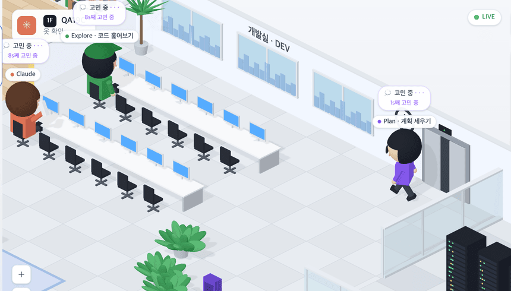
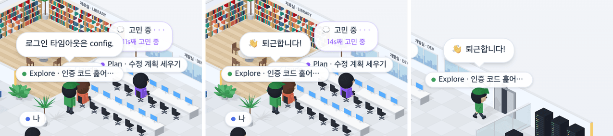
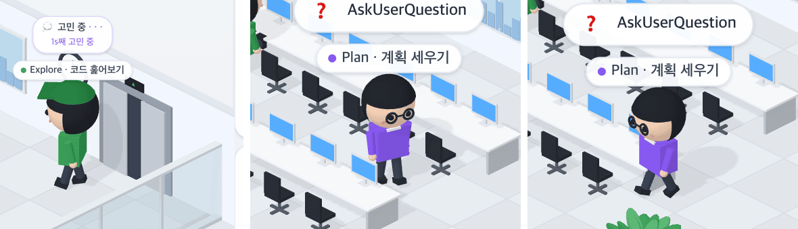

# 19 · 서브에이전트 출퇴근

- 브랜치: `feat/19-subagent-lifecycle`
- 근거: [근거 문서](../plan/spec.md) 「화면 재설계」 — 작성자 댓글(전화 · 엘리베이터 출근 · Explore 초록 옷에 모자 · Plan 보라 옷에 안경 · Claude 옆에서 보고 · 「👋 퇴근합니다!」 · 보고하러 가다 일을 받으면 다시 일하러)
- 검증한 커밋: `1413c7b` (테스트 보강 `c691af1`)

## 목표

Claude 가 일을 맡기면 자기 자리에서 전화를 걸고, 새 에이전트가 엘리베이터를 타고 출근한다. 일이 끝나면 Claude 옆으로 와서 결과를 보고하고 「👋 퇴근합니다!」 하고 엘리베이터로 사라진다. 보고하러 가다 일을 하나 더 받으면 다시 일하러 돌아간다.

## 한 일

- **출근** — 백엔드가 막 만든 직원(도착 중 · 자리로 가는 중)은 엘리베이터 안에서 시작한다. 문이 열리면 걸어 나와 자기 자리로 가고, 첫 도구가 있으면 그 방으로 바로 간다.
  - 같은 때 Claude 는 자리에서 3초 동안 왼손으로 하얀 전화기를 귀에 댄다.
  - 엘리베이터 안에 있는 동안은 이름 칩과 말풍선을 숨긴다.
- **퇴근** — 일이 끝난 직원(SUBAGENT_STOP 이 대기로 바꾼다)은 아래 순서로 움직인다.
  1. Claude 의자 뒤로 걸어간다. 가는 동안은 말풍선이 없다.
  2. Claude 쪽을 보고 서서 결과(백엔드가 대화 기록에서 뽑은 답)를 3.5초 말풍선으로 보고한다. 답이 없으면 그 자리에서 「👋 퇴근합니다!」만 띄운다.
  3. 「👋 퇴근합니다!」 하고 손을 흔든다(1.8초).
  4. 그 말풍선을 단 채 엘리베이터로 걸어가고, 문이 열리면 안으로 들어가 사라진다.
  5. 사라지면 세션의 사무실에서도 빠져 오른쪽 「사무실 사람들」 수가 준다.
- **다시 일하러** — 퇴근 길에 같은 직원이 다시 일을 받으면 돌아선다. 엘리베이터에 들어서던 중이면 먼저 걸어 나온다.
- **옷** — Explore 는 초록 옷에 초록 모자, Plan 은 보라 옷에 동그란 안경, 나머지는 지금처럼 파란 옷이다. 이름 칩의 점과 오른쪽 패널 아바타도 같은 색이다(Explore 「E」 초록, Plan 「P」 보라).
- **보고 자리** — Claude 의자 뒤, 카메라 쪽에 세 자리를 둔다. 보고 말풍선이 Claude 위로 보이게 하려는 것이다. 보고를 듣는 동안 Claude 의 말풍선은 잠시 내린다.
- **엘리베이터** — 문 뒤에 어두운 칸을 두고, 누가 타고 내리는 동안 문 두 짝이 양옆으로 열린다.
- 2D 사무실의 퇴근 걷기는 /iso 에서 돌지 않는다. 그래서 /iso 가 그 직원을 직접 내보낸다(`agentMachineService.dismissAgent`).
- 문구 「👋 퇴근합니다!」를 4개 언어에 넣었다.

## 검증

| 단계 | 명령 · 방법 | 결과 |
| --- | --- | --- |
| 정적 검증 | `make checkall` | 통과 — 백엔드 559 · 프런트 271(새 9) · 훅 73 · 플러그인 34 |
| 실검증 | 헤드리스 Chromium 1280×618(2배) · 한국어. 이벤트를 시각에 맞춰 보내고 이름 칩의 화면 위치 · 표시 여부 · 말풍선 글자를 150ms 마다 읽었다. 확대 화면으로 옷 · 전화기 · 문을 찍었다 | TC 14건 — ✅ 14 |
| 스모크 회귀 | 기존 2D 사무실 `/` 에서 직원이 왔다 가는 동안, 지휘 센터(세션 둘) | 둘 다 열린다, 콘솔 오류 0 |
| 정리 | QA 로 띄운 프런트 · 백엔드 · 브라우저를 내렸고 QA 용 대화 기록 파일을 지웠다 | `:3100` · `:8000` 듣는 프로세스 0 |

### 실검증 TC

| TC | 우선순위 | 판정 | 방법 · 근거 |
| --- | --- | --- | --- |
| A-01 엘리베이터 출근 | P1 | ✅ | `subagent_start` 직후 칩이 숨어 있다가 0.7초에 엘리베이터 앞에서 보이고, 약 4초 뒤 자기 자리에 앉는다 |
| A-02 문 | P1 | ✅ | 나오는 순간 문 두 짝이 열려 어두운 칸이 보이고, 다 나오면 닫힌다(아래 그림) |
| A-03 전화 | P2 | ✅ | 직원이 오는 동안 Claude 가 왼손으로 하얀 전화기를 귀에 대고, 3초 뒤 내린다 |
| A-04 늦게 연 화면 | P2 | ✅ | 직원이 생긴 뒤에 페이지가 세션에 붙어도 엘리베이터로 들어온다(백엔드가 곧바로 「자리로 가는 중」으로 바꾸는 경우) |
| A-05 옷 | P1 | ✅ | Explore 는 초록 옷에 모자, Plan 은 보라 옷에 안경(확대 화면). 패널 아바타는 「E」 `rgb(58, 163, 91)` · 「P」 `rgb(139, 92, 246)` |
| A-06 보고 | P1 | ✅ | 끝난 Explore 가 자료실에서 Claude 의자 뒤로 와(3.7초) 「로그인 타임아웃은 config.」를 띄운다. 그동안 Claude 말풍선은 내려가 있다 |
| A-07 작별 | P1 | ✅ | 3.5초 뒤 「👋 퇴근합니다!」로 바뀌고 1.8초 뒤 엘리베이터로 걷는다 |
| A-08 사라짐 | P1 | ✅ | 15.8초에 엘리베이터 안으로 들어가 칩이 사라지고, 「사무실 사람들」이 3명에서 2명으로 준다 |
| A-09 다시 일하러 | P1 | ✅ | 끝난 Plan 이 보고하러 가던 중 다시 일을 받자 자기 자리로 돌아간다. 「👋 퇴근합니다!」는 한 번도 뜨지 않는다 |
| A-10 콘솔 | P2 | ✅ | 위 흐름 내내 콘솔 오류 0 |
| B-01 출퇴근 규칙 | P1 | ✅ | [unit] 7건 — 엘리베이터에서 자리로 · 방으로 바로 · 보고 → 작별 → 문 → 칸 순서와 시간 · 보고 자세 · 보고 가다 일을 받으면 돌아섬 · 타던 중 불리면 다시 나옴 · 사라진 뒤엔 그대로 |
| B-02 오는 중 · 끝남 판정 | P1 | ✅ | [unit] 「도착 중」과 「자리로 가는 중」은 오는 중, 「대기」와 2D 퇴근 단계는 끝남 |
| B-03 옷 판정 | P2 | ✅ | [unit] Explore → 초록, Plan → 보라, `general-purpose` · 없음 → 파랑 |
| B-04 패널 행 | P2 | ✅ | [unit] 오른쪽 패널 행이 직원의 옷을 싣는다 |

### 화면

출근: 전화를 든 Claude, 초록 모자의 Explore, 엘리베이터에서 나오는 Plan(확대).

퇴근: Claude 의자 뒤에서 보고 → 「👋 퇴근합니다!」 → 엘리베이터로.

옷: 엘리베이터에서 나온 Explore(초록 · 모자)와 내 자리로 걸어오는 Plan(보라 · 안경).

## 검증하지 못한 것

- 실제 Claude Code 의 서브에이전트 — 같은 모양의 이벤트(`subagent_start` · `subagent_stop`, 대화 기록 파일)를 직접 보내 확인했다.
- 보고 문장의 요약 — QA 백엔드는 요약을 꺼 두어 대화 기록의 첫 문장을 그대로 쓴다(그래서 「config.」에서 끊겼다). 실제 환경의 요약 문장은 보지 못했다.

## 알려진 한계 (버그 아님)

- 손 흔들기는 작다. 2등신이라 팔이 머리 옆까지만 올라가서, 기본 배율에서는 「👋 퇴근합니다!」 말풍선이 손짓을 대신한다.
- 직원이 첫 도구 전에 오래 생각하면 백엔드가 「자리로 가는 중」으로 두므로, 그동안 페이지를 새로 열면 그 직원이 다시 엘리베이터로 들어온다.
- 완전히 퇴근한 직원과 같은 id 로 일이 다시 오면 2D 사무실과 마찬가지로 다시 나타나지 않는다(화면이 처리한 직원 id 를 기억한다).
- 보고 자리는 셋이다. 넷 이상이 한꺼번에 보고하면 자리를 나눠 쓴다.

## 다음 작업

20 `chore/20-iso-default` — 새 화면을 기본으로, 2D 픽셀 사무실 내리기, 문서 · README 갱신.
