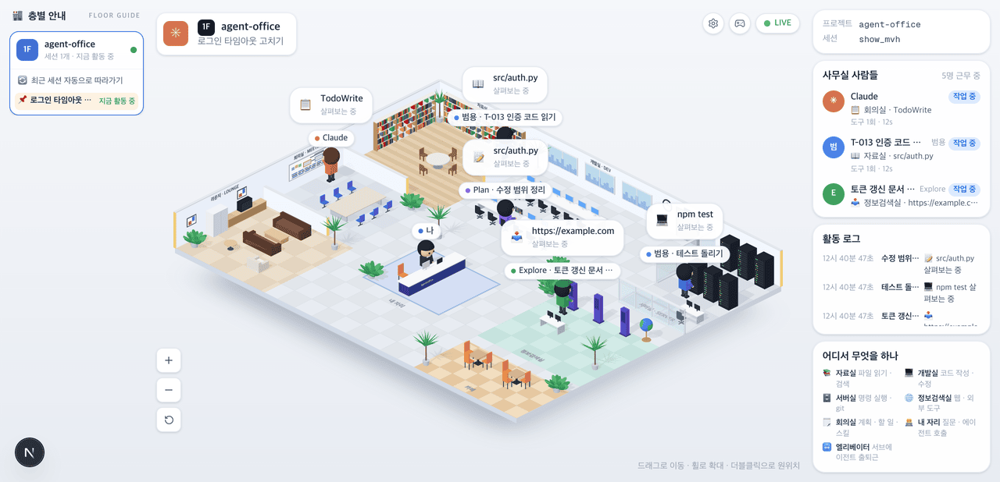
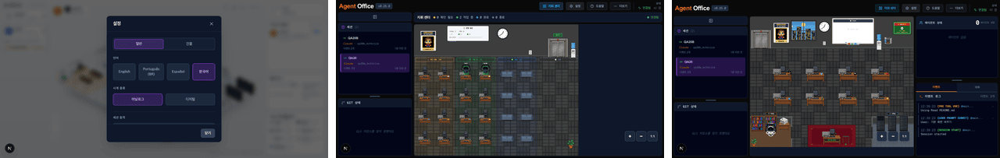

# 20 · 새 화면을 기본으로

- 브랜치: `chore/20-iso-default`
- 근거: [근거 문서](../plan/spec.md) 「화면 재설계」 — 구현 방침(「다 되면 기본을 바꾸고 2D 픽셀 사무실을 내린다」), 범위 밖(화이트보드 · 지휘 센터 · 빌딩 뷰는 고치지 않고 회귀만 본다)
- 검증한 커밋: `fc6b55b`(문서 `9add86d`)

## 목표

등각 사무실이 기본 화면(`/`)이 된다. 2D 픽셀 사무실은 기본 자리에서 내려오지만, 거기에만 있는 화이트보드 · 지휘 센터 · 빌딩 뷰는 그대로 쓸 수 있어야 한다. README 와 구조 문서도 새 화면을 기준으로 고친다.

## 한 일

- **`/` = 등각 사무실** — `/iso` 에 있던 화면을 `/` 로 옮겼다. 옛 `/iso` 링크는 `/` 로 넘어간다.
- **`/classic` = 2D 픽셀 사무실** — 원래 `/` 화면을 그대로 옮겼다. 화이트보드 · 지휘 센터 · 빌딩 뷰 · 설정 · 도움말이 다 거기 있다. 머리말 제목 「Agent Office」를 누르면 `/` 로 돌아온다.
- **「LIVE」 옆 버튼** — 영상에는 없는 자리라 작은 동그란 아이콘만 둔다. 이름은 2D 머리말의 기존 문구를 툴팁으로 쓴다.
  - ⚙ 「설정」: 기존 설정 창을 이 화면 위에 연다.
  - ⊞ 「지휘 센터」: 일하는 세션이 둘 이상일 때만 보인다(2D 머리말과 같은 조건). `/classic` 의 지휘 센터로 간다.
  - 🎮 「2D 사무실」: `/classic` 의 2D 사무실로 간다. 이 이름만 새 문구다(작업 표의 「2D 픽셀 사무실」에서 땄다).
- 폰 폭에서는 머리말 폭을 줄여 버튼과 겹치지 않게 했다.
- **문서** — README 포크 안내를 새 화면 사진과 「에이전트가 하는 일 ↔ 사무실에서 보이는 것」 표(방 일곱 곳 · 엘리베이터 · 말풍선)로 바꾸고, 2D 사무실은 `/classic` 에 있다고 적었다. 원본 스크린숏 절에도 같은 안내를 달았다. 구조 문서(ARCHITECTURE)에 「Isometric Office」 절과 파일 표를 더했다.

## 검증

| 단계 | 명령 · 방법 | 결과 |
| --- | --- | --- |
| 정적 검증 | `make checkall` | 통과 — 백엔드 559 · 프런트 271 · 훅 73 · 플러그인 34 |
| 정적 내보내기 | `bun run build` (`output: "export"`) | 통과 — `/` · `/classic` · `/iso` · `/sprite-debug` 가 정적 페이지로 나온다 |
| 실검증 | 헤드리스 Chromium 1280×618(2배) · 한국어, 390×844. 세션 하나 · 둘에서 버튼을 눌러 주소와 화면을 읽었다 | TC 10건 — ✅ 10 |
| 스모크 회귀 | `/classic` 의 2D 사무실(화이트보드 · 세션 목록 · 이벤트 로그), 지휘 센터 | 둘 다 그대로 뜬다, 콘솔 오류 0 |
| 정리 | QA 로 띄운 프런트 · 백엔드 · 브라우저를 내렸고 빌드 산출물(`out/`)을 지웠다 | `:3100` · `:8000` 듣는 프로세스 0 |

### 실검증 TC

| TC | 우선순위 | 판정 | 방법 · 근거 |
| --- | --- | --- | --- |
| A-01 기본 화면 | P1 | ✅ | `/` 에 장면 캔버스 · 층별 안내 · 오른쪽 패널 · 머리말 · 「LIVE」 |
| A-02 버튼 (세션 하나) | P2 | ✅ | 설정 · 2D 사무실 두 개. 지휘 센터는 없다 |
| A-03 버튼 (세션 둘) | P1 | ✅ | 두 번째 세션이 일하자 지휘 센터 버튼이 생긴다 |
| A-04 설정 | P1 | ✅ | ⚙ 를 누르자 기존 설정 창(「설정 · 일반 · 건물 · 언어 …」)이 뜨고 「닫기」로 닫힌다 |
| A-05 지휘 센터 | P1 | ✅ | ⊞ 를 누르자 `/classic` 에서 「확인 필요 · 작업 중 · 완료 · 종료」 구역이 보인다 |
| A-06 돌아오기 | P1 | ✅ | `/classic` 의 「Agent Office」를 누르자 `/` 의 등각 사무실로 온다 |
| A-07 2D 사무실 | P1 | ✅ | 🎮 를 누르자 `/classic` 에서 2D 사무실 캔버스 · 화이트보드 · 「세션 (2)」 목록이 보인다(아래 그림) |
| A-08 옛 링크 | P2 | ✅ | `/iso` 를 열자 `/` 로 넘어간다 |
| A-09 폰 | P2 | ✅ | 390×844 에서 머리말 오른쪽 끝(165px)이 버튼 왼쪽 끝(215px)보다 왼쪽, 가로 스크롤 없음 |
| A-10 콘솔 | P2 | ✅ | 위 흐름 내내 콘솔 오류 0 |

### 화면

`/` — 기본 화면이 된 등각 사무실(README 사진).

왼쪽부터: `/` 위에 연 설정 창, `/classic` 의 지휘 센터, `/classic` 의 2D 사무실.

## 검증하지 못한 것

- 빌딩 뷰 — 층 설정(설정 → 건물)이 있을 때만 열리는 화면이라 이번에 따로 열지 않았다. `/classic` 화면 코드는 옮기기만 했고, 제목 링크 · 컴포넌트 이름 · 머리 주석 말고는 바뀐 곳이 없다.
- 백엔드가 정적 파일로 서빙하는 배포(`SERVE_STATIC`) — 빌드 산출물에 `classic.html` 이 나오는 것까지 봤고, 백엔드의 `{경로}.html` 찾기 규칙은 바뀌지 않았다.

## 알려진 한계 (버그 아님)

- 2D 화면의 둘러보기(도움말 → 둘러보기)는 2D 화면 기준이라 `/classic` 에만 있다.
- 폰에서는 등각 화면의 양쪽 패널이 숨어 층 · 세션을 바꿀 수 없다. 🎮 로 `/classic` 에 가면 모바일 서랍에서 세션을 고를 수 있다.

## 다음 작업

화면 재설계(12–20)가 끝났다. 미뤄 둔 10 `feat/10-codex-hooks`(Codex CLI 연동)를 재개하고, 그다음 11 `chore/11-integration-qa`(통합 QA)를 한다.
