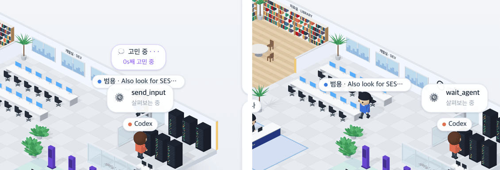

# 21 · 다시 일하러 온 직원

- 브랜치: `fix/21-returning-subagent`
- 근거: [근거 문서](../plan/spec.md) R4 · 작성자 댓글(일을 하나 더 받으면 다시 일하러 돌아간다), [19 보고서](19-subagent-lifecycle.md)의 알려진 한계
- 검증한 커밋: `6abba36`

## 목표

퇴근을 마친 직원에게 같은 id 로 일이 다시 오면 다시 출근해 일한다. Codex 는 끝난 서브에이전트에게 `send_input` · `resume_agent` 로 일을 더 맡긴다.

## 원인

- 화면의 상태 맞추기는 직원을 그 id 를 처음 볼 때만 만든다(`processedAgents`).
- 직원이 퇴근해 화면에서 빠진 뒤 같은 id 로 다시 오면, 백엔드는 직원을 새로 만들지만 화면은 이미 처리한 id 라 넘긴다. 그래서 다시 일하는 직원이 보이지 않았다.

## 한 일

- 화면에는 없는데 백엔드는 일하는 중으로 보내는 직원은 다시 출근시킨다(엘리베이터로). 백엔드가 아직 「끝남」(대기 · 퇴근 단계)으로 보내는 직원은 그대로 둔다.
- 다시 출근한 직원은 지난번에 한 말을 다시 해도 말풍선이 뜬다. 같은 문장은 한 번만 띄우던 기록을 다시 출근할 때 비운다.
- 퇴근 길에 일을 받으면 돌아서는 것(19)은 그대로다. 이번 수정은 완전히 나간 뒤에 온 경우다.

## 검증

| 단계 | 명령 · 방법 | 결과 |
| --- | --- | --- |
| 정적 검증 | `make checkall` | 통과 — 백엔드 585 · 프런트 275(새 3) · 훅 113 · 플러그인 34 |
| 실검증 | 진짜 Codex CLI(가짜 모델, `scripts/codex_session.sh` 의 대본에 「20초 쉬고 → 끝난 서브에이전트에게 `send_input` → 다시 기다리기」를 더한 것)를 돌리며 `/` 를 1초마다 읽었다. 같은 백엔드에 main 코드 화면(3101)을 띄워 수정 전과 대조했다 | TC 6건 — ✅ 6 |
| 정리 | QA 로 띄운 프런트 둘 · 백엔드 · 브라우저를 내리고 main 워크트리를 지웠다 | `:3100` · `:3101` · `:8000` 듣는 프로세스 0 |

### 실검증 TC

| TC | 우선순위 | 판정 | 방법 · 근거 |
| --- | --- | --- | --- |
| A-01 수정 전 재현 | P1 | ✅ | main 화면: 서브에이전트가 15–35초에 일하고 퇴근한 뒤, 일을 다시 받아도 36–52초 내내 보이지 않는다 |
| A-02 다시 출근 | P1 | ✅ | 수정 후: 15–34초 첫 일 → 35–37초 없음 → 38초에 새 작업 이름(「Also look for SESSION_TIMEOUT in the docs.」)으로 엘리베이터에서 다시 나온다(아래 그림) |
| A-03 두 번째 보고 · 퇴근 | P1 | ✅ | 두 번째 일에서도 Codex 옆에서 보고하고 「👋 퇴근합니다!」 뒤 57초에 나간다. 보고 문장이 첫 번째와 같아도 뜬다 |
| A-04 2D 사무실 | P2 | ✅ | `/classic` 은 퇴근 연출이 길어 두 번째 일이 올 때까지 직원이 남아 있다(수정 전후 같음, 15–46초). 콘솔 오류 0 |
| B-01 다시 출근 규칙 | P1 | ✅ | [unit] 나간 직원이 같은 id 로 일하는 중으로 오면 다시 만든다. 고친 조건을 되돌리면 이 테스트가 실패한다 |
| B-02 끝난 직원 · 말풍선 | P2 | ✅ | [unit] 백엔드가 「대기」로 보내는 직원은 다시 만들지 않는다. 다시 출근하면 지난 말풍선 기록을 비운다 |

### 화면

다시 출근: 새 작업 이름으로 엘리베이터에서 나와(왼쪽) 자리로 간다(오른쪽).

## 검증하지 못한 것

- Claude Code 의 같은 id 재사용 — Claude Code 서브에이전트가 끝난 뒤 같은 id 로 다시 오는 경로는 확인하지 않았다. 규칙은 에이전트를 가리지 않는다.

## 다음 작업

22 `feat/22-iso-mobile-guide` — 폰에서도 등각 화면에서 층 · 세션을 바꾼다.
