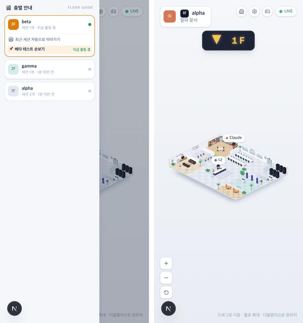

# 22 · 폰에서 층별 안내

- 브랜치: `feat/22-iso-mobile-guide`
- 근거: [근거 문서](../plan/spec.md) 「화면 재설계」 — 왼쪽 「층별 안내」, [18](18-floor-guide.md) · [20](20-iso-default.md) 보고서의 알려진 한계(폰에서는 층 · 세션을 바꿀 수 없다)
- 검증한 커밋: `a56cda2`

## 목표

1024px 보다 좁은 화면(폰 · 세로 태블릿)에서도 등각 화면에서 바로 층과 세션을 바꾼다.

## 한 일

- **버튼** — 「LIVE」 옆 버튼 줄 맨 앞에 건물 아이콘 버튼을 더했다. 1024px 미만에서만 보이고, 툴팁은 기존 문구 「층별 안내」다.
- **시트** — 누르면 왼쪽에서 층별 안내가 덮어 열린다(폭 260px, 화면의 85% 까지). 데스크톱의 층별 안내와 같은 것이다: 층 카드 · 「최근 세션 자동으로 따라가기」 · 세션 목록 · 「오래 쉰 층 더 보기」.
- **닫기** — 층이나 세션을 고르면 닫히고 그리로 간다. 다른 층이면 「▼ 1F」 표시등이 뜬다. 바깥(어두운 부분)을 누르거나 Esc 를 눌러도 닫힌다.
- **폰 배치** — 폰에서는 머리말과 버튼이 같은 줄이라 표시등을 머리말 아래로 내렸다. 버튼이 하나 늘어 머리말 최대 폭도 조금 줄였다.
- 새 문구는 없다.

## 검증

| 단계 | 명령 · 방법 | 결과 |
| --- | --- | --- |
| 정적 검증 | `make checkall` | 통과 — 백엔드 585 · 프런트 275 · 훅 113 · 플러그인 34 |
| 실검증 | 헤드리스 Chromium. 프로젝트 셋(alpha · gamma · beta, beta 가 지금 세션)을 이벤트로 만들고 390×844(터치) · 820×1180(터치) · 1280×618 에서 눌러 봤다 | TC 7건 — ✅ 7 |
| 정리 | QA 로 띄운 프런트 · 백엔드 · 브라우저를 내렸다 | `:3100` · `:8000` 듣는 프로세스 0 |

### 실검증 TC

| TC | 우선순위 | 판정 | 방법 · 근거 |
| --- | --- | --- | --- |
| A-01 폰 버튼 | P1 | ✅ | 390×844 에서 건물 버튼이 보이고, 머리말과 버튼 줄 사이가 49px |
| A-02 시트 열기 | P1 | ✅ | 누르자 시트에 「3F beta · 지금 활동 중」(펼침) · 「2F gamma」 · 「1F alpha · 세션 2개」(아래 그림 왼쪽) |
| A-03 층 바꾸기 | P1 | ✅ | 「1F alpha」를 누르자 시트가 닫히고 「▼ 1F」 표시등이 머리말 아래에 뜬다. 머리말이 「1F alpha · 알파 문서」로 바뀐다(아래 그림 오른쪽) |
| A-04 바깥 · Esc | P2 | ✅ | 바깥을 눌러도, Esc 를 눌러도 닫힌다 |
| A-05 태블릿 | P2 | ✅ | 820×1180 에서도 양쪽 패널이 숨고 건물 버튼이 보인다 |
| A-06 데스크톱 | P1 | ✅ | 1280×618 에서는 건물 버튼이 숨고 층별 안내 · 오른쪽 패널이 그대로다 |
| A-07 콘솔 | P2 | ✅ | 세 크기 모두 콘솔 오류 0, 가로 스크롤 없음 |

### 화면

폰: 시트를 연 모습과 1F 로 옮긴 순간.

## 검증하지 못한 것

- 실제 폰 · 태블릿 — 데스크톱 브라우저의 터치 흉내로만 봤다.

## 알려진 한계 (버그 아님)

- 폰에서는 오른쪽 패널(사무실 사람들 · 활동 로그 · 범례)은 여전히 숨는다. 사람의 상태는 장면의 이름 칩 · 말풍선으로 본다.

## 다음 작업

작업 표의 항목(00–22)이 모두 끝났다.
