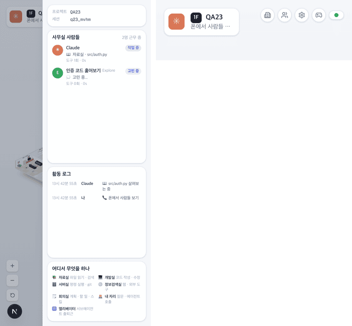

# 23 · 폰에서 사무실 사람들

- 브랜치: `feat/23-iso-mobile-panel`
- 근거: [근거 문서](../plan/spec.md) 「화면 재설계」 — 오른쪽 패널, [22 보고서](22-iso-mobile-guide.md)의 알려진 한계(폰에서는 오른쪽 패널이 숨는다)
- 검증한 커밋: `b915d31`

## 목표

1024px 보다 좁은 화면에서도 사무실 사람들 · 활동 로그 · 방 범례를 본다.

## 한 일

- **버튼** — 「LIVE」 옆 버튼 줄의 층별 안내 버튼 다음에 사람 아이콘 버튼을 더했다. 1024px 미만에서만 보이고, 툴팁은 기존 문구 「사무실 사람들」이다.
- **시트** — 누르면 오른쪽에서 데스크톱과 같은 패널(프로젝트 · 세션, 사무실 사람들, 활동 로그, 어디서 무엇을 하나)이 덮어 열린다(폭 280px, 화면의 85% 까지). 열려 있는 동안에도 실시간으로 바뀐다.
- **닫기** — 바깥(어두운 부분)을 누르거나 Esc. 시트는 한 번에 하나만 열린다(층별 안내 시트와 같은 자리를 쓴다).
- **폰 윗줄** — 버튼이 하나 늘어, 폰(640px 미만)에서는 「LIVE」를 점만 남겼다. 글자는 화면 읽기 프로그램용으로 남긴다. 그래서 머리말 폭은 22 그대로다.
- 새 문구는 없다.

## 검증

| 단계 | 명령 · 방법 | 결과 |
| --- | --- | --- |
| 정적 검증 | `make checkall` | 통과 — 백엔드 585 · 프런트 275 · 훅 113 · 플러그인 34 |
| 실검증 | 헤드리스 Chromium. Claude 가 읽는 중이고 Explore 직원이 하나 있는 세션을 이벤트로 만들고, 390×844(터치) · 1280×618 에서 눌러 봤다 | TC 7건 — ✅ 7 |
| 정리 | QA 로 띄운 프런트 · 백엔드 · 브라우저를 내렸다 | `:3100` · `:8000` 듣는 프로세스 0 |

### 실검증 TC

| TC | 우선순위 | 판정 | 방법 · 근거 |
| --- | --- | --- | --- |
| A-01 폰 윗줄 | P1 | ✅ | 층별 안내 · 사람 · 설정 · 2D 버튼과 초록 점. 머리말 「1F QA23 · 폰에서 사람들 …」과 버튼 줄 사이가 42px(아래 그림 오른쪽) |
| A-02 시트 열기 | P1 | ✅ | 사람 버튼을 누르자 오른쪽(오른쪽 끝 390px)에서 「사무실 사람들 · 2명 근무 중」(Claude 「작업 중 📖 자료실 · src/auth.py」, Explore 「E」 「고민 중」) · 활동 로그 · 범례(아래 그림 왼쪽) |
| A-03 열린 채로 바뀜 | P1 | ✅ | 열어 둔 채 직원이 grep 을 시작하자 그 행이 「작업 중 🔎 자료실 · SESSION_TIMEOUT」로 바뀐다 |
| A-04 바깥 · Esc | P2 | ✅ | 바깥을 눌러도, Esc 를 눌러도 닫힌다 |
| A-05 층별 안내 시트 | P1 | ✅ | 22 의 층별 안내 시트도 그대로 열린다 |
| A-06 데스크톱 | P1 | ✅ | 1280×618 에서는 두 버튼이 숨고 양쪽 패널이 그대로다 |
| A-07 콘솔 | P2 | ✅ | 콘솔 오류 0, 가로 스크롤 없음 |

### 화면

폰: 사람 시트(왼쪽)와 윗줄(오른쪽).

## 검증하지 못한 것

- 실제 폰 · 태블릿 — 데스크톱 브라우저의 터치 흉내로만 봤다.

## 다음 작업

작업 표의 항목(00–23)이 모두 끝났다.
