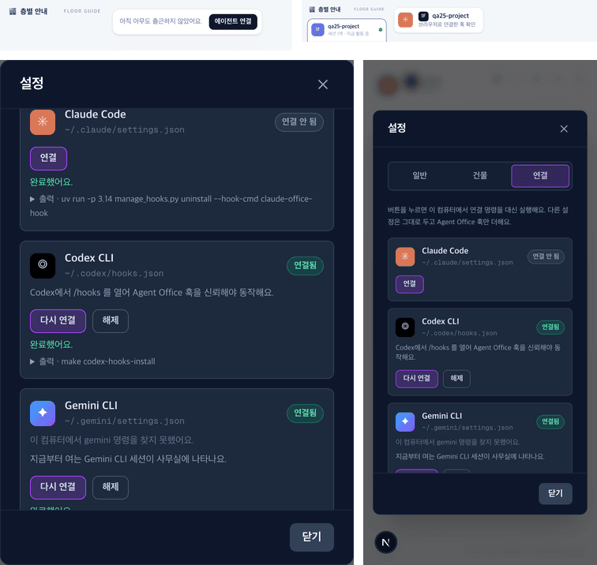

# 25 · 브라우저에서 에이전트 연결

- 브랜치: `feat/25-connect-from-browser`
- 근거: 사용자 요청 — 「명령어를 직접 치는 게 아니라 브라우저에서 해당 명령어 설치가 진행되도록」
- 검증한 커밋: `2da6380`

## 목표

`make hooks-install` 같은 명령을 터미널에 치지 않고, 브라우저에서 Claude Code · Codex CLI · Gemini CLI 를 사무실에 연결하고 해제한다.

## 한 일

- **설정 창 「연결」 탭** — 에이전트마다 연결 상태(연결됨 · 연결 안 됨), 훅이 들어가는 설정 파일, 「연결」 · 「다시 연결」 · 「해제」 버튼이 있다. 누르면 백엔드가 README 의 명령을 그대로 실행한다(Claude Code `make hooks-install`, Codex `make codex-hooks-install`, Gemini `make gemini-hooks-install`). 결과와 출력 끝 40줄을 보여 주고, 연결 뒤 할 일(Codex 는 `/hooks` 에서 신뢰)도 적는다.
- **해제** — 그 에이전트의 훅 항목만 지운다. 훅 도구는 다른 에이전트도 쓰므로 남긴다(`make hooks-uninstall` 은 도구까지 지워서 쓰지 않는다).
- **빈 사무실** — 세션이 하나도 없으면 왼쪽 위에 「아직 아무도 출근하지 않았어요 · 에이전트 연결」이 뜨고, 누르면 그 탭이 열린다. 폰에서는 버튼만 보인다.
- **API** — `GET /api/v1/hooks` 는 각 에이전트의 설정 파일을 읽어 상태를 준다. `POST /api/v1/hooks/{agent}/install` · `remove` 는 다른 부작용 있는 API 처럼 실행 토큰이 있어야 하고, 한 번에 하나만 돌고, 백엔드가 다른 컴퓨터에서도 열려 있으면(Docker) 거절한다.
- **토큰 주소를 한 줄로** — 실행 토큰이 든 주소가 로그에서 두세 줄로 접혀, 터미널에서 눌러도 잘린 토큰이 열렸다. 백엔드가 `Agent Office: http://localhost:4747/?token=…` 를 한 줄로 따로 찍는다. 토큰이 없거나 틀리면 탭이 이 줄을 가리킨다.
- **401 · 403 을 화면이 읽는다** — CORS 미들웨어가 안쪽에 있어서 토큰 거절(401)이 브라우저에는 네트워크 오류로 보였다. 그래서 「백엔드가 떠 있는지 확인」이라는 엉뚱한 안내가 떴다. CORS 를 바깥으로 옮겼다.
- 문구는 4개 언어(ko · en · es · pt-BR). README 에 브라우저로 연결하는 방법을 적었다.

## 검증

| 단계 | 명령 · 방법 | 결과 |
| --- | --- | --- |
| 정적 검증 | `make checkall` | 통과 — 백엔드 596(새 11) · 프런트 275 · 훅 113 · 플러그인 34 |
| 실검증 | 사용자가 띄워 둔 `make dev`(4747 · 8000)는 건드리지 않고, 작업 폴더를 따로 만들어 백엔드 8010 · 프런트 4748 로 띄웠다. 백엔드는 가짜 홈 폴더(`HOME`)로 띄워 설치가 실제 사용자 설정이 아니라 그 폴더에 들어가게 했고, `make dev` 처럼 make 안에서 도는 환경(`MAKEFLAGS`)도 흉내 냈다. 헤드리스 Chromium 1280×800 · 390×844(터치) | TC 14건 — ✅ 14 |
| 정리 | QA 서버 · 브라우저 · 작업 폴더 · 가짜 홈 폴더를 지웠다. 실제 `~/.claude/settings.json` 은 그대로(해시 같음)이고 `~/.local/bin` 에 훅 도구가 없다 | `:8010` · `:4748` 듣는 프로세스 0 |

### 실검증 TC

| TC | 우선순위 | 판정 | 방법 · 근거 |
| --- | --- | --- | --- |
| A-01 빈 사무실 버튼 | P1 | ✅ | 세션 0개에서 「아직 아무도 출근하지 않았어요 · 에이전트 연결」(아래 그림 맨 위 왼쪽). 누르면 설정 창이 「연결」 탭으로 열린다 |
| A-02 토큰 없이 | P1 | ✅ | 세 줄 모두 「연결 안 됨」, 설정 파일 `~/.claude/settings.json` · `~/.codex/hooks.json` · `~/.gemini/settings.json`. 「Agent Office: …?token=…」 안내가 뜨고 버튼이 꺼진다 |
| A-03 Claude Code 연결 | P1 | ✅ | act — 토큰 주소로 열고 「연결」. 도는 동안 버튼이 전부 꺼지고, 8초 뒤 「완료했어요」 · 「연결됨」 · 「출력 · make hooks-install」. 가짜 홈의 `settings.json` 에 훅 12개가 들어가고, 원래 있던 다른 훅과 `theme` 는 그대로다. 훅 도구와 API 키 파일도 생겼다 |
| A-04 진짜로 사무실에 뜬다 | P1 | ✅ | act — `settings.json` 에 들어간 명령(`claude-office-hook session_start` 등)을 Claude Code 처럼 셸로 실행했다. 사무실에 「1F qa25-project · 브라우저로 연결한 훅 확인」 세션이 뜨고 빈 사무실 버튼이 사라진다(아래 그림 맨 위 오른쪽) |
| A-05 Codex 연결 | P1 | ✅ | act — `~/.codex/hooks.json` 에 이벤트 9개, 「Codex에서 /hooks 를 열어 Agent Office 훅을 신뢰해야 동작해요」 |
| A-06 Claude 해제 | P1 | ✅ | act — 「연결 안 됨」, 우리 훅 0개, 다른 훅 · `theme` 그대로. 훅 도구는 남고 Codex 는 「연결됨」 그대로(아래 그림 왼쪽) |
| A-07 Gemini 연결 | P2 | ✅ | act — `~/.gemini/settings.json` 에 이벤트 8개. 이 맥에는 gemini 명령이 없어 「gemini 명령을 찾지 못했어요」도 뜬다 |
| A-08 틀린 토큰 | P1 | ✅ | 고치기 전(이 브랜치 첫 커밋): 「연결 상태를 불러오지 못했어요. 백엔드가 떠 있는지…」 — 401 이 CORS 에 막혔다. 고친 뒤: 「Agent Office: …?token=…」 안내 · 버튼 꺼짐. 실행은 되지 않는다(Claude 훅 0개 그대로) |
| A-09 Docker 처럼 열린 백엔드 | P2 | ✅ | 주입 — 상태 응답을 `not_local` 로 바꿨다. 안내 문구가 뜨고 버튼이 전부 꺼진다. 실제 거절(409)은 [unit] |
| A-10 실패 표시 | P2 | ✅ | 주입 — 설치 응답을 실패로 바꿨다. 빨간 「실패했어요. 아래 출력을 확인해 주세요.」 · 출력이 펼쳐진 채 |
| A-11 폰 | P1 | ✅ | 390×844. 빈 사무실은 버튼만(16–123px)이고 도구 버튼 줄(208px~)과 겹치지 않는다. 설정 창 16–374px · 탭 셋 · 가로 스크롤 없음(아래 그림 오른쪽) |
| A-12 다른 탭 · ⚙ | P2 | ✅ | ⚙ 은 「일반」 탭으로 열린다. 「건물」 탭도 그대로 |
| A-13 콘솔 | P2 | ✅ | 콘솔 오류 0. 틀린 토큰 TC 의 401 한 줄만 있다(의도한 거절) |
| B-01 API 규칙 | P1 | ✅ | [unit] 토큰 없으면 401(CORS 헤더 포함 — 미들웨어 순서를 되돌리면 실패), 모르는 에이전트 404 · 동작 422, 열린 백엔드 409, 출력 끝 40줄 · 한 번에 하나 |

### 화면

위: 빈 사무실 버튼, 연결한 훅으로 들어온 세션. 아래: 데스크톱 「연결」 탭(Claude 해제 뒤), 폰.

## 검증하지 못한 것

- 실제 사용자 설정에 설치 — QA 는 가짜 홈 폴더에서만 했다. 실제 Claude Code 를 새로 열어 세션이 뜨는 것은 사용자가 확인한다(훅 명령은 Claude Code 와 같은 방식으로 실행해 확인했다).
- Codex `/hooks` 신뢰 — Codex CLI 안에서 하는 일이라 화면은 안내만 한다.

## 알려진 한계 (버그 아님)

- 버튼은 실행 토큰이 있어야 눌린다. 다른 웹사이트가 몰래 설치하지 못하게 하기 위해서다. `make dev` 터미널의 `Agent Office:` 줄 주소로 열어야 하고, 백엔드를 다시 띄우면 토큰이 바뀐다.
- Docker 로 띄운 백엔드는 컨테이너 안이라 연결할 수 없다 — 터미널에서 `make hooks-install`.

## 다음 작업

없음. 새 요청이 오면 작업 표에 이어 넣는다.
