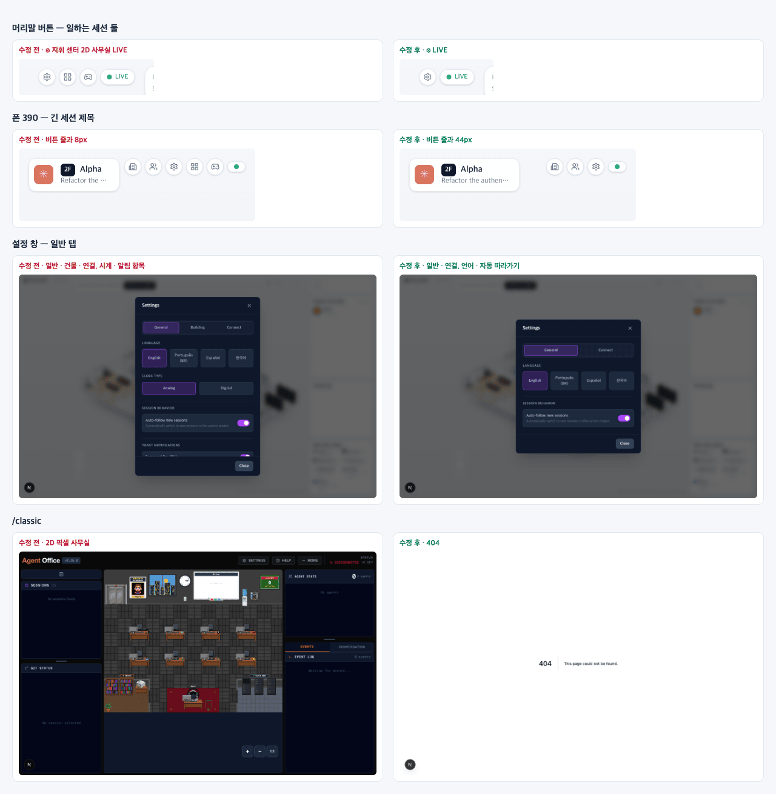

# 26 · 2D 사무실 제거

- 브랜치: `chore/26-remove-2d-office`
- 근거: 사용자 지시 — 「그 화면은 필요없어. 관련 코드 다제거해(기능 동작에 필요한거빼고) 2D 사무실은 다 제거해버려」, [근거 문서](../plan/spec.md) 「2D 사무실 제거」
- 검증한 커밋: `2d4b207`(실검증 전체) · `f3b6ee3`(main 의 27 위로 옮긴 뒤 스모크)

## 목표

2D 픽셀 사무실(`/classic`)과 그 화면에만 쓰이던 코드를 지운다. 등각 사무실이 동작하는 데 필요한 코드는 남긴다.

## 한 일

- **화면** — `/classic`(2D 픽셀 사무실: 화이트보드 · 지휘 센터 · 빌딩 뷰 · 투어 · 주의 알림)과 `/sprite-debug`(스프라이트 도구)를 지웠다. 그 화면만 가져다 쓰던 컴포넌트 · 훅 · 스토어 · 시스템 · 시험과 스프라이트 그림 25장도 같이 지웠다. 무엇이 2D 전용인지는 import 그래프로 가렸다 — 등각 페이지(`/` · `/iso` · 레이아웃)에서는 닿지 않고 `/classic` · `/sprite-debug` 에서만 닿는 파일이다.
- **머리말** — 「LIVE」 옆 지휘 센터 · 2D 사무실 버튼을 뺐다. 버튼이 줄어 머리말과 빈 사무실 안내의 최대 폭을 `100% - 15rem` 에서 `100% - 13rem` 으로 넓혔다(22 에서 버튼 하나에 2rem 을 줄였던 것을 되돌림).
- **설정 창** — 탭은 「일반 · 연결」 둘이다. 건물 탭과 시계 종류 · 시간 형식 · 명령 막대 · 클릭해 포커스 · 알림 거르기는 2D 화면에서만 동작해서, 그 뒤의 이동 · 주의 알림 저장소와 함께 지웠다. DB 에 남은 옛 값(`clock_type` 등)은 읽지 않을 뿐 지우지 않는다.
- **의존성 · 설정** — pixi.js · @pixi/react · react-zoom-pan-pinch · react-markdown · remark-gfm 을 뺐다. React strict mode 는 @pixi/react 가 이중 마운트를 버티지 못해 꺼 두었던 것이라 기본값(켬)으로 돌렸다. `globals.css` 의 투어 · 화면 전환 · 캔버스 규칙을 지웠다.
- **번역** — 2D 화면에서만 쓰던 키 201개를 4개 언어에서 지웠다(언어마다 301 → 100).
- **남은 코드** — 2D 벽 장식 · 깔개 · 쓰레기통 · 프린터 위치, 방 벽 그리기 크기, 장애물 오버레이 · 그리드 재설정, 엘리베이터 그림 위치, 2D 애니메이션 루프를 돌리던 훅을 지웠다.
- **도구 · 문서** — 스프라이트를 만들던 저장소 스킬 셋(`.claude/skills`)과 유료 스프라이트 무시 규칙을 지웠다. `make version-check` 는 2D 머리말의 버전 배지를 찾다가 20 이후 main 에서도 실패하고 있었다 — 배지 자리를 빼서 다섯 곳만 본다. README · ARCHITECTURE · quickstart · frontend README · CONTRIBUTING · CLAUDE.md 에서 2D 사무실을 걷어 냈고, 화이트보드 모드 문서를 지웠다.
- **계획** — 근거 문서에 「2D 사무실 제거」 절을 두고 후속(설정 창 밝은 디자인 · 2D 화면만 읽던 백엔드 데이터 정리)을 적었다. 다른 작업과 번호가 겹치지 않게 작업 표 번호는 시작할 때 비어 있는 번호로 넣는다.

## 검증

| 단계 | 명령 · 방법 | 결과 |
| --- | --- | --- |
| 정적 검증 | `UV_FROZEN=1 make checkall` | 통과 — main 의 27 위로 옮긴 뒤 백엔드 602 · 프런트 242 · 훅 113 · 플러그인 34. main 의 28 위로 다시 옮긴 뒤 `make test`(백엔드 609 · 프런트 242 · 훅 113 · 플러그인 34) · 타입 검사도 통과 |
| 빌드 | `bun run build`(정적 내보내기) · `out/` 에서 `pixi` 검색 · `make version-check` | 페이지 `/` · `/iso` · `/_not-found` 뿐, pixi 0건, `OK: all 5 locations at 0.25.0`(수정 전: `ERROR: version pattern not found in frontend/src/app/page.tsx`) |
| 실검증 | 다른 세션의 서버(4747 · 4748 · 8000 · 8010)는 건드리지 않고 작업 폴더를 따로 만들어 띄웠다 — 백엔드 8011(빈 DB · 요약 꺼짐), 수정 후 4760, 수정 전(main `862ece9`) 4770. 두 프런트를 같은 백엔드에 붙이고 시뮬레이터(`errands` · `complex`)와 직접 넣은 이벤트로 같은 장면을 동시에 봤다. 헤드리스 Chromium 1280×800 · 1920×1200 · 390×844. main 의 27(연결 탭 · 백엔드)을 받아 옮긴 뒤 `f3b6ee3` 에서 스모크를 한 번 더 돌렸다 — 빈 사무실 → 연결 탭, `quick` 시나리오, 콘솔 오류 0 | TC 33건 — ✅ 33 |
| 정리 | QA 서버(실검증 3개 · 스모크 2개) · 브라우저를 내리고, 수정 전 작업 폴더 · QA DB · 스크립트 · 캡처를 지웠다. 바꾼 설정값(언어 · 자동 따라가기 · 옛 키)은 처음 상태(빈 값)로 되돌린 뒤 다시 조회했다 | `:8011` · `:4760` · `:4770` 듣는 프로세스 0 |

### 실검증 TC

| TC | 우선순위 | 판정 | 방법 · 근거 |
| --- | --- | --- | --- |
| A-01 `/classic` | P1 | ✅ | 수정 전: 2D 픽셀 사무실. 수정 후: 404 「This page could not be found.」(응답 404, 아래 그림 맨 아래) |
| A-02 `/sprite-debug` | P1 | ✅ | 수정 전: 스프라이트 도구. 수정 후: 404 |
| A-03 `/iso` | P2 | ✅ | 양쪽 모두 `/` 로 바뀐다 |
| A-04 스프라이트 그림 | P2 | ✅ | `/sprites/desk.png` 수정 전 200 → 수정 후 404 |
| B-01 버튼(세션 하나) | P1 | ✅ | 1280 폭 버튼: 수정 전 `settings` · `2D office` → 수정 후 `settings`(+ LIVE) |
| B-02 버튼(일하는 세션 둘) | P1 | ✅ | 수정 전 `settings` · `command center` · `2D office` → 수정 후 `settings`(아래 그림 맨 위) |
| B-03 폰 버튼 | P2 | ✅ | 390 폭: 수정 전 버튼 4개(층별 안내 · 사람들 · ⚙ · 🎮) → 수정 후 3개 + LIVE 점 |
| C-01 설정 일반 탭 | P1 | ✅ | 수정 후 탭 「General · Connect」, 언어 · 자동 따라가기만 있다. 수정 전은 「General · Building · Connect」에 시계 · 알림 항목(아래 그림) |
| C-02 빈 사무실 → 연결 탭 | P1 | ✅ | 「Connect an agent」를 누르면 연결 탭으로 열린다. 양쪽 같음 |
| C-03 탭 왕복 | P2 | ✅ | 일반 ↔ 연결이 확인창 없이 바뀐다 |
| C-04 언어 저장 | P1 | ✅ | act — 한국어를 고르고 새로고침해도 한국어(`language=ko`). 영어로 되돌림 |
| C-05 자동 따라가기 저장 | P1 | ✅ | act — 끄고 새로고침해도 꺼짐(`auto_follow_new_sessions=false`). 다시 켬 |
| C-06 옛 설정값 | P2 | ✅ | act — `clock_type=digital` · `toastFilterError=true` 를 넣고 새로고침. 콘솔 오류 0, 설정 창 정상. 넣은 키는 지웠다 |
| C-07 연결 탭 | P3 | ✅ | 카드 3개(Claude Code · Codex CLI · Gemini CLI), 양쪽 같음. 「연결」은 누르지 않았다(전역 훅 설정을 바꾼다) |
| D-01 심부름 | P1 | ✅ | 시뮬레이터 `errands` — 사장이 자료실로 걸어가 「SESSION_TIMEOUT · Looking into it」 말풍선을 띄운다. 활동 로그 14줄이 수정 전과 한 줄씩 같다 |
| D-02 서브에이전트 | P1 | ✅ | `complex` — 서브에이전트 5명이 출근해 일하고 「👋 Heading home!」 뒤 퇴근한다. 수정 전과 같다 |
| D-03 오른쪽 패널 | P1 | ✅ | 사람들 · 활동 로그(40줄) · 방 범례가 채워진다 |
| D-04 층별 안내 | P2 | ✅ | 3F Beta · 2F Alpha · 1F Simulation |
| D-05 압축 이벤트 | P2 | ✅ | `context_compaction` 을 넣어도 콘솔 오류 0(2D 쓰레기통 연출은 지웠다) |
| D-06 층 표시등 | P2 | ✅ | 1F 카드를 누르자 「▼ 1F」가 떴다가 사라진다. 양쪽 같음 — 표시등 애니메이션 CSS 는 남겼다 |
| D-07 백엔드 `error` 메시지 | P2 | ✅ | 주입 — 세션 웹소켓에 `{"type":"error"}` 를 끼워 넣었다. 콘솔 오류 0, LIVE 유지. 수정 전도 같다 |
| E-01 장면 캔버스 | P1 | ✅ | strict mode 를 켠 dev 에서 캔버스 1개(WebGL 1개). 수정 전과 같다 |
| E-02 중복 없음 | P1 | ✅ | 활동 로그에 같은 줄 연속 0, 줄 수가 수정 전과 같다. 백엔드 웹소켓은 세션을 바꿀 때만 새로 열리고, 열려 있는 것은 늘 하나 |
| E-03 콘솔 | P1 | ✅ | 시나리오 · 설정 · 폭 확인 내내 콘솔 오류 0. 지운 경로를 열 때의 404 한 줄씩은 의도한 것 |
| F-01 빌드 | P1 | ✅ | 정적 내보내기 성공, 페이지 `/` · `/iso` · `/_not-found` |
| F-02 번들 | P2 | ✅ | `out/` 에 `pixi` 0건 |
| F-03 버전 확인 | P2 | ✅ | 수정 후 `OK: all 5 locations`, 수정 전 실패 |
| F-04 `make checkall` | P3 | ✅ | [unit] 통과 |
| G-01 폰 · 긴 제목 | P2 | ✅ | 390 폭, 「Refactor the authentication middleware …」 머리말과 버튼 줄 사이가 수정 전 8px → 수정 후 44px |
| G-02 폰 · 빈 사무실 | P2 | ✅ | 안내와 버튼 줄 사이 57px → 91px |
| G-03 데스크톱 폭 | P3 | ✅ | 1280 · 1920 수정 후 캡처에서 층별 안내 · 장면 · 패널 배치가 그대로다. 배치 코드는 바꾸지 않았고 다른 곳은 버튼 줄뿐 |
| H-01 언어별 키 | P2 | ✅ | [unit] `tests/i18n.test.ts` |
| H-02 키 원문 | P2 | ✅ | ko · es · pt-BR · en 에서 설정 창과 화면에 `settings.` · `iso.` 같은 키 원문 0 |

### 화면

위부터: 일하는 세션 둘일 때 머리말 버튼, 폰 390 의 긴 세션 제목, 설정 창 일반 탭, `/classic`. 왼쪽이 수정 전, 오른쪽이 수정 후.

## 검증하지 못한 것

- 정적 내보내기(`out/`)를 서빙해 열어 보지는 않았다 — 빌드 성공과 페이지 목록까지 봤다. 화면 확인은 dev 에서 했다.

## 알려진 한계 (버그 아님)

- 직원 상태 기계와 2D 좌표 경로 계산(애니메이션 시스템 · 내비게이션 그리드 · 대기열 위치)은 남겼다. 등각 화면이 출근 · 퇴근 단계를 읽기 때문이다(애니메이션 루프는 돌지 않는다).
- 백엔드는 아직 화이트보드 집계 · 지휘 센터 개요(`/ws/overview`) · 깃 상태처럼 2D 화면만 읽던 데이터를 만든다 — 후속 「2D 데이터 정리」에서 걷는다.
- 설정 창은 아직 2D 시절의 어두운 남색 · 보라색이다 — 후속 「설정 창 밝은 디자인」.

## 다음 작업

설정 창 밝은 디자인(사용자 지시) → 2D 화면만 읽던 데이터 정리. 작업 표 번호는 시작할 때 정한다.
