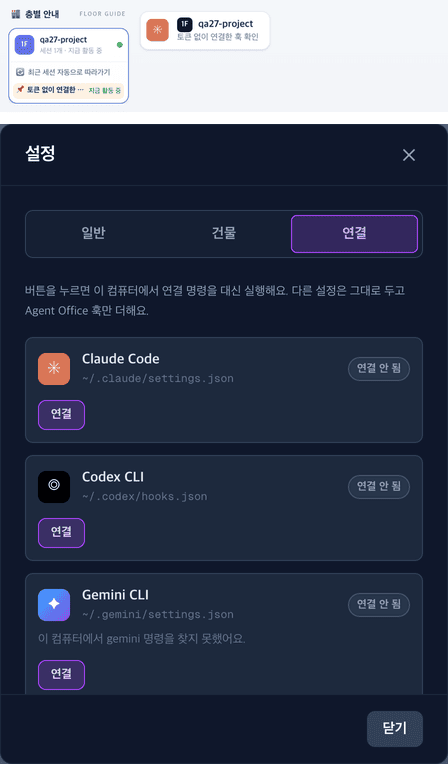

# 27 · 토큰 없이 연결

- 브랜치: `fix/27-connect-without-token`
- 근거: 사용자 요청 — 「링크 안 눌림 눌리게 수정해」(그냥 연 화면에서 「연결」 버튼이 꺼져 있고 토큰 주소 안내만 뜬다), [25 보고서](25-connect-from-browser.md)의 알려진 한계
- 검증한 커밋: `bb28b16`

## 목표

`http://localhost:4747` 을 그냥 열어도 설정 창 「연결」 탭의 버튼이 눌리고, 누르면 연결된다.

## 원인

- 연결 API 는 다른 부작용 있는 API 처럼 실행 토큰을 요구했다. 토큰은 백엔드 터미널에 찍힌 `?token=` 주소로 열어야만 화면에 들어온다.
- 그래서 그냥 연 화면은 버튼이 꺼진 채 「터미널의 주소로 열어 주세요」만 보였다. 안내 속 주소도 진짜 토큰이 없어 링크로 만들 수 없다.

## 한 일

- **사무실 화면에서 온 연결은 토큰 없이 받는다** — 백엔드는 요청의 Origin 이 사무실 화면의 주소(CORS 목록 중 `localhost` · `127.0.0.1` · `::1`)면 연결 · 해제를 실행한다. 브라우저 웹소켓 연결이 이미 따르던 규칙이다. 그 목록을 미들웨어로 옮겨 둘이 함께 쓴다.
- **그 밖은 그대로 막는다** — 웹 페이지는 Origin 을 바꿀 수 없다. 그래서 다른 웹사이트, DNS 리바인딩(Origin 이 공격자 주소), Origin 이 없거나 `null` 인 요청은 여전히 토큰이 있어야 한다. `CLAUDE_OFFICE_API_KEY` 를 직접 정했으면 전부 그 키가 있어야 한다.
- **화면** — 버튼을 미리 끄지 않는다. 백엔드가 거절했을 때만 토큰 안내가 뜬다.
- README 의 연결 방법에서 토큰 주소 단계를 뺐다.

## 검증

| 단계 | 명령 · 방법 | 결과 |
| --- | --- | --- |
| 정적 검증 | `make checkall` | 통과 — 백엔드 602(새 7) · 프런트 275 · 훅 113 · 플러그인 34 |
| 실검증 | 사용자가 띄워 둔 `make dev`(4747 · 8000)는 건드리지 않고, 작업 폴더를 따로 만들어 백엔드 8010 · 프런트 4748 로 띄웠다. 백엔드는 가짜 홈 폴더로 띄워 설치가 실제 사용자 설정에 들어가지 않게 했다. 헤드리스 Chromium 1280×800 · 390×844(터치), 토큰 없는 주소로 열었다 | TC 8건 — ✅ 8 |
| 정리 | QA 서버 · 브라우저 · 작업 폴더 · 가짜 홈 폴더를 지웠다. 실제 `~/.claude/settings.json` 은 그대로(해시 같음)이고 `~/.local/bin` 에 훅 도구가 없다 | `:8010` · `:4748` 듣는 프로세스 0 |

### 실검증 TC

| TC | 우선순위 | 판정 | 방법 · 근거 |
| --- | --- | --- | --- |
| A-01 그냥 연 화면 | P1 | ✅ | 토큰 없음(저장된 토큰도 없음). 「연결」 탭에 토큰 안내가 없고 세 버튼이 모두 켜져 있다(아래 그림 아래) |
| A-02 Claude Code 연결 | P1 | ✅ | act — 「연결」을 누르자 「완료했어요」 · 「연결됨」. 가짜 홈의 `settings.json` 에 훅 12개, 원래 있던 다른 훅과 `theme` 는 그대로 |
| A-03 사무실에 뜬다 | P1 | ✅ | act — 들어간 훅 명령을 Claude Code 처럼 실행했다. 「1F qa27-project · 토큰 없이 연결한 훅 확인」 세션이 뜨고(아래 그림 위), 「LIVE」 · 「Claude 작업 중 📖 자료실 · src/auth.py」가 실시간으로 바뀐다(웹소켓도 옮긴 규칙으로 붙는다) |
| A-04 다른 출처는 막는다 | P1 | ✅ | act — `curl` 로 연결 API 에 Origin 을 바꿔 보냈다. `https://evil.example` · `http://attacker.test:8010` · `null` · Origin 없음은 401, 사무실 화면(`http://localhost:4748`)만 200 |
| A-05 거절되면 안내 | P2 | ✅ | 주입 — 연결 응답을 401 로 바꿨다. 「…?token=… 주소로 이 화면을 열어 주세요」가 뜨고 버튼이 꺼진다 |
| A-06 해제 | P2 | ✅ | act — 토큰 없이 「해제」. 우리 훅 0개, 다른 훅 그대로 |
| A-07 폰 | P2 | ✅ | 390×844, 토큰 없이도 세 버튼이 켜져 있고 가로 스크롤 없음 |
| A-08 콘솔 | P2 | ✅ | 콘솔 오류 0. A-05 에서 일부러 만든 401 한 줄만 있다 |
| B-01 출처 규칙 | P1 | ✅ | [unit] Origin 없음 · 다른 사이트 · 리바인딩 · `0.0.0.0`(CORS 목록에 있지만 루프백 아님) · `null` 은 401, 사무실 화면은 통과(이 예외를 빼면 실패), 키를 직접 정했으면 사무실 화면도 401, 401 응답에 CORS 헤더 |

### 화면

위: 연결한 훅으로 들어온 세션. 아래: 토큰 없이 연 「연결」 탭.

## 검증하지 못한 것

- 실제 사용자 설정에 설치 — QA 는 가짜 홈 폴더에서만 했다.

## 알려진 한계 (버그 아님)

- 화면을 `0.0.0.0:4747` 처럼 루프백이 아닌 주소로 열면 토큰이 필요하다. `localhost` · `127.0.0.1` 로 연다.
- 「DB 비우기」 · 「시뮬레이션」처럼 다른 부작용 있는 기능은 지금처럼 토큰이 필요하다.

## 다음 작업

없음. 새 요청이 오면 작업 표에 이어 넣는다.
