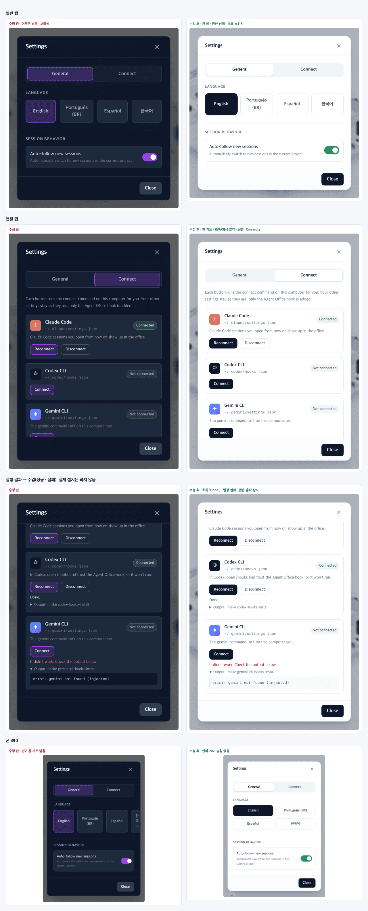

# 29 · 설정 창 밝은 디자인

- 브랜치: `feat/29-light-settings-modal`
- 근거: 사용자 지시 — 「이 모달 디자인도 UI에 맞춰 이런 보라색 기존 레거시 디자인은 다폐기할거임」, [근거 문서](../plan/spec.md) 「2D 사무실 제거」
- 검증한 커밋: `a412cd7`

## 목표

설정 창에 남아 있던 2D 시절의 어두운 남색 · 보라색을 걷어 내고, 등각 사무실 화면과 같은 밝은 디자인으로 맞춘다. 동작과 문구는 그대로 둔다.

## 한 일

- **창 틀(`Modal.tsx`)** — 흰 바탕 · 옅은 슬레이트 테두리 · `rounded-2xl` 카드(오른쪽 패널 카드와 같은 모양). 뒤 배경은 폰 시트와 같은 `slate-900/30`. 닫기 버튼은 둥근 도구 버튼 모양에 파란 포커스 표시.
- **일반 탭(`SettingsModal.tsx`)** — 탭은 회색 막대 안의 흰 선택 칸. 고른 언어는 진한 남색 칸에 흰 글자(머리말 층 배지 · 「에이전트 연결」 버튼과 같은 색). 자동 따라가기 스위치는 층별 안내의 「지금 활동 중」 초록(`#2ca056`). 「닫기」는 진한 남색 버튼.
- **연결 탭(`ConnectTab.tsx`)** — 흰 카드, 「연결됨」 초록 · 「연결 안 됨」 회색 알약, 진한 「연결」 · 밝은 「해제」 버튼, 호박색 안내 상자, 밝은 출력 상자. 성공은 초록, 실패는 빨강 글자.
- **읽기 쉽게** — 흰 바탕에서 작은 보조 글자는 `slate-500` 이상으로 두어 대비 4.5:1 을 넘긴다. 스위치에도 포커스 표시를 붙였다(전에는 없었다). 폰에서 언어 버튼 넷이 한 줄에서 넘치던 것을 두 줄 두 칸으로 바꾸고, 낱말 가운데서 줄이 바뀌지 않게 했다.
- 보라색 · 어두운 레거시 클래스는 이 세 파일에만 남아 있었다. 이제 프런트에 없다.

## 검증

| 단계 | 명령 · 방법 | 결과 |
| --- | --- | --- |
| 정적 검증 | `UV_FROZEN=1 make checkall` | 통과 — 백엔드 609 · 프런트 242 · 훅 113 · 플러그인 34 |
| 실검증 | 다른 세션 서버는 두고 작업 폴더를 따로 만들어 띄웠다 — 백엔드 8011(빈 DB), 수정 후 4760, 수정 전(main `8fce0dd`) 4770. 헤드리스 Chromium 1280×800 · 390×844. 색은 화면에 칠해진 값(`getComputedStyle` → sRGB)으로 쟀다. 연결 탭의 실행 결과는 요청을 가로채 가짜 응답으로만 봤다 — 실제 설치는 하지 않았다(백엔드 로그에 `POST /api/v1/hooks` 0건, `~/.claude/settings.json` 수정 시각 그대로) | TC 10건 — ✅ 10 |
| 정리 | QA 서버 3개 · 브라우저를 내리고, 수정 전 작업 폴더 · QA DB · 스크립트 · 캡처를 지웠다. 바꾼 언어는 처음 상태(빈 값)로 되돌렸다 | `:8011` · `:4760` · `:4770` 듣는 프로세스 0 |

### 실검증 TC

| TC | 우선순위 | 판정 | 방법 · 근거 |
| --- | --- | --- | --- |
| A-01 일반 탭 | P1 | ✅ | 창 `rgb(255,255,255)`, 탭 막대 slate-100, 고른 언어 slate-900 바탕 · 흰 글자, 스위치 `rgb(44,160,86)`. 보라색으로 칠한 곳 수정 전 7 → 수정 후 0 |
| A-02 연결 탭 | P1 | ✅ | 흰 카드, 「Connected」 emerald-100 · 「Not connected」 slate-100 알약, 「Reconnect」 · 「Connect」 slate-900, 「Disconnect」 흰 버튼. 보라색 9 → 0 |
| A-03 다른 컴퓨터에서 열린 백엔드 | P2 | ✅ | 주입 — 상태 응답을 `available:false · not_local` 로 바꿨다. 호박색 밝은 안내 상자, 버튼 전부 꺼짐(수정 전과 같음) |
| A-04 실행 결과 | P2 | ✅ | 주입 — Codex 는 성공, Gemini 는 실패 응답. 「Done.」 emerald-700, 「It didn't work…」 rose-600, 출력은 밝은 상자(아래 그림 셋째 줄). 요청은 백엔드에 닿지 않았다 |
| A-05 불러오기 실패 | P3 | ✅ | 주입 — 상태 응답 500. 「Couldn't read the connections…」 rose-600 |
| A-06 키보드 포커스 | P2 | ✅ | 언어 버튼: 흰 2px + 파랑(blue-400) 4px 링, 스위치: 파랑 2px 링(수정 전은 없음), 「Close」: 파랑 2px 테두리 |
| A-07 폰 390 | P2 | ✅ | 창 좌우 16px. 일반 · 연결 탭 모두 가로 넘침 없음(수정 전은 언어 줄이 넘쳤다). 언어 버튼 154px × 2줄, 모두 한 줄 글자 |
| A-08 대비 | P2 | ✅ | 수정 후 4.5:1 미만 글자 0건(에이전트 로고 글자 ✳ · ✦ 는 로고라 제외). 수정 전에는 보조 글자가 3.07 까지 내려갔다 |
| A-09 한국어 | P3 | ✅ | act — 한국어로 바꿔도 탭 · 버튼 글자가 넘치지 않는다. 영어로 되돌리고 저장값을 지웠다 |
| B-01 스모크 | P1 | ✅ | 등각 화면 → 빈 사무실 「Connect an agent」 → 연결 탭 → 일반 탭 → 닫기. 콘솔 오류 0 |

### 화면

위부터: 일반 탭, 연결 탭, 실행 결과(가짜 응답), 폰 390. 왼쪽이 수정 전, 오른쪽이 수정 후.

## 검증하지 못한 것

- 실제 「연결」 · 「해제」 실행 — 이 컴퓨터의 전역 훅 설정을 바꾸므로 누르지 않았다. 버튼과 결과 표시는 가짜 응답으로만 봤다(동작 코드는 바꾸지 않았다).

## 알려진 한계 (버그 아님)

- 설정 창 안에서 포커스가 갇히지 않는다(Tab 이 창 밖으로 나간다). 전부터 그랬고 이번에 바꾸지 않았다.

## 다음 작업

2D 화면만 읽던 데이터 정리(백엔드 화이트보드 집계 · 지휘 센터 개요 등). 작업 표 번호는 시작할 때 정한다.
