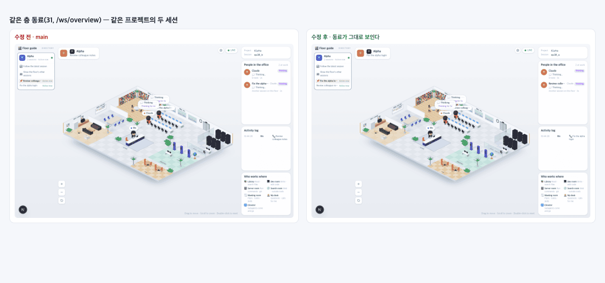

# 30 · 2D 화면만 부르던 백엔드 통로 정리

- 브랜치: `chore/30-prune-2d-feeds`
- 근거: 사용자 지시 — 「관련 코드 다제거해(기능 동작에 필요한거빼고) 2D 사무실은 다 제거해버려」, [근거 문서](../plan/spec.md) 「2D 사무실 제거」
- 검증한 커밋: `6d35b62`

## 목표

2D 사무실을 지운 뒤 아무도 부르지 않는 백엔드 통로와 그 뒤의 서비스를 지운다. 등각 사무실이 쓰는 통로는 남긴다.

## 한 일

- **창 포커스** — `POST /api/v1/sessions/{id}/focus`(터미널 창을 앞으로 가져오던 「클릭해 포커스」)와 미들웨어의 그 분기를 지웠다.
- **`GET /api/v1/status`** — 2D 머리말이 읽던 상태 끝점을 지웠다. Docker 상태 확인은 `/health` 라 그대로다.
- **깃 상태** — 저장소를 주기적으로 훑어 `git_status` 메시지를 보내던 서비스(`git_service.py` · `models/git.py`), 웹소켓 연결 때 보내던 첫 메시지, `GIT_POLL_INTERVAL` 설정을 지웠다. 프런트의 `gitStatus` 상태 · 타입도 지웠다.
- **층 · 방 설정과 팀 병합** — 2D 빌딩 뷰의 층 · 방 설정(`/api/v1/floors` · `building_config` · `floors.toml` · 제품 매핑), 세션의 `floorId` · `roomId`, 방 단위 웹소켓 `/ws/room/{id}` 과 팀 세션을 한 상태로 합치던 `RoomOrchestrator` 를 지웠다. 빌딩 설정은 `/api/v1/floors` 를 불러야만 읽혔고 이제 부르는 곳이 없어서, 이 경로는 이미 돌지 않고 있었다. DB 비우기는 이제 설정값을 전부 지운다(전에는 `building_config` 만 남겼다).
- **남긴 것** — 지휘 센터 개요 `/ws/overview` 는 31 의 「같은 층 동료」가 읽으므로 남겼다. 개요를 만드는 함수는 `room_orchestrator.py` 에서 `app/core/overview.py` 로 옮겼다. 팀 이벤트 형 · `teammate_idle` 전이 · 팀 필드(`team_name` 등)는 그대로다.
- **생성 타입 · 문서** — `make gen-types` 로 `generated.ts` 를 다시 만들었다. `make fmt` 가 이 파일을 다시 접어 형 비교(type-drift)가 어긋나던 것을 `frontend/.prettierignore` 로 막았다. backend README · ARCHITECTURE · 배포 안내 · `.env.example` 을 고쳤다.

## 검증

| 단계 | 명령 · 방법 | 결과 |
| --- | --- | --- |
| 정적 검증 | `UV_FROZEN=1 make checkall` · `make gen-types` 뒤 `git diff --exit-code frontend/src/types/generated.ts` | 통과 — 백엔드 565(지운 기능의 시험 46건 삭제 · DB 비우기 시험 1건 추가) · 프런트 261 · 훅 113 · 플러그인 34, 형 비교 차이 없음 |
| 실검증 | 다른 세션 서버는 두고 수정 후(이 브랜치) 백엔드 8011 · 프런트 4760, 수정 전(main `b0529ac`) 백엔드 8012 · 프런트 4770 을 각각 빈 DB 로 띄웠다. 같은 이벤트를 두 백엔드에 넣고 헤드리스 Chromium 1280×800 으로 나란히 봤다 | TC 9건 — ✅ 9 |
| 정리 | QA 서버 4개 · 브라우저를 내리고 수정 전 작업 폴더 · QA DB · 스크립트 · 캡처를 지웠다 | `:8011` · `:8012` · `:4760` · `:4770` 듣는 프로세스 0 |

### 실검증 TC

| TC | 우선순위 | 판정 | 방법 · 근거 |
| --- | --- | --- | --- |
| A-01 지운 끝점 | P1 | ✅ | `/focus` 401(있음) → 404, `/api/v1/status` 200 → 404, `/api/v1/floors` 200 → 404 |
| A-02 방 웹소켓 | P1 | ✅ | 페이지 출처에서 `/ws/room/qa30` 연결: 수정 전 열림 → 수정 후 닫힘(1006) |
| A-03 `/health` | P2 | ✅ | 양쪽 200 |
| A-04 세션 목록 | P2 | ✅ | 응답 필드에서 `floorId` · `roomId` 가 빠졌다 |
| B-01 세션 웹소켓 | P1 | ✅ | `state_update` 정상. `git_status` 0건(수정 전도 깃 저장소가 아닌 폴더라 0건 — 지운 코드는 시험으로 덮음) |
| B-02 같은 층 동료 | P1 | ✅ | 같은 프로젝트 「Alpha」 세션 둘. 양쪽 모두 다른 세션의 Claude 가 사무실과 「사무실 사람들」에 보이고 `/ws/overview` 가 상태를 35–36번 보냈다(아래 그림) |
| B-03 심부름 | P1 | ✅ | `errands` 시나리오 — 활동 로그 14줄, 마지막 줄까지 수정 전과 같다 |
| B-04 팀 시나리오 | P2 | ✅ | `teams` 시나리오 — 세션 셋(lead · impl · test)이 생기고 두 백엔드 로그에 오류 · Traceback 0 |
| B-05 콘솔 | P1 | ✅ | 콘솔 오류 0 |

### 화면

같은 층 동료 — 왼쪽 수정 전, 오른쪽 수정 후. 화면은 바뀌지 않는다.

## 검증하지 못한 것

- 실제 깃 저장소에서의 `git_status` 차이 — QA 프로젝트 폴더가 깃 저장소가 아니라 수정 전에도 메시지가 없었다. 지운 서비스는 시험 · 코드로만 확인했다.

## 알려진 한계 (버그 아님)

- 옛 DB 에는 세션의 `floor_id` · `room_id` 컬럼이 남는다. 읽지 않을 뿐 해는 없다.
- 팀 필드 `team_name` · `is_lead` 는 이제 쓰기만 하고 읽는 곳이 시험뿐이다. 다음 정리에서 같이 본다.

## 다음 작업

2D 화면만 읽던 상태 정리(화이트보드 집계 · 사무실 상태 · 대화 기록 · 압축 단계 · 디버그 상태). 작업 표 번호는 시작할 때 정한다.
