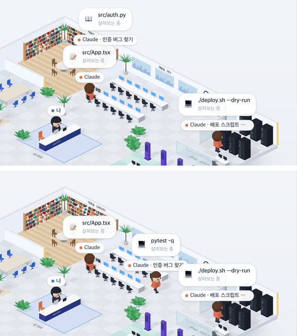

# 31 · 같은 층 동료

- 브랜치: `feat/31-floor-colleagues`
- 근거: 사용자 요청 — 「활동 중인 건 많은데 왜 한 명밖에 안 돌아다님?」 → 「그렇게 한번 바꿔봐」(같은 층에서 활동 중인 세션의 Claude 들이 한 사무실에 같이 돌아다니게)
- 검증한 커밋: `714b0f7`

## 목표

같은 층(프로젝트)에서 지금 일하는 다른 세션의 Claude 도 사무실에 나와, 자기 세션이 일하는 방으로 다닌다.

## 한 일

- **동료** — 층별 안내에서 고른 세션 말고, 같은 층에서 지금 일하는 세션(최근 2분 안에 이벤트, 최신 순, 최대 5개)의 Claude 가 동료로 나온다. 빈 개발실 자리에 앉고, 자기 세션이 읽으면 자료실 · 명령을 돌리면 서버실처럼 그 세션의 일에 따라 움직인다. 이름 칩은 「Claude · 세션 제목」이다.
- **자리** — 개발실 빈 의자 11개 중 5개까지만 동료가 쓰고, 나머지는 고른 세션의 서브에이전트 몫이다.
- **사무실 사람들** — 동료도 목록에 나오고, 도구 수 대신 「같은 층 다른 세션」이라고 적는다(도구 기록은 그 세션 쪽에 있다).
- **드나들기** — 세션이 일을 멈추면(2분 조용하거나 끝나면) 사무실에서 빠진다. 층별 안내에서 동료 세션을 고르면 그 세션이 주인공이 되고, 원래 세션은 동료가 된다.
- **데이터** — 지휘 센터가 쓰던 `/ws/overview` 소켓 하나로 모든 세션의 Claude 상태를 받는다. 이 소켓은 Claude 의 상태만 보내서, 지금 하는 일(방) · 막힘 · 말풍선 · 차례 진행 여부를 더했다. 보여 줄 동료가 있을 때만 연다.
- 다른 층의 세션은 나오지 않는다. 문구 1개(4개 언어)를 더했다.

## 검증

| 단계 | 명령 · 방법 | 결과 |
| --- | --- | --- |
| 정적 검증 | `make checkall` | 통과 — 백엔드 610(새 1) · 프런트 248(새 6) · 훅 113 · 플러그인 34 |
| 실검증 | 사용자가 띄워 둔 `make dev` 는 건드리지 않고 작업 폴더를 따로 만들어 백엔드 8010 · 프런트 4748 로 띄웠다(빈 DB). 같은 층 `demo-app` 에 세션 셋(편집 · 읽기 · 명령), 다른 층 `other-app` 에 하나를 이벤트로 만들고 헤드리스 Chromium 1280×800 으로 봤다 | TC 7건 — ✅ 7 |
| 정리 | QA 서버 · 브라우저 · 작업 폴더를 정리했다 | `:8010` · `:4748` 듣는 프로세스 0 |

### 실검증 TC

| TC | 우선순위 | 판정 | 방법 · 근거 |
| --- | --- | --- | --- |
| A-01 셋이 같이 있다 | P1 | ✅ | 고른 세션 「UI 손보기」의 Claude 는 개발실에서 `src/App.tsx` 편집, 「Claude · 인증 버그 찾기」는 자료실에서 `src/auth.py`, 「Claude · 배포 스크립트 점검」은 서버실에서 `./deploy.sh --dry-run`(아래 그림 위) |
| A-02 다른 층은 없다 | P1 | ✅ | `other-app` 세션의 Claude 칩은 없다 |
| A-03 따라 움직인다 | P1 | ✅ | 「인증 버그 찾기」 세션이 `pytest -q` 를 돌리자 그 Claude 가 서버실로 걸어간다 — 서버실 동료와의 화면 거리 289px → 140px(아래 그림 아래) |
| A-04 사무실 사람들 | P2 | ✅ | 「Claude · 작업 중 📝 개발실 · src/App.tsx · 도구 1회」 아래에 두 동료가 「작업 중 💻 서버실 · ./deploy.sh --dry-run · 같은 층 다른 세션」, 「📖 자료실 · src/auth.py」로 나온다 |
| A-05 주인공 바꾸기 | P1 | ✅ | 층별 안내에서 「인증 버그 찾기」를 고르자 머리말이 그 세션으로 바뀌고, 칩이 「Claude」 · 「Claude · 배포 스크립트 점검」 · 「Claude · UI 손보기」가 된다 |
| A-06 끝나면 나간다 | P2 | ✅ | 「배포 스크립트 점검」 세션을 끝내자(`session_end`) 다음 목록 갱신에 그 Claude 가 빠진다 |
| A-07 연결 · 콘솔 | P2 | ✅ | `ws://…/ws/overview` 소켓 하나가 열리고 콘솔 오류 0 |
| B-01 규칙 | P1 | ✅ | [unit] 같은 층 · 최근 2분 · 고른 세션 제외 · 최신 순 · 최대 5개 · 층이 없으면 없음, 동료 칩 이름과 권한 대기 → 「내 자리」, 생각 중 판정(고민 중), 말풍선이 같으면 그때 시각 유지, overview 에 방 · 말풍선 · 차례가 실린다 |

### 화면

위: 세 세션의 Claude 가 각자 개발실 · 자료실 · 서버실에. 아래: 「인증 버그 찾기」 세션이 명령을 돌리자 서버실로 걸어간다.

## 검증하지 못한 것

- 사용자가 띄워 둔 실제 세션들 — 머지 뒤 사용자 화면에서 본다.

## 알려진 한계 (버그 아님)

- 동료는 처음 보일 때 자리에 앉은 채로 나타나고, 빠질 때도 바로 사라진다(엘리베이터로 오가지 않는다).
- 동료 세션의 서브에이전트는 나오지 않는다. 동료는 그 세션의 Claude 하나다.
- 칩은 150px 에서 잘린다. 긴 세션 제목은 사무실 사람들 목록에서 본다.

## 다음 작업

없음. 새 요청이 오면 작업 표에 이어 넣는다.
