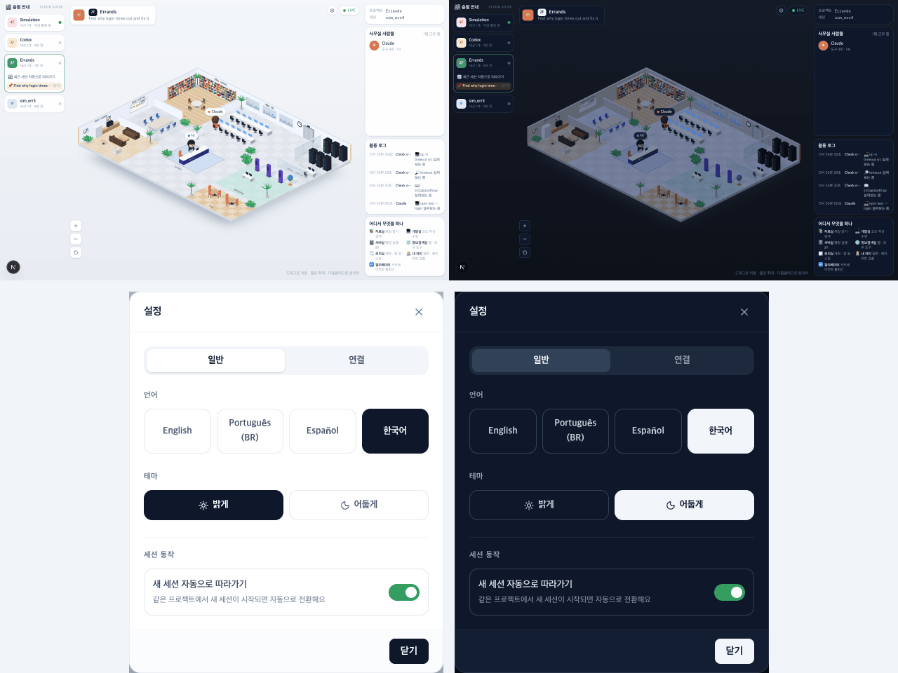

# 32 · 어두운 테마

- 브랜치: `feat/32-dark-theme`
- 근거: 사용자 요청 — 「다크 테마로도 바꿀수있게 작업해줘」, [근거 문서](../plan/spec.md) 「어두운 테마」
- 검증한 커밋: `ea109f7`(31 머지 전). main 의 31 · 33 을 받은 뒤 `0742969` · `86ed977` 에서 정적 검증 · 스모크를 다시 돌렸다

## 목표

설정에서 밝은 화면과 어두운 화면을 고를 수 있게 한다. 어둡게 고르면 화면 틀과 사무실이 함께 밤 화면으로 바뀐다.

## 한 일

- **고르기** — 설정 「일반」 탭에 「테마」(「밝게」 · 「어둡게」)를 더했다. 기본은 밝게다. 언어 버튼과 같은 모양 · 같은 방향키 동작이라, 둘을 버튼 묶음 하나(`RadioButtons`)로 합쳤다.
- **저장** — 고른 값은 언어처럼 백엔드 설정(`theme`)에 저장한다. 백엔드는 키를 가리지 않아 고치지 않았다. 브라우저에도 같은 값을 남기고, 페이지 머리의 짧은 스크립트가 그 값을 읽어 화면을 그리기 전에 `<html>` 에 `dark` 를 붙인다. 그래서 어둡게 둔 사람이 새로 열어도 밝은 화면이 번쩍이지 않는다. 브라우저 저장소를 못 쓰면(사생활 보호 모드) 백엔드 값만으로 동작한다.
- **화면 틀** — Tailwind 의 `dark:` 를 OS 설정이 아니라 `<html>` 의 `dark` 로 켜고, 층별 안내 · 머리말 · 오른쪽 패널 · 확대 버튼 · 폰에서 덮어 여는 창 · 설정 창 · 연결 탭 · 이름 칩 · 말풍선(고민 · 말 · 도구 · 실패)에 어두운 남색 변형을 더했다. 검은 OpenCode · Codex 로고는 어두운 머리말에 묻혀서 옅은 테두리를 둘렀다.
- **밤 조명** — 장면 조명을 낮추고 푸르게 했다(주변광 1.9 → 0.85, 해 1.6 → 0.75). 벽 · 벽 끝 · 바닥판 옆면 · 화이트보드 · 액자는 낮에 스스로 밝히는 값이 있어 조명만 낮추면 그대로 밝다. 그 값만 0.12 배로 낮췄다. 아이맥 화면 · 랙 불빛 · 키오스크 화면은 그대로 켜 둔다. 0.3 배에서는 벽 끝의 노란 줄이 여전히 켜진 것처럼 보여서 더 낮췄다.

## 검증

| 단계 | 명령 · 방법 | 결과 |
| --- | --- | --- |
| 정적 검증 | `make checkall` | 통과 — 백엔드 609 · 프런트 250(새 8: 테마 저장 · 첫 그리기 스크립트 · 설정 불러오기) · 훅 113 · 플러그인 34. main 의 31 을 받은 뒤 백엔드 610 · 프런트 256, 33 을 받은 뒤 백엔드 610 · 프런트 258 · 훅 113 · 플러그인 34 |
| 빌드 | `bun run build`(정적 내보내기) | 페이지 `/` · `/iso` · `/_not-found`, `out/index.html` 에 테마 스크립트가 들어 있다 |
| 실검증 | 사용자가 띄워 둔 서버(4747 · 8000)는 건드리지 않고 작업 폴더를 따로 만들어 띄웠다 — 백엔드 8030(빈 DB · 요약 꺼짐), 수정 후 4750, 수정 전(main) 4751. 수정 전은 처음에 `8fce0dd`, 29 머지 뒤 `2d6168d` 로 바꿔 설정 창을 다시 비교했다. 시뮬레이터(`complex` · `errands`)와 직접 넣은 이벤트, 헤드리스 Chromium 1280×800 · 1280×900 · 390×844 | TC 17건 — ✅ 17 |
| 31 을 받은 뒤 스모크 | 같은 층에 `errands` 세션 둘을 띄우고 설정에서 어둡게로 바꾼 뒤 새로고침 | 「이 층의 다른 세션」 줄까지 어둡다. 새로고침 직후 `dark` 가 붙어 있고 콘솔 오류 0 |
| 33 을 받은 뒤 스모크 | 33 이 더한 설정 「같은 층 세션 함께 보기」 스위치와 층별 안내의 👥 버튼에도 어두운 변형을 넣고, 설정 창 밝게 · 어둡게와 층별 안내를 찍었다 | 스위치 2개 · 👥 버튼이 어둡다. 콘솔 오류 0 |
| 정리 | QA 서버 3개 · 브라우저를 내리고, 수정 전 작업 폴더 · QA DB · 스크립트 · 캡처를 지웠다 | `:8030` · `:4750` · `:4751` 듣는 프로세스 0(31 · 33 뒤 스모크 서버도 같다) |

### 실검증 TC

| TC | 우선순위 | 판정 | 방법 · 근거 |
| --- | --- | --- | --- |
| A-01 기본은 밝게 | P1 | ✅ | 저장된 값이 없는 새 브라우저는 밝게 연다. 빈 사무실 1280×800 을 수정 전과 픽셀로 비교했다. 다른 픽셀 29개 중 9개는 수정 전끼리 찍어도 달라지는 랙 불빛이다. 20개는 「Connect an agent」 버튼 모서리의 계단 현상(밝기 12 차이)이고, 그 버튼의 배경 · 모서리 · 위치 계산값은 같다 |
| A-02 설정에서 어둡게 | P1 | ✅ | act — 「테마」 → 「어둡게」. 바로 어두워지고 백엔드 `theme=dark`, 브라우저 저장값 `dark` |
| A-03 방향키 | P2 | ✅ | 「어둡게」에서 → 를 누르면 「밝게」로 초점과 값이 옮겨 가고, ← 로 돌아온다 |
| A-04 새로 열어도 어둡게 | P1 | ✅ | 새로고침 직후 `<body>` 가 생기기 전에 이미 `dark` 가 붙어 있다. 그린 뒤 `color-scheme: dark` |
| A-05 다른 곳에서 바꾼 값 | P2 | ✅ | 브라우저에는 밝게, 백엔드에는 어둡게를 두고 열었다. 설정을 불러온 뒤 어둡게로 바뀌고 브라우저 저장값도 `dark` 가 된다 |
| A-06 저장소를 못 쓸 때 | P2 | ✅ | 주입 — `localStorage` 를 읽으면 예외가 나게 하고 열었다. 백엔드 값(어둡게)으로 바뀌고, 설정에서 밝게로 바꾸면 백엔드 값도 바뀐다. 콘솔 오류 0 |
| A-07 모르는 값 | P3 | ✅ | 주입 — 백엔드 `theme=sepia`. 새 브라우저는 밝게 연다 |
| A-08 언어 버튼 회귀 | P1 | ✅ | 버튼 묶음을 합친 뒤에도 「한국어」를 누르면 제목이 「설정」, `language=ko`. ← 로 `es`. 밝은 설정 창에서 탭 · 언어 버튼의 위치 · 크기 · 색 · 글자 위치가 수정 전(29 머지 뒤 main)과 같다 |
| B-01 어두운 사무실 | P1 | ✅ | `complex` — 층별 안내 · 머리말 · 오른쪽 패널 · 확대 버튼 · 이름 칩 · 말풍선이 어두운 남색, 사무실은 밤 조명(아래 그림 위 오른쪽) |
| B-02 밤 조명 | P1 | ✅ | 확대 캡처 — 벽 · 바닥판 · 화이트보드는 어둡고, 아이맥 화면 · 랙 불빛 · 키오스크 화면은 켜져 있다 |
| B-03 말풍선 세 가지 | P2 | ✅ | 주입 — 시뮬레이터에서는 실패 말풍선이 뜨는 순간을 잡지 못해, `isoBubbles.ts` 의 클래스를 그대로 읽어 고민 · 말 · 실패 말풍선을 그렸다. 어둡게에서 각각 보라 · 남색 · 붉은 바탕에 꼬리까지 같은 색 |
| B-04 폰 | P1 | ✅ | 390×844 — 사무실 · 층별 안내 창 · 사람들 창이 어둡다. 가로 스크롤 없음, 화면 높이 그대로 |
| B-05 설정 창 · 연결 탭 | P1 | ✅ | 1280 에서 일반 · 연결 탭, 390 에서 일반 탭이 어둡다(아래 그림 아래). 연결 카드의 「연결」은 누르지 않았다(전역 훅 설정을 바꾼다) |
| B-06 검은 로고 | P3 | ✅ | `coding_agent=codex` 세션 — 머리말의 검은 로고에 옅은 테두리가 보인다 |
| B-07 장면을 다시 만들 때 | P2 | ✅ | dev(React strict mode)는 장면을 두 번 만든다. 그 상태에서도 밤 조명이 걸린다(B-01 이 그 상태) |
| C-01 빌드 | P1 | ✅ | 위 「빌드」 |
| C-02 콘솔 | P1 | ✅ | 위 실행 전부에서 콘솔 오류 0 |

### 화면

위: 밝게 · 어둡게(같은 세션, 1280×800 을 반으로 줄임). 아래: 설정 창 일반 탭, 밝게 · 어둡게.

## 검증하지 못한 것

- 진짜 Claude Code 세션으로는 보지 않았다. 시뮬레이터와 직접 넣은 이벤트만 썼다. 이벤트 경로는 바꾸지 않았다.
- 헤드리스 Chromium 만 봤다. Safari · Firefox 는 보지 않았다.

## 알려진 한계 (버그 아님)

- OS 의 다크 모드는 따르지 않는다. 밝게 · 어둡게 둘 중에서 고른다.
- 다른 브라우저에서 밝게로 바꾸면, 어둡게 남아 있던 브라우저는 다음에 열 때 설정을 불러올 때까지 잠깐 어둡게 보인다.
- 바닥 · 벽의 방 이름 글씨는 조명을 받지 않는 재질이라 밤에도 낮과 같은 밝기다.

## 다음 작업

없음. 새 요청이 오면 작업 표에 이어 넣는다.
