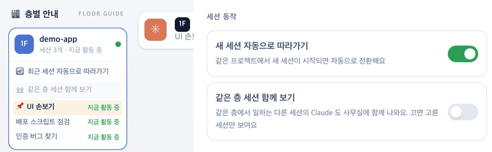

# 33 · 같은 층 세션 함께 보기

- 브랜치: `feat/33-floor-view-toggle`
- 근거: 사용자 요청 — 「세션별로 층별로 보이게 하는 옵션을 추가하는 건 어떰」, [31 보고서](31-floor-colleagues.md)
- 검증한 커밋: `7b634f1`

## 목표

사무실을 세션별(고른 세션만)로 볼지, 층별(같은 층에서 일하는 다른 세션의 Claude 도 함께)로 볼지 고른다.

## 한 일

- **층별 안내** — 「🔄 최근 세션 자동으로 따라가기」 아래에 「👥 같은 층 세션 함께 보기」 스위치를 더했다. 꺼지면 흐리게 보인다.
- **설정 창** — 일반 탭 「세션 동작」에 같은 스위치와 설명(「같은 층에서 일하는 다른 세션의 Claude 도 사무실에 함께 나와요. 끄면 고른 세션만 보여요」)을 더했다. 두 곳은 같은 값을 쓴다.
- **동작** — 끄면 동료가 빠지고 `/ws/overview` 소켓도 닫힌다. 켜면 31 처럼 같은 층 동료가 나온다. 기본은 켜짐이고, 다른 설정처럼 백엔드에 저장된다(`show_floor_colleagues`).
- 설정 창의 스위치 행은 두 개가 같은 모양이라 작은 컴포넌트로 묶었다. 문구 3개(4개 언어)를 더했다.

## 검증

| 단계 | 명령 · 방법 | 결과 |
| --- | --- | --- |
| 정적 검증 | `make checkall` | 통과 — 백엔드 610 · 프런트 250(새 2) · 훅 113 · 플러그인 34 |
| 실검증 | 작업 폴더를 따로 만들어 백엔드 8010 · 프런트 4748 로 띄웠다(빈 DB). 같은 층에 세션 셋(편집 · 읽기 · 명령)을 이벤트로 만들고 헤드리스 Chromium 1280×800 으로 스위치를 켜고 껐다 | TC 5건 — ✅ 5 |
| 정리 | QA 서버 · 브라우저 · 작업 폴더를 정리했다 | `:8010` · `:4748` 듣는 프로세스 0 |

### 실검증 TC

| TC | 우선순위 | 판정 | 방법 · 근거 |
| --- | --- | --- | --- |
| A-01 기본은 함께 | P1 | ✅ | 스위치가 켜져 있고(`aria-checked="true"`) 칩 「Claude」 · 「Claude · 배포 스크립트 점검」 · 「Claude · 인증 버그 찾기」, 사무실 사람들 3명 |
| A-02 끄면 고른 세션만 | P1 | ✅ | 층별 안내에서 끄자 칩이 「Claude」 · 「나」만 남고 사무실 사람들 1명, overview 소켓이 닫힌다(아래 그림 왼쪽) |
| A-03 저장 | P1 | ✅ | 백엔드 설정에 `show_floor_colleagues=false` 가 저장되고, 새로고침해도 꺼진 채다 |
| A-04 설정 창 | P1 | ✅ | 일반 탭 「세션 동작」에 「같은 층 세션 함께 보기」가 꺼진 채로 보이고(아래 그림 오른쪽), 거기서 켜자 층별 안내 스위치도 켜지고 동료 둘이 돌아온다 |
| A-05 콘솔 | P2 | ✅ | 콘솔 오류 0 |
| B-01 설정 값 | P1 | ✅ | [unit] 저장된 값이 없으면 켜짐, `false` 면 꺼짐, 바꾸면 `PUT /api/v1/preferences/show_floor_colleagues` 로 저장 |

### 화면

왼쪽: 층별 안내의 두 스위치(함께 보기 꺼짐). 오른쪽: 설정 창 「세션 동작」.

## 검증하지 못한 것

- 없음.

## 다음 작업

없음. 새 요청이 오면 작업 표에 이어 넣는다.
