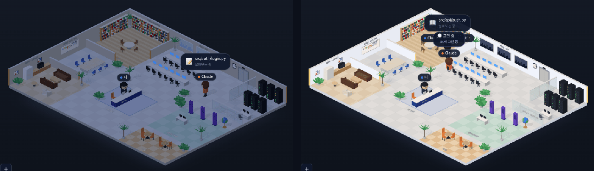

# 34 · 어두운 테마에서도 사무실 불은 켜 둔다

- 브랜치: `feat/34-lit-office-at-night`
- 근거: 사용자 피드백 — 「사무실에 조명은 들어와야될거같은데」(32 의 어두운 테마 화면을 보고), [근거 문서](../plan/spec.md) 「어두운 테마」
- 검증한 커밋: `9324da2`

## 목표

어두운 테마에서 사무실이 불을 끈 것처럼 보이지 않게 한다. 둘레만 밤이고 사무실 안은 불이 켜져 있다.

## 원인

32 는 장면 조명 자체를 낮췄다(주변광 1.9 → 0.85, 해 1.6 → 0.75, 벽 · 바닥판 · 화이트보드의 자체 밝기 0.12 배). 그래서 사무실 전체가 회색으로 가라앉아, 아이맥 화면 · 랙 불빛만 켜진 퇴근한 사무실처럼 보였다.

## 한 일

- 어두운 테마의 조명을 실내등으로 바꿨다. 밝기는 낮과 거의 같고(주변광 1.8, 해 1.45), 빛만 조금 따뜻하다(`#fff7ee`). 처음 고른 `#fff3e2` 는 벽이 누렇게 보여서 한 단계 낮췄다.
- 밤인 것은 창밖으로 보인다. 개발실 창의 하늘은 남색(`nightWindow`), 빌딩은 더 어두운 남색(`nightSkyline`)이 된다. 밝게로 돌아오면 원래 색으로 바뀐다. 나중에 만든 창 재질도 지금 테마의 색을 따른다.
- 32 의 벽 밝기 낮추기는 필요 없어져서 지웠다. 화면 틀 · 설정 창 · 말풍선의 어두운 색은 그대로다.

## 검증

| 단계 | 명령 · 방법 | 결과 |
| --- | --- | --- |
| 정적 검증 | `make checkall` | 통과 — 백엔드 610 · 프런트 258 · 훅 113 · 플러그인 34. 그 뒤 더한 창 색 시험 3건(`isoNightView.test.ts`)도 통과, 타입 · 린트 깨끗 |
| 실검증 | 사용자가 띄워 둔 서버(4747 · 8000)는 건드리지 않았다 — 백엔드 8030(빈 DB · 요약 꺼짐), 수정 후 4750, 수정 전(main `d45e4e2`) 4751. 시뮬레이터 `complex` · `errands`, 헤드리스 Chromium 1280×800 | TC 4건 — ✅ 4 |
| 정리 | QA 서버 3개 · 브라우저를 내리고, 수정 전 작업 폴더 · QA DB · 스크립트 · 캡처를 지웠다 | `:8030` · `:4750` · `:4751` 듣는 프로세스 0 |

### 실검증 TC

| TC | 우선순위 | 판정 | 방법 · 근거 |
| --- | --- | --- | --- |
| A-01 불 켠 사무실 | P1 | ✅ | 같은 세션을 수정 전 · 후 어둡게로 나란히 봤다. 수정 전은 회색으로 가라앉고, 수정 후는 바닥 · 벽 · 가구가 낮처럼 밝다(아래 그림) |
| A-02 창밖은 밤 | P1 | ✅ | 이름표 층을 숨기고 개발실 창을 확대했다. 어둡게는 남색 하늘에 어두운 빌딩, 밝게는 하늘색 그대로 |
| A-03 밝게는 그대로 | P1 | ✅ | 빈 사무실 1280×800 을 수정 전과 픽셀로 비교했다. 다른 픽셀 90개는 서버실 · 개발실 영역이고, 수정 전끼리 찍어도 같은 영역에서 120개가 달라진다(랙 불빛 · 화면 효과) |
| A-04 바로 바꾸기 | P2 | ✅ | 어둡게로 연 화면에서 설정으로 밝게를 고르면 창이 바로 하늘색으로 돌아온다. 새로 연 밝게 화면과 창 · 벽이 같고, 다른 픽셀 302개는 깜박이는 랙 불빛 영역뿐. 콘솔 오류 0 |

### 화면

어둡게, 왼쪽이 수정 전(32) · 오른쪽이 수정 후.

## 검증하지 못한 것

- 진짜 Claude Code 세션으로는 보지 않았다(시뮬레이터만). 이벤트 경로는 바꾸지 않았다.
- 헤드리스 Chromium 만 봤다.

## 알려진 한계 (버그 아님)

- 바닥 · 벽의 방 이름 글씨는 조명을 받지 않는 재질이라 테마와 관계없이 같은 색이다.

## 다음 작업

없음. 새 요청이 오면 작업 표에 이어 넣는다.
