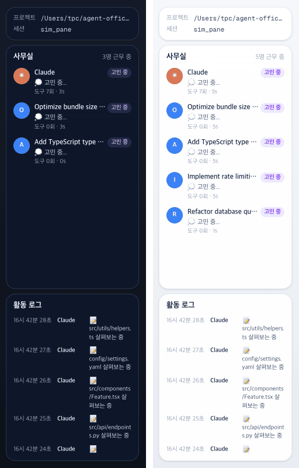

# 35 · 오른쪽 패널 정리

- 브랜치: `feat/35-side-panel-trim`
- 근거: 사용자 요청 — 「어디서 무엇을 하나는 제거」, 「사무실 사람들 -> 사무실」, [근거 문서](../plan/spec.md) 「오른쪽 패널 정리」
- 검증한 커밋: `d9f6ba3`

## 목표

오른쪽 패널에서 방 범례를 빼고, 사람 카드의 제목을 「사무실」로 줄인다.

## 한 일

- 방 범례 카드 「어디서 무엇을 하나」를 지웠다. 오른쪽에는 프로젝트 · 세션 카드, 「사무실」, 「활동 로그」만 남는다. 남은 두 카드가 빈자리를 3 : 2 로 나눠 채운다.
- 사람 카드 제목을 「사무실」로 바꿨다(Office · Oficina · Escritório). 폰에서 이 카드를 여는 버튼의 툴팁도 같은 문구라 함께 바뀐다.
- 범례에서만 쓰던 문구(`iso.panel.rooms` · `iso.roomDoes.*` 7개 · `iso.room.elevator`)를 4개 언어에서 지웠다. 활동 로그가 쓰는 방 이름은 남겼다.
- 근거 문서에 「오른쪽 패널 정리」 절을 두고, README 의 오른쪽 설명을 고쳤다. 「화면 구성」 표는 영상에서 읽은 기록이라 그대로 뒀다.

## 검증

| 단계 | 명령 · 방법 | 결과 |
| --- | --- | --- |
| 정적 검증 | `make checkall` | 통과 — 백엔드 610 · 프런트 261 · 훅 113 · 플러그인 34 |
| 실검증 | 사용자가 띄워 둔 서버(4747 · 8000)는 건드리지 않았다 — 백엔드 8030(빈 DB · 요약 꺼짐), 수정 후 4750. 시뮬레이터 `complex`, 헤드리스 Chromium 1280×800 · 390×844 | TC 4건 — ✅ 4 |
| 정리 | QA 서버 2개 · 브라우저를 내리고 QA DB · 스크립트 · 캡처를 지웠다 | `:8030` · `:4750` 듣는 프로세스 0 |

### 실검증 TC

| TC | 우선순위 | 판정 | 방법 · 근거 |
| --- | --- | --- | --- |
| A-01 범례 없음 | P1 | ✅ | 오른쪽 카드 제목이 「사무실」 · 「활동 로그」 둘뿐이다. 화면 글자에 「어디서 무엇을」 · 「Who works where」 · 범례 설명 문구가 없다 |
| A-02 제목 「사무실」 | P1 | ✅ | 한국어 「사무실」, 영어 「Office」. 번역 키 원문(`iso.panel.` 등) 노출 0 |
| A-03 밝게 · 어둡게 | P2 | ✅ | 1280×800 두 테마에서 카드 둘이 오른쪽 열을 채운다(아래 그림) |
| A-04 폰 | P2 | ✅ | 390×844 — 사람 버튼 툴팁 「사무실」, 눌러 연 창에도 카드 둘뿐. 콘솔 오류 0 |

### 화면

오른쪽 패널, 왼쪽 어둡게 · 오른쪽 밝게.

## 검증하지 못한 것

- 진짜 Claude Code 세션으로는 보지 않았다(시뮬레이터만). 이벤트 경로는 바꾸지 않았다.

## 다음 작업

없음. 새 요청이 오면 작업 표에 이어 넣는다.
