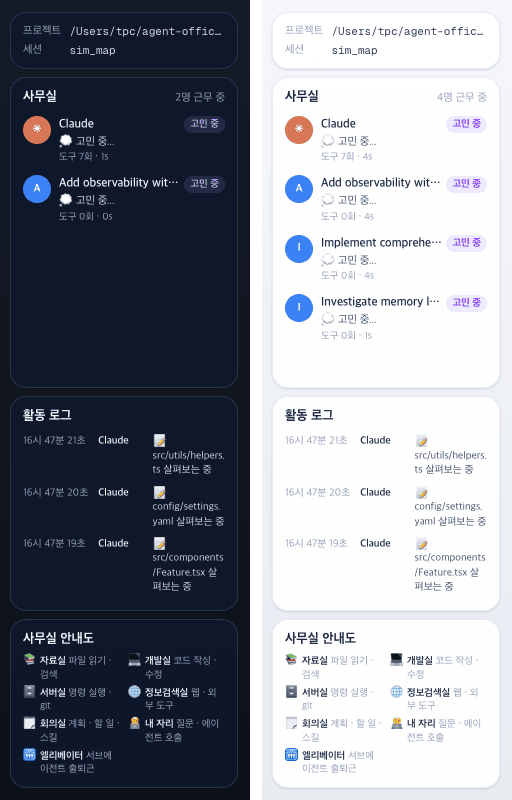

# 36 · 방 범례 제목을 「사무실 안내도」로

- 브랜치: `feat/36-office-map-title`
- 근거: 사용자 정정 — 「어디서 무엇을 하나 제목만 지우라는의미였고 지우지말고 다른 제목을 ㅗ바꾸자」, 「사무실 안내도로 진행」, [근거 문서](../plan/spec.md) 「오른쪽 패널 정리」
- 검증한 커밋: `7be742f`

## 목표

35 에서 카드째 지운 방 범례를 되살리고, 제목만 「사무실 안내도」로 바꾼다.

## 한 일

- 35 의 코드 커밋(`d9f6ba3`)을 되돌려 방 범례 카드와 그 문구(`iso.roomDoes.*` 7개 · `iso.room.elevator`)를 되살렸다.
- 범례 제목을 「사무실 안내도」로 바꿨다(Office map · Plano de la oficina · Mapa do escritório). 35 에서 바꾼 사람 카드 제목 「사무실」은 그대로 뒀다.
- 근거 문서 「오른쪽 패널 정리」에 정정을 적고, README 의 오른쪽 설명을 고쳤다.

## 검증

| 단계 | 명령 · 방법 | 결과 |
| --- | --- | --- |
| 정적 검증 | `make checkall` | 통과 — 백엔드 610 · 프런트 261 · 훅 113 · 플러그인 34 |
| 실검증 | 사용자가 띄워 둔 서버(4747 · 8000)는 건드리지 않았다 — 백엔드 8030(빈 DB · 요약 꺼짐), 수정 후 4750. 시뮬레이터 `complex`, 헤드리스 Chromium 1280×800 · 390×844 | TC 3건 — ✅ 3 |
| 정리 | QA 서버 2개 · 브라우저를 내리고 QA DB · 스크립트 · 캡처를 지웠다 | `:8030` · `:4750` 듣는 프로세스 0 |

### 실검증 TC

| TC | 우선순위 | 판정 | 방법 · 근거 |
| --- | --- | --- | --- |
| A-01 카드가 돌아왔다 | P1 | ✅ | 오른쪽 카드 제목이 「사무실」 · 「활동 로그」 · 「사무실 안내도」, 안내도 줄 7개(첫 줄 「자료실 파일 읽기 · 검색」) |
| A-02 네 언어 | P1 | ✅ | Office map · Plano de la oficina · Mapa do escritório. 번역 키 원문 노출 0 |
| A-03 테마 · 폰 | P2 | ✅ | 1280×800 밝게 · 어둡게, 390×844 에서 연 창에도 카드 셋. 콘솔 오류 0 |

### 화면

오른쪽 패널, 왼쪽 어둡게 · 오른쪽 밝게.

## 검증하지 못한 것

- 진짜 Claude Code 세션으로는 보지 않았다(시뮬레이터만). 이벤트 경로는 바꾸지 않았다.

## 다음 작업

없음. 새 요청이 오면 작업 표에 이어 넣는다.
