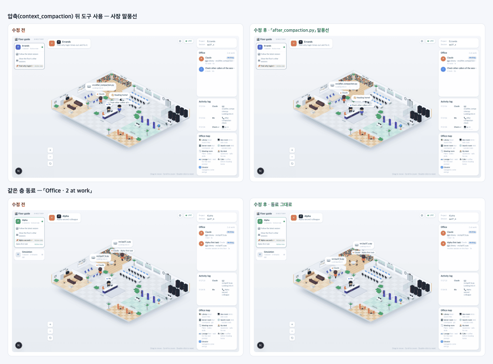

# 37 · 2D 화면만 읽던 상태 정리

- 브랜치: `chore/37-prune-2d-state`
- 근거: 사용자 지시 — 「관련 코드 다제거해(기능 동작에 필요한거빼고) 2D 사무실은 다 제거해버려」, [근거 문서](../plan/spec.md) 「2D 사무실 제거」
- 검증한 커밋: `1388464`

## 목표

백엔드가 만들어 보내지만 2D 화면만 읽던 상태와, 프런트 저장소에서 2D 화면만 쓰던 상태를 지운다. 등각 사무실 · 같은 층 동료가 읽는 값은 남긴다.

## 한 일

- **화이트보드 · 칸반 · 백그라운드 작업** — `whiteboard_tracker.py`, 화이트보드 모델(`WhiteboardData` · `KanbanTask` · `BackgroundTask` 등)과 상태 기계의 집계 · 칸반 처리, 프런트 `whiteboardSlice` 를 지웠다. 이벤트 형 · payload · 기록 요약 · `teammate_idle` 전이는 그대로다.
- **사무실 상태 · 토큰 추적 · 보고서 감지** — `GameState.office`(엘리베이터 · 전화 · 컨텍스트 사용량 · 압축 뒤 도구 수 · 프린터 보고서 · 책상 수), `token_tracker.py`, 서브에이전트가 끝날 때마다 기록 파일을 50MB 까지 읽던 도구 수 계산, 멈출 때마다 LLM 을 부르던 보고서 감지(`detect_report_request`)를 지웠다.
- **대화 기록** — `GameState.conversation` 과 그것만 쌓던 `tool_handler.py`, 복원할 때 기록 파일을 다시 읽던 단계를 지웠다. 사장 말풍선(`set_boss_speech`)은 그대로다.
- **프런트 압축 단계** — `compactionPhase` · `isCompacting` 을 지웠다. 한 번 `context_compaction` 이 오면 끝까지 풀리지 않아, 사장 말풍선이 대기열에 쌓이고 대기 중인 직원이 계속 막혀 있었다. 이벤트는 그대로 기록되고 활동 로그에 남는다.
- **디버그 · 쓰지 않는 값** — 2D 디버그 오버레이 상태(`debugSlice`), 쓰는 곳 없는 선택자 · 재생 프레임 · 할 일 사본, 2D 캔버스 상수(`office_layout.py`), 쓰기만 하던 `phase` · 팀 필드(`team_name` · `teammate_name` · `is_lead`, DB 컬럼은 둔다) · `Session` 모델을 지웠다.
- **남긴 것** — 할 일 파이프라인(개요의 할 일 수를 같은 층 동료가 쓴다), `/ws/overview`, 기록(활동 로그), `isReplaying`, 프런트 `DESKS_PER_ROW`.
- 생성 타입을 다시 만들고 backend · frontend · hooks README, ARCHITECTURE, AI 요약 안내를 고쳤다.

## 검증

| 단계 | 명령 · 방법 | 결과 |
| --- | --- | --- |
| 정적 검증 | `UV_FROZEN=1 make checkall` · `make gen-types` 뒤 `git diff --exit-code frontend/src/types/generated.ts` | 통과 — 백엔드 497(지운 기능의 시험 삭제 · 관찰 대상을 기록 · 말풍선으로 바꾼 시험 포함) · 프런트 261 · 훅 113 · 플러그인 34, 형 비교 차이 없음 |
| 실검증 | 다른 세션 서버는 두고 수정 후(이 브랜치) 백엔드 8011 · 프런트 4760, 수정 전(main `5904475`) 백엔드 8012 · 프런트 4770 을 각각 빈 DB 로 띄웠다. 같은 이벤트를 두 백엔드에 넣고 헤드리스 Chromium 1280×800 으로 나란히 봤다 | TC 7건 — ✅ 7 |
| 정리 | QA 서버 4개 · 브라우저를 내리고 수정 전 작업 폴더 · QA DB · 스크립트 · 캡처를 지웠다 | `:8011` · `:8012` · `:4760` · `:4770` 듣는 프로세스 0 |

### 실검증 TC

| TC | 우선순위 | 판정 | 방법 · 근거 |
| --- | --- | --- | --- |
| A-01 상태 키 | P1 | ✅ | 세션 웹소켓 `state_update` 의 상태 키 — 수정 전 `whiteboardData` · `office` · `conversation` 포함 → 수정 후 `agents` · `arrivalQueue` · `boss` · `codingAgent` · `departureQueue` · `history` · `lastUpdated` · `sessionId` · `todos` |
| B-01 심부름 | P1 | ✅ | `errands` — 활동 로그 14줄이 수정 전과 한 줄씩 같다 |
| B-02 서브에이전트 | P1 | ✅ | `complex` — 출근해 일하고 「👋 Heading home!」 뒤 퇴근. 활동 로그 40줄, 수정 전과 같다 |
| B-03 압축 뒤 | P1 | ✅ | `context_compaction` 뒤 `Read src/after_compaction.py` — 양쪽 모두 사장 말풍선이 뜬다(아래 그림 위). 수정 전은 등각 화면이 대기열을 직접 비워서 화면에는 같게 보인다 |
| B-04 같은 층 동료 | P1 | ✅ | 같은 프로젝트 세션 둘 — 「Office · 2 at work」에 「Alpha first task · Another session on this floor」, 이름 칩 「Claude · Alpha first task」. 수정 전과 같다(아래 그림 아래) |
| B-05 재시작 뒤 복원 | P2 | ✅ | 백엔드를 다시 켜고 끝난 세션을 열면 활동 로그가 복원된다(수정 전 25줄 · 수정 후 28줄 — `complex` 가 도구 수를 무작위로 정해 저장된 이벤트도 70 · 77 개로 다르다) |
| B-06 오류 | P1 | ✅ | 콘솔 오류 0, 두 백엔드 로그에 Traceback 0 |

### 화면

위: 압축 뒤 사장 말풍선. 아래: 같은 층 동료. 왼쪽 수정 전, 오른쪽 수정 후.

## 검증하지 못한 것

- 실제 Claude Code 세션의 토큰 사용량 · 기록 파일 읽기 차이 — 시뮬레이터로만 봤다. 지운 코드는 시험으로 확인했다.

## 알려진 한계 (버그 아님)

- 옛 DB 에는 팀 필드 컬럼이 남는다(쓰기만 한다).
- `isReplaying` 은 읽는 곳이 있어 남겼지만 실제 앱에서 켜지는 경로는 없다(전부터).

## 다음 작업

2D 사무실 제거는 이 항목으로 마친다.
