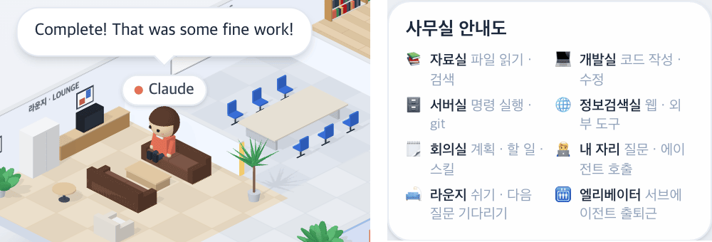

# 38 · 턴이 끝나면 라운지 소파에서 쉰다

- 브랜치: `feat/38-lounge-rest`
- 근거: 사용자 질문 — 「라운지랑 카페는 안써?」에 낸 제안을 「좋아 그렇게 진행하면되겠음」으로 승인, [근거 문서](../plan/spec.md) 「라운지 · 카페」
- 검증한 커밋: `5185309`

## 목표

라운지를 쓴다. 응답을 마치고 다음 질문을 기다리는 Claude 는 라운지 소파에서 쉰다.

## 한 일

- 걷기 규칙(`stepIsoWalker`)에 「쉼」을 더했다. 턴이 끝나고(`turnActive` 꺼짐) 돌릴 도구가 없으면, 도구가 끝난 뒤처럼 1.5초 머문 다음 자리 대신 라운지 소파로 가서 앉는다.
- 새 질문이 오면 소파에서든, 소파로 가던 길이든 곧장 자기 자리로 돌아간다. 도구가 오면 지금처럼 그 방으로 간다.
- 처음 연 화면에서 턴이 이미 끝나 있으면 걸어가지 않고 소파에 앉은 채로 그린다.
- 앉을 자리는 앞 소파 두 칸 · 뒤 소파 두 칸 · 안락의자 순서다(`BREAK_SPOTS`). 쉬는 방은 도구가 보내는 방(`ErrandRoomId`)과 따로 뒀다(`BreakRoomId`). 그래서 활동 로그의 방 이름 문구는 그대로다.
- 사무실 안내도에 「🛋️ 라운지 · 쉬기 · 다음 질문 기다리기」 줄을 더했다(네 언어).

## 검증

| 단계 | 명령 · 방법 | 결과 |
| --- | --- | --- |
| 정적 검증 | `make checkall` | 통과 — 백엔드 565 · 프런트 267(새 6: 쉬러 가기 · 소파에 머물기 · 새 턴에 곧장 복귀 · 가던 길에 돌아서기 · 소파에서도 도구 · Claude 만 쉼) · 훅 113 · 플러그인 34 |
| 실검증 | 사용자가 띄워 둔 서버(4747 · 8000)는 건드리지 않았다 — 백엔드 8030(빈 DB · 요약 꺼짐), 수정 후 4750. 이벤트를 직접 넣고 시뮬레이터 `errands` 를 돌려, 화면의 Claude 이름표 위치를 1초마다 쟀다. 헤드리스 Chromium 1280×800 | TC 4건 — ✅ 4 |
| 정리 | QA 서버 2개 · 브라우저를 내리고 QA DB · 스크립트 · 캡처를 지웠다 | `:8030` · `:4750` 듣는 프로세스 0 |

### 실검증 TC

| TC | 우선순위 | 판정 | 방법 · 근거 |
| --- | --- | --- | --- |
| A-01 턴이 끝나면 소파로 | P1 | ✅ | act — `user_prompt_submit` 뒤 자리(이름표 607, 316)에 있다가 `stop` 을 보내자 10초 안에 라운지(365, 333)로 가서 앉는다(아래 그림 왼쪽) |
| A-02 다시 열면 소파에 | P1 | ✅ | 턴이 끝난 채 새로고침 — 3.5초 뒤 이미 라운지(365, 333). 걸어간 흔적이 없다 |
| A-03 새 질문이면 곧장 자리로 | P1 | ✅ | act — `user_prompt_submit` 0.6초 뒤 이미 자리 쪽으로 움직이고(380, 325), 8초 안에 자리(614, 319) |
| A-04 심부름 회귀 | P1 | ✅ | `errands` 한 판 — 자료실 · 서버실 · 자리를 오가고 턴이 끝나자 라운지에 앉는다. 콘솔 오류 0. 사무실 안내도에 라운지 줄(아래 그림 오른쪽) |

### 화면

왼쪽: 턴을 마친 Claude 가 마지막 말을 띄운 채 소파에 앉아 있다. 오른쪽: 사무실 안내도의 라운지 줄.

## 검증하지 못한 것

- 진짜 Claude Code 세션으로는 보지 않았다(시뮬레이터 · 직접 넣은 이벤트만). 턴이 끝났는지는 백엔드가 이미 보내는 값(`turnActive`)을 읽는다.

## 알려진 한계 (버그 아님)

- 쉬는 것은 Claude 뿐이다. 서브에이전트는 일이 끝나면 퇴근하고, 같은 층 다른 세션의 Claude 는 일하는 동안만 사무실에 보인다.

## 다음 작업

39 퇴근 전 카페 → 40 압축 중 커피(37 머지 뒤).
