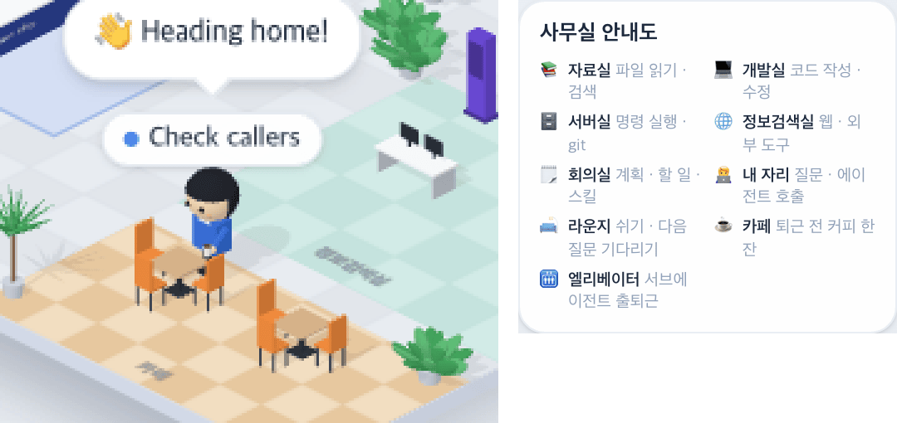

# 39 · 퇴근 전에 카페에 들른다

- 브랜치: `feat/39-cafe-on-the-way-out`
- 근거: 사용자 질문 — 「라운지랑 카페는 안써?」에 낸 제안을 「좋아 그렇게 진행하면되겠음」으로 승인, [근거 문서](../plan/spec.md) 「라운지 · 카페」
- 검증한 커밋: `f36352c`

## 목표

카페를 쓴다. 일을 마친 서브에이전트가 퇴근하기 전에 카페에 들러 커피를 마신다.

## 한 일

- 퇴근 단계에 「커피」를 넣었다. Claude 에게 보고하고(3.5초) 「👋 퇴근합니다!」 손을 흔든 뒤(1.8초), 엘리베이터 대신 카페로 걸어가 탁자 앞에 서서 4초 동안 커피를 마시고, 그다음 엘리베이터를 탄다. 말풍선은 엘리베이터에 탈 때까지 「👋 퇴근합니다!」 그대로다.
- 카페에서는 오른손에 머그잔을 들고, 이따금 입으로 올린다.
- 커피를 마시던 중에 일을 더 받으면 곧장 그 일의 방으로 간다(지금까지의 퇴근 길과 같다).
- 카페에 설 자리는 두 탁자의 빈 쪽(뒤)과 두 탁자 사이 세 곳이다(`BREAK_SPOTS.cafe`). 세 곳 모두 길찾기 시험의 「걸을 수 있는 자리」에 넣었다.
- 사무실 안내도에 「☕ 카페 · 퇴근 전 커피 한 잔」 줄을 더했다(네 언어).

## 검증

| 단계 | 명령 · 방법 | 결과 |
| --- | --- | --- |
| 정적 검증 | `make checkall` | 통과 — 백엔드 565 · 프런트 269(새 2: 카페에 서서 마시기 · 카페에서 일 받으면 복귀, 퇴근 순서 시험에 커피 단계) · 훅 113 · 플러그인 34 |
| 실검증 | 사용자가 띄워 둔 서버(4747 · 8000)는 건드리지 않았다 — 백엔드 8030(빈 DB · 요약 꺼짐), 수정 후 4750. 서브에이전트를 이벤트로 직접 불러 일 하나를 시키고 끝낸 뒤, 이름표 위치를 0.5초마다 쟀다. 헤드리스 Chromium 1280×800 | TC 3건 — ✅ 3 |
| 정리 | QA 서버 2개 · 브라우저를 내리고 QA DB · 스크립트 · 캡처를 지웠다 | `:8030` · `:4750` 듣는 프로세스 0 |

### 실검증 TC

| TC | 우선순위 | 판정 | 방법 · 근거 |
| --- | --- | --- | --- |
| A-01 퇴근 길 순서 | P1 | ✅ | act — `subagent_stop` 뒤 보고 자리(597, 324)에 3.0–8.0초, 카페(625, 496)에 14.5–18.0초 머물고, 엘리베이터 쪽(873, 349)으로 걸어가 26초에 사라진다 |
| A-02 카페에서 커피 | P1 | ✅ | 확대 캡처 — 첫 탁자 뒤에 서서 머그잔을 들고 있고, 머리 위에 「👋 Heading home!」(아래 그림 왼쪽) |
| A-03 안내도 · 콘솔 | P2 | ✅ | 사무실 안내도에 「☕ 카페 퇴근 전 커피 한 잔」(아래 그림 오른쪽). 콘솔 오류 0 |

### 화면

왼쪽: 퇴근하던 서브에이전트가 카페에서 커피를 마신다. 오른쪽: 사무실 안내도.

## 검증하지 못한 것

- 진짜 Claude Code 세션으로는 보지 않았다(직접 넣은 이벤트만). 퇴근 신호(`subagent_stop`)는 지금과 같다.
- 카페에서 일을 더 받는 경우는 시험(`isoErrands.test.ts`)으로만 봤다.

## 알려진 한계 (버그 아님)

- 퇴근이 카페 들르는 만큼(걷기 포함 약 15초) 길어진다. 그동안 오른쪽 「사무실」 목록에도 남아 있다.

## 다음 작업

40 압축 중 커피(37 머지 뒤).
