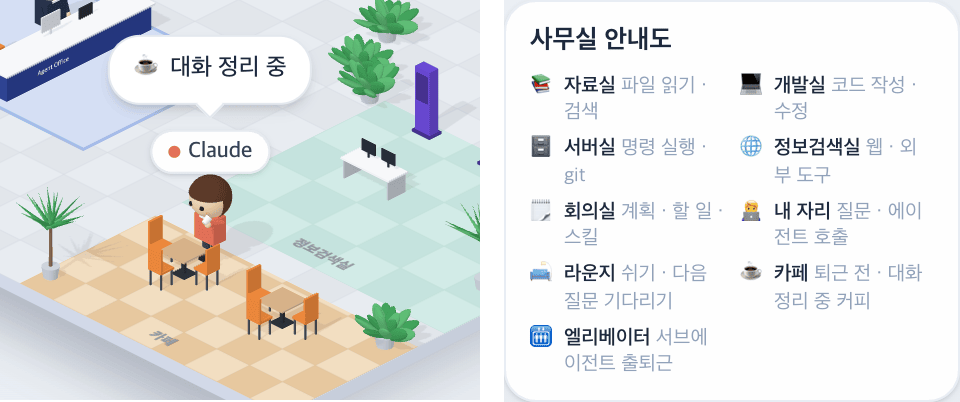

# 40 · 대화 기록을 압축하는 동안 카페에서 커피

- 브랜치: `feat/40-coffee-while-compacting`
- 근거: 사용자 질문 — 「라운지랑 카페는 안써?」에 낸 제안을 「좋아 그렇게 진행하면되겠음」으로 승인, [근거 문서](../plan/spec.md) 「라운지 · 카페」
- 검증한 커밋: `8bd2c64`

## 목표

대화 기록을 압축하는 동안 Claude 가 카페에서 커피를 마신다.

## 한 일

- **압축 중 판단** — 훅은 압축 시작(`context_compaction`)만 보내고 끝은 보내지 않는다. 그래서 화면 이벤트 로그의 가장 최근 이벤트가 압축이면 압축 중으로 본다(`isCompacting`). 그 뒤 어떤 이벤트든 오면 끝난다.
- **쉬는 방** — 38 의 「쉼」(참/거짓)을 쉬는 방(`breakRoom`: 라운지 · 카페 · 없음)으로 넓혔다. 우선순위는 도구 > 압축(카페) > 턴 끝(라운지)이다. 쉬는 방이 바뀌거나 쉼이 끝나면 걷던 길에서도 곧장 돌아선다. 카페에서는 39 처럼 머그잔을 들고 마신다.
- **말풍선** — 압축 중에는 「고민 중」 대신 「☕ 대화 정리 중」을 띄운다(네 언어). 사무실 안내도의 카페 줄은 「퇴근 전 · 대화 정리 중 커피」로 바꿨다.
- **처음 배치 고침**(38 에서 생긴 결함) — 사람 배치가 세션 상태를 받기 전의 빈 값으로 먼저 이뤄졌다. 그래서 일하는 세션을 열어도 Claude 가 소파에서 시작해 자리로 걸어갔고, 압축 중에 열면 자리에서 카페로 걸어갔다. 이제 상태 반영의 끝에 「이 세션의 스냅샷 받음」(`snapshotSessionId`)을 남긴다. 세션이 골라져 있으면 그 표시를 기다렸다가, 새 스냅샷마다 모두를 그 스냅샷이 말하는 자리에 다시 앉힌다. 층을 바꿀 때도 이전 세션의 Claude 가 걸어오지 않고 제자리에 나타난다.

## 검증

| 단계 | 명령 · 방법 | 결과 |
| --- | --- | --- |
| 정적 검증 | `make checkall` | 통과 — 백엔드 497 · 프런트 268(새: 카페로 가기 · 소파에서 카페로 · 압축 끝나면 복귀 · 압축 판단 · 압축 중엔 고민 안 함 · 스냅샷 표시) · 훅 113 · 플러그인 34 |
| 실검증 | 사용자가 띄워 둔 서버(4747 · 8000)는 건드리지 않았다 — 백엔드 8030(경우마다 빈 DB · 요약 꺼짐), 수정 후 4750. 이벤트를 직접 넣고 Claude 이름표 위치를 쟀다. 시뮬레이터 `complex`. 헤드리스 Chromium 1280×800 | TC 6건 — ✅ 6 |
| 정리 | QA 서버 2개 · 브라우저를 내리고 QA DB · 스크립트 · 캡처를 지웠다 | `:8030` · `:4750` 듣는 프로세스 0 |

### 실검증 TC

| TC | 우선순위 | 판정 | 방법 · 근거 |
| --- | --- | --- | --- |
| A-01 압축하면 카페로 | P1 | ✅ | act — 일하던 Claude(자리 614, 319)에게 `context_compaction` 을 보내자 카페(625, 496)로 가서 「☕ 대화 정리 중」(아래 그림 왼쪽). 「고민 중」은 뜨지 않는다 |
| A-02 다음 이벤트로 끝 | P1 | ✅ | act — `pre_tool_use`(Read) 0.8초 뒤 말풍선이 사라지고 자리를 떠나, 자료실(602, 278)로 간다 |
| A-03 압축 중에 다시 열기 | P1 | ✅ | 새로고침 직후 이미 카페(625, 496)에 「☕ 대화 정리 중」. 고치기 전에는 자리에서 걸어갔다 |
| A-04 처음 자리 | P1 | ✅ | 경우마다 빈 DB 로 세션 하나만 두고 열었다. 일하는 중이면 자리(614, 319), 턴이 끝났으면 소파(365, 333), 압축 중이면 카페(625, 496)에 처음부터 나타나고 움직이지 않는다. 고치기 전에는 일하는 중 · 압축 중 모두 소파에서 걸어갔다 |
| A-05 층 바꾸기 · 빈 사무실 | P2 | ✅ | 일하는 층 ↔ 턴 끝난 층을 오가면 1.2초 안에 자리 ↔ 소파에 나타난다(걸어오지 않음). 세션이 없는 빈 사무실에는 지금처럼 Claude(소파)와 나가 보인다 |
| A-06 서브에이전트 회귀 | P2 | ✅ | `complex` 90초 — 이름표가 최대 6개, 퇴근하는 서브에이전트가 카페를 지나고, 콘솔 오류 0 |

### 화면

왼쪽: 압축하는 동안 카페에서 커피를 마시는 Claude. 오른쪽: 사무실 안내도의 카페 줄.

## 검증하지 못한 것

- 진짜 Claude Code 의 자동 압축으로는 보지 않았다(이벤트를 직접 넣었다). 압축 뒤 처음 오는 이벤트가 무엇이든 압축을 끝낸다는 가정이다.
- 새 스냅샷마다 다시 앉히는 부분(`IsoOffice`)은 브라우저로만 봤다. 스토어의 스냅샷 표시는 시험이 있다.

## 알려진 한계 (버그 아님)

- 압축 시작 신호가 없는 에이전트(Gemini 는 수동 `/compress` 만)는 압축해도 카페에 가지 않는다.
- 빈 사무실(세션 없음)에는 턴 정보가 없어 Claude 가 소파에 앉아 있다.

## 다음 작업

없음. 새 요청이 오면 작업 표에 이어 넣는다.
