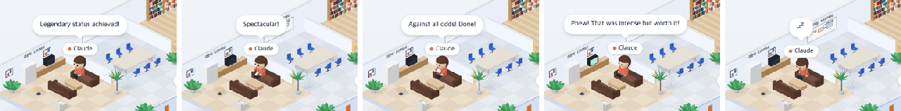

# 41 · 라운지에서 쉬는 동안 할 일

- 브랜치: `feat/41-lounge-pastimes`
- 근거: 사용자 요청 — 「라운지에 멍때리고있지말고 커피를 마시던 이런 류의 기믹을 좀 추가하면어떨까」, 제안에 「ㅇㅋ 라운지는 그런 동작 기믹을 넣고」, [근거 문서](../plan/spec.md) 「라운지 · 카페」
- 검증한 커밋: `cd5e95f`

## 목표

라운지 소파에서 멍하니 앉아 있지 않고, 쉬는 동안 뭔가를 하게 한다.

## 한 일

- 쉬는 동안 25초마다 커피 → 휴대폰 → 책 → TV 를 돌아가며 한다(`loungeAct`). 시간은 마지막 이벤트(턴이 끝난 때)부터 센다. 그래서 다시 열어도 같은 동작이 이어진다.
- 마지막 이벤트 뒤 5분이 지나면 꾸벅꾸벅 졸며(몸을 앞으로 숙이고 고개를 끄덕임) 「💤」 말풍선을 띄운다.
- 동작마다 소품과 자세가 다르다. 커피는 오른손 머그잔(39 의 컵)을 이따금 입으로 올린다. 휴대폰은 두 손으로 든 폰(새 소품)을 엄지로 두드린다. 책은 자료실의 책을 펴 든다. TV 는 뒤로 기대 앉는다.
- TV 를 보는 동안 라운지 TV 화면이 켜진다. 4초마다 장면이 바뀌듯 색이 바뀌고 살짝 깜박인다.
- 계획 문서에 사용자가 고른 작업 공간 기믹 42–48 을 넣었다(「이거 다 반영해서 작업해」).

## 검증

| 단계 | 명령 · 방법 | 결과 |
| --- | --- | --- |
| 정적 검증 | `make checkall` | 통과 — 백엔드 497 · 프런트 272(새: 동작 순서 · 졸기 · 시계가 늦을 때, 휴식 시작 시각) · 훅 113 · 플러그인 34 |
| 실검증 | 사용자가 띄워 둔 서버(4747 · 8000)는 건드리지 않았다 — 백엔드 8030(경우마다 빈 DB · 요약 꺼짐), 수정 후 4750. 턴 끝 이벤트(`stop`)의 시각을 0 · 30 · 55 · 80 · 360초 전으로 넣고 세션을 열어, 동작마다 기다리지 않고 바로 봤다. 헤드리스 Chromium 1280×800 | TC 5건 — ✅ 5 |
| 정리 | QA 서버 2개 · 브라우저를 내리고 QA DB · 스크립트 · 캡처를 지웠다 | `:8030` · `:4750` 듣는 프로세스 0 |

### 실검증 TC

| TC | 우선순위 | 판정 | 방법 · 근거 |
| --- | --- | --- | --- |
| A-01 커피 | P1 | ✅ | 0초 — 소파에서 오른손에 흰 머그잔(아래 그림 1) |
| A-02 휴대폰 | P1 | ✅ | 30초 — 두 손 앞에 흰 휴대폰(그림 2) |
| A-03 책 | P1 | ✅ | 55초 — 빨간 책을 펴 들었다(그림 3) |
| A-04 TV | P1 | ✅ | 80초 — 뒤로 기대 앉고 TV 화면이 켜졌다(그림 4, 초록빛 화면) |
| A-05 졸기 | P1 | ✅ | 6분 — 몸을 숙이고 「💤」 말풍선(그림 5). 다섯 경우 모두 콘솔 오류 0 |

### 화면

왼쪽부터 커피 · 휴대폰 · 책 · TV · 졸기. 위의 흰 말풍선은 시뮬레이션 세션의 마지막 답이다.

## 검증하지 못한 것

- 동작이 25초마다 실제로 넘어가는 것은 시험(`loungeActs.test.ts`)과 시각을 바꾼 화면으로 봤다. 한 화면에서 2분 넘게 지켜보지는 않았다.

## 알려진 한계 (버그 아님)

- 동작 순서는 늘 같다(커피부터). 쉬는 사람은 지금 Claude 하나라 섞지 않았다.

## 다음 작업

42 내 자리(나) 타이핑 → 43 서버실 손목시계 → 44 회의실 포스트잇 → 45 지구본 → 46 책 더미 → 47 개발실 머리 긁기 · 만세 → 48 엘리베이터 표시등.
