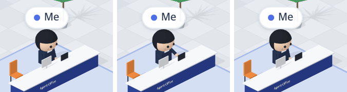

# 42 · 질문을 보내면 「나」가 키보드를 두드린다

- 브랜치: `feat/42-me-typing`
- 근거: 사용자 요청 — 작업 공간 기믹 제안 표에 「이거 다 반영해서 작업해」, [근거 문서](../plan/spec.md) 「작업 공간 기믹」
- 검증한 커밋: `d0b88ca`

## 목표

내 자리의 「나」가 질문을 보내는 순간 키보드를 두드린다.

## 한 일

- 「나」에게 마지막으로 질문을 보낸 시각(이벤트 로그의 가장 최근 `user_prompt_submit`)을 넘긴다(`typedAt`).
- 그 뒤 4초 동안 안내 데스크에서 앉은 자세 대신 타이핑 자세(손을 키보드에 대고 두드림)를 한다. 시각은 이벤트 시각이라, 질문하고 한참 뒤에 연 화면에서는 두드리지 않는다.

## 검증

| 단계 | 명령 · 방법 | 결과 |
| --- | --- | --- |
| 정적 검증 | `make checkall` | 통과 — 백엔드 497 · 프런트 273(새 1: 「나」에게만 마지막 질문 시각) · 훅 113 · 플러그인 34 |
| 실검증 | 사용자가 띄워 둔 서버(4747 · 8000)는 건드리지 않았다 — 백엔드 8030(빈 DB · 요약 꺼짐), 수정 후 4750. 「나」 자리를 질문 전 · 1.2초 뒤 · 1.45초 뒤 · 6초 뒤 찍어 비교했다. 헤드리스 Chromium 1280×800 | TC 2건 — ✅ 2 |
| 정리 | QA 서버 2개 · 브라우저를 내리고 QA DB · 스크립트 · 캡처를 지웠다 | `:8030` · `:4750` 듣는 프로세스 0 |

### 실검증 TC

| TC | 우선순위 | 판정 | 방법 · 근거 |
| --- | --- | --- | --- |
| A-01 질문하면 두드린다 | P1 | ✅ | act — `user_prompt_submit` 1.2초 뒤 팔이 키보드로 나가 있고(질문 전과 다른 픽셀 169개), 0.25초 사이에도 손이 움직인다(101개). 아래 그림 가운데 |
| A-02 4초 뒤 멈춘다 | P1 | ✅ | 6초 뒤 질문 전 모습과 픽셀까지 같다(0개). 콘솔 오류 0 |

### 화면

왼쪽부터 질문 전 · 질문 직후(두드림) · 6초 뒤.

## 알려진 한계 (버그 아님)

- 안내 데스크가 팔을 반쯤 가려서 움직임이 크게 보이지는 않는다.

## 다음 작업

43 서버실 손목시계.
