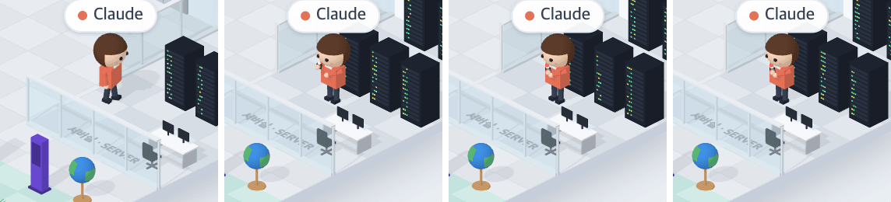

# 43 · 명령이 오래 돌면 서버실에서 손목시계를 본다

- 브랜치: `feat/43-server-wait-watch`
- 근거: 사용자 요청 — 작업 공간 기믹 제안 표에 「이거 다 반영해서 작업해」, [근거 문서](../plan/spec.md) 「작업 공간 기믹」
- 검증한 커밋: `fd89e9a`

## 목표

서버실에서 명령이 10초 넘게 돌면, 기다리는 사람이 팔짱을 끼고 손목시계를 본다.

## 한 일

- 명령(`running`)이 시작된 때를 사람마다 재고, 10초가 넘었는데 랙 앞에서 일하는 자세면 「기다림」으로 본다(`watchesTheClock`). 시간 판단은 앞으로 넣을 작업 공간 기믹과 함께 `systems/roomGimmicks.ts` 에 모았다.
- 기다리는 동안 랙에서 돌아서 방 쪽을 본다. 등 뒤로는 팔짱이 보이지 않아서다. 그리고 팔짱을 끼고, 4초마다 1.2초씩 왼쪽 손목을 눈앞으로 올린다. 왼쪽 손목에 손목시계(새 소품)가 보인다.
- 명령이 끝나면 지금처럼 머물다 자리로 돌아간다.

## 검증

| 단계 | 명령 · 방법 | 결과 |
| --- | --- | --- |
| 정적 검증 | `make checkall` | 통과 — 백엔드 497 · 프런트 274(새 1: 10초 기준) · 훅 113 · 플러그인 34 |
| 실검증 | 사용자가 띄워 둔 서버(4747 · 8000)는 건드리지 않았다 — 백엔드 8030(빈 DB · 요약 꺼짐), 수정 후 4750. `pre_tool_use`(Bash `npm test`)를 보내고 6초 · 12.5초 뒤부터 0.5초마다 Claude 를 찍었다. 헤드리스 Chromium 1280×800 | TC 3건 — ✅ 3 |
| 정리 | QA 서버 2개 · 브라우저를 내리고 QA DB · 스크립트 · 캡처를 지웠다 | `:8030` · `:4750` 듣는 프로세스 0 |

### 실검증 TC

| TC | 우선순위 | 판정 | 방법 · 근거 |
| --- | --- | --- | --- |
| A-01 처음엔 평소대로 | P1 | ✅ | 6초 — 서버실로 걸어가 랙 쪽을 본다(아래 그림 1) |
| A-02 10초가 넘으면 손목시계 | P1 | ✅ | 12.5초부터 — 방 쪽으로 돌아서 팔짱을 끼고, 왼쪽 손목을 얼굴 앞으로 올린다(그림 2–4) |
| A-03 콘솔 | P2 | ✅ | 처음 그린 모습은 등만 보여서, 방 쪽으로 돌아서게 고친 뒤 다시 찍었다. 콘솔 오류 0 |

### 화면

왼쪽부터 6초(가는 중) · 12.5초 · 13.5초 · 15초.

## 검증하지 못한 것

- 진짜 긴 명령(실제 Claude Code 셸)으로는 보지 않았다. 이벤트를 직접 넣었다.

## 다음 작업

44 회의실 포스트잇.
