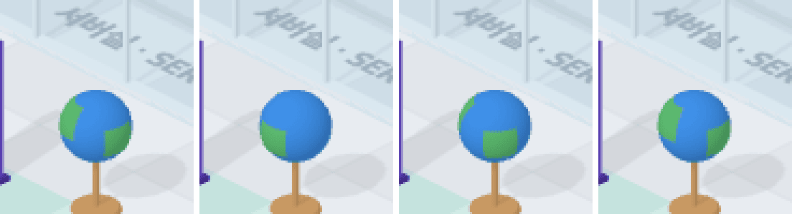

# 45 · 웹을 찾는 동안 지구본이 돈다

- 브랜치: `feat/45-search-globe-spin`
- 근거: 사용자 요청 — 작업 공간 기믹 제안 표에 「이거 다 반영해서 작업해」, [근거 문서](../plan/spec.md) 「작업 공간 기믹」
- 검증한 커밋: `be16d1c`

## 목표

정보검색실에서 웹 · MCP 도구를 쓰는 동안 지구본이 빙글빙글 돈다.

## 한 일

- 누군가 웹 검색 · 웹 읽기 · MCP 도구(`browsing` 활동)를 쓰는 동안 정보검색실 지구본이 돈다. 바다와 땅 조각을 한 공(`globeSpin`)으로 묶어서 같이 돈다.
- 갑자기 돌거나 서지 않고, 1초 안팎으로 빨라졌다가(초당 1.8 라디안까지) 천천히 멈춘다(`globeSpeed`).

## 검증

| 단계 | 명령 · 방법 | 결과 |
| --- | --- | --- |
| 정적 검증 | `make checkall` | 통과 — 백엔드 497 · 프런트 278(새 1: 빨라졌다 멈추기) · 훅 113 · 플러그인 34 |
| 실검증 | 사용자가 띄워 둔 서버(4747 · 8000)는 건드리지 않았다 — 백엔드 8030(빈 DB · 요약 꺼짐), 수정 후 4750. 지구본만 잘라 0.5초 간격 두 장씩 찍어, 검색 전 · 중 · 후의 달라진 픽셀을 셌다. 헤드리스 Chromium 1280×800 | TC 3건 — ✅ 3 |
| 정리 | QA 서버 2개 · 브라우저를 내리고 QA DB · 스크립트 · 캡처를 지웠다 | `:8030` · `:4750` 듣는 프로세스 0 |

### 실검증 TC

| TC | 우선순위 | 판정 | 방법 · 근거 |
| --- | --- | --- | --- |
| A-01 평소엔 멈춰 있다 | P2 | ✅ | 검색 전 0.5초 사이 바뀐 픽셀 0(아래 그림 1) |
| A-02 검색하면 돈다 | P1 | ✅ | `pre_tool_use`(WebSearch) 3초 뒤 0.5초 사이 398픽셀 — 땅 조각이 옮겨 간다(그림 2 · 3) |
| A-03 끝나면 멈춘다 | P1 | ✅ | `post_tool_use` 4초 뒤 0(그림 4, 다른 각도에서 멈춤). 콘솔 오류 0 |

### 화면

왼쪽부터 검색 전 · 검색 중(0.5초 간격 두 장) · 검색 뒤.

## 다음 작업

46 자료실 책 더미.
