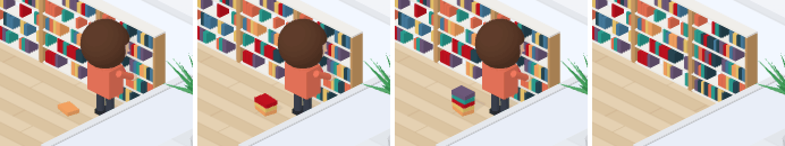

# 46 · 자료실에서 오래 읽으면 책 더미가 쌓인다

- 브랜치: `feat/46-library-book-pile`
- 근거: 사용자 요청 — 작업 공간 기믹 제안 표에 「이거 다 반영해서 작업해」, [근거 문서](../plan/spec.md) 「작업 공간 기믹」
- 검증한 커밋: `cda3055`

## 목표

자료실에서 읽기가 길어지면 읽는 사람 옆에 책 더미가 쌓인다.

## 한 일

- 자료실 책장 앞에서 일하는 동안 새 읽기 도구가 올 때마다(새 도구 말풍선이 뜰 때마다) 책이 한 권씩 쌓인다. 최대 6권이다(`bookPile`).
- 자료실을 떠나면 더미를 치운다. 자료실로 걸어가는 사이에 온 읽기들은 도착할 때 한 권으로 센다.
- 더미는 사람 왼쪽 한 걸음 뒤 바닥에 놓인다. 책장을 보고 서면 그쪽이 카메라 쪽이라 다리나 벽에 가리지 않는다. 처음엔 다리 옆, 다음엔 반대쪽에 두었는데 각각 다리와 자료실 벽에 가려서 옮겼다. 책은 한 권씩 조금씩 비뚤게 쌓인다.

## 검증

| 단계 | 명령 · 방법 | 결과 |
| --- | --- | --- |
| 정적 검증 | `make checkall` | 통과 — 백엔드 497 · 프런트 280(새 2: 새 읽기마다 한 권, 6권 상한 · 떠나면 치움) · 훅 113 · 플러그인 34 |
| 실검증 | 사용자가 띄워 둔 서버(4747 · 8000)는 건드리지 않았다 — 백엔드 8030(빈 DB · 요약 꺼짐), 수정 후 4750. 첫 읽기를 길게 보내 자료실에 도착시킨 뒤 읽기를 연달아 보내고, 1 · 3 · 5번째 뒤와 떠난 뒤를 찍었다. 헤드리스 Chromium 1280×800 | TC 3건 — ✅ 3 |
| 정리 | QA 서버 2개 · 브라우저를 내리고 QA DB · 스크립트 · 캡처를 지웠다 | `:8030` · `:4750` 듣는 프로세스 0 |

### 실검증 TC

| TC | 우선순위 | 판정 | 방법 · 근거 |
| --- | --- | --- | --- |
| A-01 읽을 때마다 한 권 | P1 | ✅ | 1 · 3 · 5번째 읽기 뒤 책이 1 · 3 · 5권(아래 그림 1–3) |
| A-02 떠나면 치운다 | P1 | ✅ | 마지막 읽기 6초 뒤 자리로 돌아가고 더미가 없다(그림 4) |
| A-03 보이는 자리 | P2 | ✅ | 다리 · 벽에 가리지 않는다(두 번 옮긴 뒤). 콘솔 오류 0 |

### 화면

왼쪽부터 1권 · 3권 · 5권 · 떠난 뒤.

## 알려진 한계 (버그 아님)

- 왼쪽 벽을 보고 서는 자료실 자리(뒤쪽 두 곳)에서는 더미가 사람 옆쪽에 놓여 조금 덜 보인다.

## 다음 작업

47 개발실 머리 긁기 · 만세.
