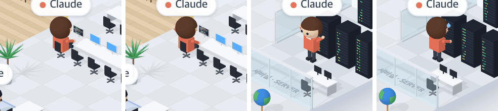

# 47 · 고치다가 머리를 긁고, 테스트가 통과하면 만세

- 브랜치: `feat/47-dev-scratch-cheer`
- 근거: 사용자 요청 — 작업 공간 기믹 제안 표에 「이거 다 반영해서 작업해」, [근거 문서](../plan/spec.md) 「작업 공간 기믹」
- 검증한 커밋: `a8d363d`

## 목표

개발실에서 고치는 동안 가끔 머리를 긁고, 테스트가 통과하면 만세를 한다.

## 한 일

- **머리 긁기** — 책상에서 타이핑하는 동안 8초마다 1.2초씩 오른팔을 머리 옆으로 올려 긁는다(`scratchesHead`). 처음엔 손을 앞으로 올렸는데, 등 뒤에서 보면 큰 머리에 가려 안 보였다. 그래서 팔을 옆으로 올렸다.
- **만세** — 그 사람의 가장 최근 테스트 명령(`test` · `tests` · `pytest` · `vitest` · `jest` 가 든 셸 명령)이 통과하면 2.5초 동안 두 팔을 들고 흔든다. 서 있으면 깡충거린다. 랙 앞이면 방 쪽으로 돌아선다.
- **통과 판단** — 실패한 도구는 상세에 `errorType` 이 붙어서, 그게 없으면 통과다(`lastPassedTestId`). 백엔드가 끝난 도구의 시각을 시작 시각 근처로 적는다. 그래서 이벤트 시각으로 재면 만세가 이미 지나 있었다. 지금은 새 통과 기록이 처음 보인 순간부터 잰다. 페이지를 열 때 이미 있던 통과에는 만세하지 않는다.

## 검증

| 단계 | 명령 · 방법 | 결과 |
| --- | --- | --- |
| 정적 검증 | `make checkall` | 통과 — 백엔드 497 · 프런트 285(새: 머리 긁는 때, 테스트 명령 판별, 최근 통과 · 실패 뒤엔 없음, 사람별 통과 기록) · 훅 113 · 플러그인 34 |
| 실검증 | 사용자가 띄워 둔 서버(4747 · 8000)는 건드리지 않았다 — 백엔드 8030(빈 DB · 요약 꺼짐), 수정 후 4750. Edit · `npm test`(통과 · 실패)를 이벤트로 보냈다. 순간을 맞추려고 커밋하지 않은 임시 훅으로 화면 안의 팔 각도 · 타이머를 읽으며 찍었다(훅은 지웠다). 헤드리스 Chromium 1280×800 | TC 4건 — ✅ 4 |
| 정리 | QA 서버 2개 · 브라우저를 내리고 QA DB · 스크립트 · 캡처를 지웠다 | `:8030` · `:4750` 듣는 프로세스 0 |

### 실검증 TC

| TC | 우선순위 | 판정 | 방법 · 근거 |
| --- | --- | --- | --- |
| A-01 타이핑 중 머리 긁기 | P1 | ✅ | 타이핑 7.0초 뒤 오른팔 각도가 바뀌고(z 2.82), 머리 옆에 손이 보인다(아래 그림 2). 6초 · 8초 · 9초에는 타이핑 자세(그림 1) |
| A-02 테스트 통과 만세 | P1 | ✅ | 통과 0.15–0.75초 뒤 방 쪽으로 돌아서 두 팔을 들고 흔든다(그림 3) |
| A-03 실패하면 없음 | P1 | ✅ | 실패(`errorType`) 뒤 2초 동안 팔이 올라가지 않고, 식은땀만 흘린다(그림 4) |
| A-04 콘솔 | P2 | ✅ | 콘솔 오류 0 |

### 화면

왼쪽부터 타이핑 · 머리 긁기 · 테스트 통과 만세 · 테스트 실패.

## 알려진 한계 (버그 아님)

- `test` 가 든 명령이면 테스트로 본다. 그래서 `ls tests/` 가 성공해도 만세를 한다.
- 통과 뒤 바로 자리로 걸어가기 시작하면 걷는 동안에는 만세를 하지 않는다.

## 다음 작업

48 엘리베이터 표시등.
