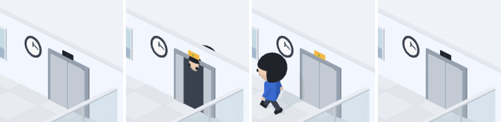

# 48 · 서브에이전트가 내릴 때 엘리베이터 표시등

- 브랜치: `feat/48-elevator-lamp`
- 근거: 사용자 요청 — 작업 공간 기믹 제안 표에 「이거 다 반영해서 작업해」, [근거 문서](../plan/spec.md) 「작업 공간 기믹」
- 검증한 커밋: `108e80d`

## 목표

서브에이전트가 엘리베이터에서 내릴 때 문 위 표시등이 켜진다.

## 한 일

- 엘리베이터 문 위의 표지판(초록 「▲」)을 평소엔 어둡게 두고, 화살표도 흐리게 했다(불투명도 0.3).
- 새로 온 서브에이전트가 엘리베이터에서 내리는 동안 판이 호박색으로 켜지고 화살표가 또렷해진다. 내린 뒤에도 1.5초 더 켜져 있다가 꺼진다(`lampLit`).

## 검증

| 단계 | 명령 · 방법 | 결과 |
| --- | --- | --- |
| 정적 검증 | `make checkall` | 통과 — 백엔드 497 · 프런트 286(새 1: 켜지는 동안과 1.5초 유지) · 훅 113 · 플러그인 34 |
| 실검증 | 사용자가 띄워 둔 서버(4747 · 8000)는 건드리지 않았다 — 백엔드 8030(빈 DB · 요약 꺼짐), 수정 후 4750. `subagent_start` 를 보내고 엘리베이터를 0.3초마다 찍어 호박색 픽셀을 셌다. 헤드리스 Chromium 1280×800 | TC 3건 — ✅ 3 |
| 정리 | QA 서버 2개 · 브라우저를 내리고 QA DB · 스크립트 · 캡처를 지웠다 | `:8030` · `:4750` 듣는 프로세스 0 |

### 실검증 TC

| TC | 우선순위 | 판정 | 방법 · 근거 |
| --- | --- | --- | --- |
| A-01 평소엔 꺼짐 | P2 | ✅ | 호박색 0(아래 그림 1) |
| A-02 내릴 때 켜짐 | P1 | ✅ | `subagent_start` 0.3–1.8초 — 문이 열리고 내리는 동안 · 걸어 나가는 동안 판이 켜진다(호박색 106, 그림 2 · 3) |
| A-03 다시 꺼짐 | P1 | ✅ | 2.1초부터 0, 4초 뒤에도 0(그림 4). 콘솔 오류 0 |

### 화면

왼쪽부터 평소 · 내리는 중 · 걸어 나가는 중 · 꺼진 뒤.

## 알려진 한계 (버그 아님)

- 퇴근하며 타는 쪽에는 켜지지 않는다(요청은 「내릴 때」).

## 다음 작업

없음. 새 요청이 오면 작업 표에 이어 넣는다.
