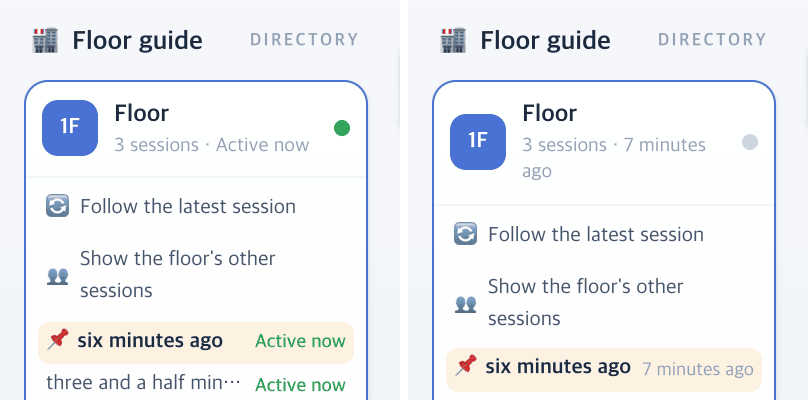

# 49 · 「지금 일하는 중」 기준을 5분으로

- 브랜치: `fix/49-active-now-five-minutes`
- 근거: 사용자 질문 — 「세션이 이렇게 켜져있는데 왜 클로드가 세개밖에없어?」, 「5분으로 바꿔」(다른 세션에서 고쳐 메인 체크아웃에 둔 변경을, 사용자가 고른 대로 브랜치 · PR 로 올렸다)
- 검증한 커밋: `8220878`

## 목표

열려 있는 세션을 「지금 일하는 중」으로 보는 기준을 마지막 이벤트 뒤 2분에서 5분으로 늘린다.

## 한 일

- `ACTIVE_NOW_MS` 를 2분에서 5분으로 바꿨다(`frontend/src/systems/floors.ts`). 한동안 생각만 하는 세션이 층별 안내의 「지금 활동 중」에서 빠지고, 같은 층 사무실의 동료로도 사라지던 것을 막는다.
- 경계를 보는 시험을 5분 기준(4분 59초 활동 · 5분 비활동)으로 고쳤다.

## 검증

| 단계 | 명령 · 방법 | 결과 |
| --- | --- | --- |
| 정적 검증 | `make checkall` | 통과 — 백엔드 497 · 프런트 286 · 훅 113 · 플러그인 34 |
| 실검증 | 사용자가 띄워 둔 서버(4747 · 8000)는 건드리지 않았다 — 백엔드 8030(빈 DB · 요약 꺼짐), 수정 후 4750. 같은 층에 세션 셋을 열고, 브라우저 시계를 3분 51초 · 6분 37초 뒤로 감아 층별 안내를 읽었다(백엔드는 세션 시각을 받은 시각으로 적어서 과거 이벤트로는 만들 수 없다). 헤드리스 Chromium 1280×800 | TC 2건 — ✅ 2 |
| 정리 | QA 서버 2개 · 브라우저를 내리고 QA DB · 스크립트 · 캡처를 지웠다 | `:8030` · `:4750` 듣는 프로세스 0 |

### 실검증 TC

| TC | 우선순위 | 판정 | 방법 · 근거 |
| --- | --- | --- | --- |
| A-01 4분 안쪽은 활동 중 | P1 | ✅ | 3분 51초 뒤 — 세 세션 모두 「Active now」(아래 그림 왼쪽). 2분 기준이었다면 「3 minutes ago」였다 |
| A-02 5분 넘으면 아님 | P1 | ✅ | 6분 37초 뒤 — 「7 minutes ago」(그림 오른쪽). 콘솔 오류 0 |

### 화면

층별 안내, 왼쪽 3분 51초 뒤 · 오른쪽 6분 37초 뒤.

## 다음 작업

없음. 새 요청이 오면 작업 표에 이어 넣는다.
